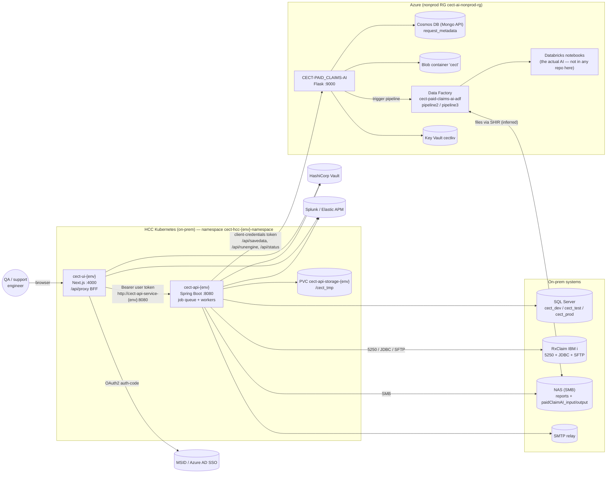
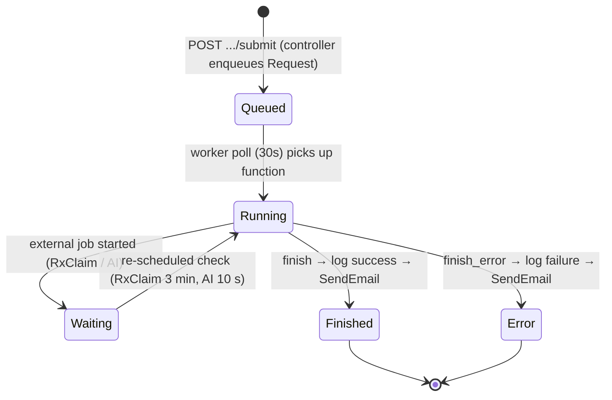
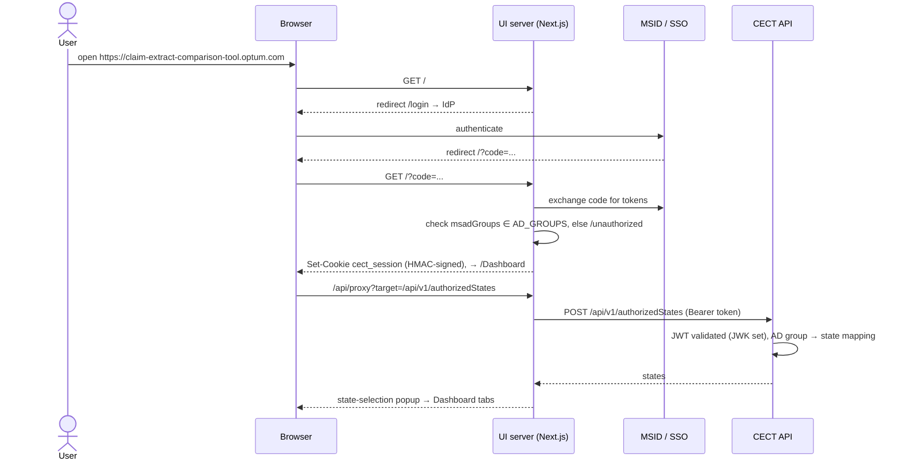
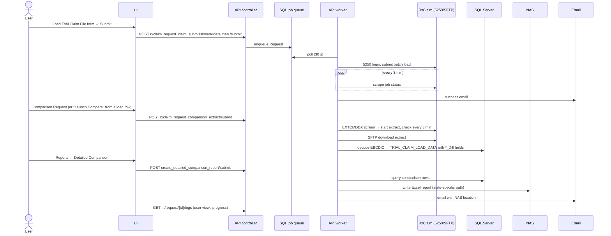
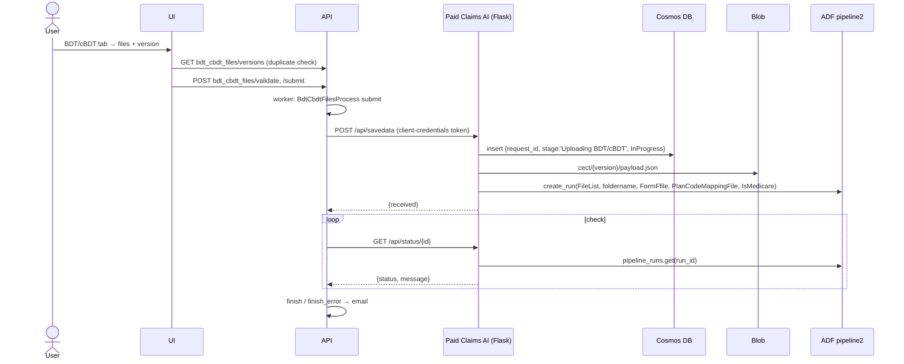
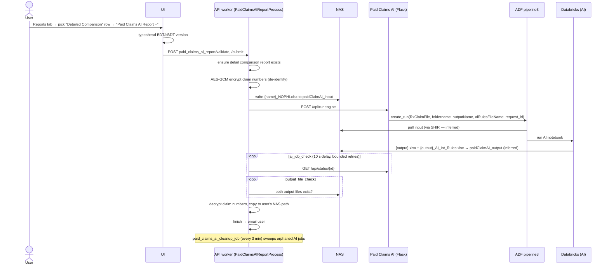
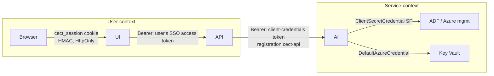
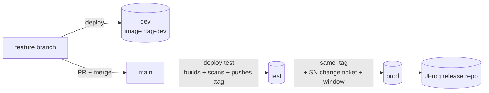

# CECT — Consolidated System Knowledge Transfer

**UI · API · GitHub Actions workflows · Kubernetes config · Paid Claims AI — how they fit together**

| Repo | Role | Runtime | Deployed to |
|---|---|---|---|
| `claims-extract-comparison-tool-ui-2-0` | Web front end + BFF proxy | Next.js 16 / Node 24 | HCC Kubernetes (port 4000) |
| `claims-extract-comparison-tool-api` | Business logic, job queue, RxClaim automation, reports | Java 21 / Spring Boot 4.1 | HCC Kubernetes (port 8080) |
| `cect-gh-actions-workflows` | Shared reusable build/scan/deploy workflow | GitHub Actions (`workflow_call`) | — |
| `cect-k8s-config` | Reference/snapshot of ConfigMaps, Ingress, NetworkPolicies, DDL | Plain YAML, applied by hand | — |
| `CECT-PAID_CLAIMS-AI` | Dispatcher in front of the Azure AI pipelines | Python 3.12 / Flask + gunicorn | Azure (container in ACR; App Service intended) |

> Deeper per-repo guides already exist. Use this document for the end-to-end picture and these for detail:
> - UI: `docs/CECT-UI-Knowledge-Transfer.md`, `docs/CECT-UI-Beginner-KT-Guide.md` (this repo)
> - API: `docs/API_KT_GUIDE.md` in the API repo (see §11 for corrections)
> - Workflows: `docs/CECT-GH-Actions-Workflows-KT-Guide.md` (unmerged worktree branch in `cect-gh-actions-workflows`)
> - Paid Claims AI: `technical_design.md`, plus `docs/CECT-Paid-Claims-AI-Beginner-KT-Guide.md` (unmerged worktree branch `claude/suspicious-swanson-15c0ff`)

---

## Table of Contents

1. [What CECT does (business view)](#1-what-cect-does-business-view)
2. [The big picture](#2-the-big-picture)
3. [Component 1 — UI](#3-component-1--ui)
4. [Component 2 — API](#4-component-2--api)
5. [Component 3 — Paid Claims AI](#5-component-3--paid-claims-ai)
6. [How the pieces link: contracts between components](#6-how-the-pieces-link-contracts-between-components)
7. [End-to-end flows](#7-end-to-end-flows)
8. [Security & identity across the stack](#8-security--identity-across-the-stack)
9. [CI/CD — the GitHub Actions workflow](#9-cicd--the-github-actions-workflow)
10. [Runtime infrastructure — Kubernetes, config, environments](#10-runtime-infrastructure--kubernetes-config-environments)
11. [Known issues, risks & doc corrections](#11-known-issues-risks--doc-corrections)
12. [Where to look when… (troubleshooting map)](#12-where-to-look-when-troubleshooting-map)
13. [Glossary](#13-glossary)

---

## 1. What CECT does (business view)

**RxClaim** is the pharmacy claims-adjudication system (IBM i / AS/400). Before a configuration or code change is promoted in RxClaim, QA needs proof it doesn't unexpectedly change how claims adjudicate.

CECT (Claims Extract Comparison Tool) automates that:

1. **Load trial claims** into an RxClaim test environment (re-adjudicate historical claims under the new config).
2. **Extract & compare** — pull the trial results back out and diff them field-by-field against the historical (production) result.
3. **Report** — produce Detailed / Summary / Clinical Review / Single Reject / Progress reports as Excel files on a NAS share.
4. **Paid Claims AI** — feed a de-identified Detailed Comparison report plus the client's benefit-design templates (BDT/cBDT) to an AI engine in Azure, which produces an AI analysis and an "AI interpreted rules" file.

There are two deployment flavours of the same code: **Commercial (CORE)** and **ODI-Gov** (government; `CECT_IS_ODI_GOV_ENV=true`), which adds state-based access control, single-session enforcement, different hosts/NAS paths, and hides some UI tabs.

---

## 2. The big picture



**Three key facts:**

1. **The browser only ever talks to the UI server.** Every data call goes through the UI's `/api/proxy`, which attaches the user's token server-side and forwards to the API.
2. **The API is the hub.** It is the only thing that talks to RxClaim, SQL Server, the NAS, email, and the Paid Claims AI service. The UI never calls the AI service.
3. **Paid Claims AI is asynchronous and file-based.** The API calls the Flask service to *start* work, polls its status, then picks up result files from the NAS. There are no callbacks into the API.

---

## 3. Component 1 — UI

Repo: `claims-extract-comparison-tool-ui-2-0` (Skyline micro-product template; npm workspaces + Lerna).

| Aspect | Detail |
|---|---|
| App | `surfaces/cect-ui` — Next.js 16 Pages Router, React 18, MUI v5, `material-react-table` |
| Shared lib | `packages/cect-ui/cect-ui-components` — Header, Footer, **`src/common/cect-endpoints.ts`** (the API client), Vault client |
| Entry | `server-lifecycle.js` — loads Vault secrets into `process.env`, initialises Splunk logger, then starts Next standalone server |
| Auth | OAuth2 auth-code via MSID; AD-group check in `index.tsx` `getServerSideProps`; HMAC-signed HttpOnly `cect_session` cookie (`src/server/auth-session.ts`) |
| Gateway | `src/pages/api/proxy.ts` — session check, SSRF/host checks, CORS check, ~45-entry target allow-list, PII-redacted logging |
| Health | `GET /health-check` |
| Logging | Winston → Splunk HEC; Elastic APM RUM |

**Dashboard tabs → API feature** (the mapping that matters for cross-repo work):

| UI tab / form | API base path (`/api/request_type/...`) |
|---|---|
| Load Trial Claim File (`TrialClaimFileLoadRequestForm`) | `rxclaim_request_claim_submission` |
| Comparison Request (`ComparsionRequestForm`) | `rxclaim_request_comparison_extract` |
| Compare with PAR (ODI-Gov, `CompareRequestWithPARForm`) | `rxclaim_request_comparison_par_extract` |
| Detailed / Summary / Clinical report forms | `create_detailed_comparison_report` / `create_summary_comparison_report` / `create_clinical_review_report` |
| Single Reject Reports | `create_single_reject_report` |
| Create Subset | `create_trial_claim_subset_file` |
| Import Data | `import_excel_data` (`ImportExcelDataController`) |
| Progress Reports | `create_progress_report` (synchronous) |
| BDT/cBDT | `bdt_cbdt_files` |
| Paid Claims AI Report (from a "Detailed Comparison" row in Reports) | `paid_claims_ai_report` |
| Reports tab history | `getAllRequests` |
| Log viewer `/logpage` | `{type}/request/{id}` and `.../logs` |
| State picker / Header | `/api/v1/authorizedStates`, `/api/rxclaim/environments`, `/api/rxclaim/claimDataQueues` |
| Session / user | `/api/user_metadata/*`, `/api/user/session/*` |

> **Gotcha: submit paths and history paths use different type names for two features.** Trial-claim loads are *submitted* to `rxclaim_request_claim_submission` but *listed/logged* under `rxclaim_batch_trial_claim`. Comparisons are *submitted* to `rxclaim_request_comparison_extract` (or `..._par_extract`) but *listed/logged* under `rxclaim_comparison_request`. The other features use the same name for both. The history names are the request "type" stored in the job queue (`RequestsController`, `SchedulerServiceImpl`).

Every form follows the same **validate → submit** pattern: `POST .../validate` (200 with `errors[]`), then `POST .../submit` (201, sometimes treated as success on 504 for long-running jobs).

---

## 4. Component 2 — API

Repo: `claims-extract-comparison-tool-api`. Java root `src/main/java/com/optumrx/optumrxautomation/cect/`.

| Aspect | Detail |
|---|---|
| Stack | Java 21, Spring Boot 4.1.1, Spring Cloud 2025.1.2 (Vault, Kubernetes), Hibernate, Apache POI, jt400, JSch, JCIFS |
| DB | **Microsoft SQL Server** via jTDS (NTLMv2). H2 for local/tests. `ddl-auto: update` |
| Async model | **DB-backed job queue** — no Kafka/MQ. `scheduler/` holds the queue + locks, `worker/` polls every 30 s and dispatches `@CectFunction` handlers |
| RxClaim | 5250 green-screen automation (`rxclaim5250/`, `ibm-5250-wrapper`), AS/400 JDBC, SFTP extract download |
| Comparison engine | `comparison_data/` — decodes fixed-width EBCDIC/packed-decimal extract (2041-byte CORE / 2020-byte ODI-Gov layouts) into `TRIAL_CLAIM_LOAD_DATA` with `*_Diff` fields |
| Reports | Streaming POI Excel, written to NAS per state code; email on success/failure |
| Inbound auth | OAuth2 resource server, JWT (`SecurityConfig.java`, `JwtAuthConverter.java`); `/api/**` authenticated, `/healthz` public, everything else `denyAll` |
| Outbound auth to AI | OAuth2 client-credentials registration `cect-api` (`OAuthClientConfiguration.java`, `AiApiServiceImpl.java`) |
| Profiles | `local`, `dev`, `test`, `prod`, `dev-odi-gov`, `test-odi-gov` |
| Health | `GET /healthz` |

**Job lifecycle (generic):**



The UI polls `GET /api/request_type/{type}/request/{id}/logs` to show progress.

---

## 5. Component 3 — Paid Claims AI

Repo: `CECT-PAID_CLAIMS-AI` (default branch `dev`). **Two code files**: `app.py` (all routes) and `verify.py` (Azure AD JWT check).

**Important:** this service does **not** run an LLM or model itself. It is a thin **dispatcher**:

1. Verify the caller's Azure AD token (`verify_azure_token()` — RS256, audience `api://<app-id>`, tenant issuer).
2. Write a status record to **Cosmos DB** (`cect-paid-claims-ai-cosmosmongodb.request_metadata`).
3. Upload the request JSON to **Blob Storage** (`cect/<version>/payload*.json`).
4. Trigger an **Azure Data Factory** pipeline in `cect-paid-claims-ai-adf`.

The AI/model logic lives in **ADF `pipeline3` → Databricks notebooks**, which are not in any of these repos. To learn which model and prompts are used, look at the ADF factory and its Databricks workspace.

| Endpoint | Called by API from | What it does |
|---|---|---|
| `POST /api/savedata` | `BdtCbdtFilesServiceImpl.java` (~line 329) | Register a BDT/cBDT file set (version, files, format files, RxComet mapping, plan-code mapping, Medicare flag) → ADF **`pipeline2`** |
| `POST /api/runengine` | `PaidClaimsAIReportServiceImpl.java` (~line 737) | Run the AI engine on a de-identified detail comparison report against a BDT/cBDT version → ADF **`pipeline3`** |
| `GET /api/status/<id>` | Both of the above (polling) | Reads Cosmos + `adf_client.pipeline_runs.get(run_id)`; surfaces notebook `Error_flag` / `error_messages_str` |
| `GET /health` | — | `{"status":"ok"}` |

Request body shape is always `{ "fields": { ... } }`; response is `{ "received": { ... } }` or `{ status, message }`.

**Config:** no environment variables. Secrets come from Key Vault `cectkv` (`BLOB-CONNECTION-STRING`, `COSMOS-CONNECTION-STRING`, `TENANTID`, `CLIENTID`, `CLIENTSECRET-Temp`). Subscription, resource group (`cect-ai-nonprod-rg`) and factory name are **hard-coded to nonprod** in `app.py`.

**Runtime:** gunicorn, 6 gevent workers, port 9000, UID 1001.

---

## 6. How the pieces link: contracts between components

### 6.1 UI → API

| Contract | Value |
|---|---|
| Transport | Browser → `/api/proxy?target=<path>` (UI server) → `CECT_BACKEND_DATA_API_URL + path` |
| In-cluster URL | `http://cect-api-service-<env>.cect-hcc-<env>-namespace.svc:8080` (from `cect-ui-config-map-<env>`) |
| Auth | `Authorization: Bearer <user access token>` — taken from the signed session cookie, never from client JS |
| State routing | `stateCode` injected into POST bodies for `/api/request_type/*` + `x-state-code` header (`enrichPostPayloadWithStateCode`, `getStateCodeHeader`) |
| Endpoint list | `apiEndpoints` enum in `packages/cect-ui/cect-ui-components/src/common/cect-endpoints.ts` **and** `ALLOWED_TARGET_PATTERNS` in `surfaces/cect-ui/src/pages/api/proxy.ts` |
| Response shape | `getData`/`postData` normalise everything to `{ statusCode, errorMessage, data }` |

> **Rule:** adding a new API endpoint for the UI means touching **three** places — the API controller, the `apiEndpoints` enum, **and** the proxy allow-list. If you forget the allow-list, the proxy returns `400 Invalid target`.

### 6.2 API → Paid Claims AI

| Contract | Value |
|---|---|
| Base URL | `cect.api.client.ai-api.base-url` = `${CECT_AI_API_BASE_URL}` |
| Auth | Client-credentials token: `${CECT_AI_API_CLIENT_ID}`, `${CECT_AI_API_CLIENT_SECRET}`, `${CECT_AI_API_SCOPE}`, `${CECT_AI_API_TOKEN_URI}`. The AI service validates audience `api://<AZURE_AD_APP_ID>` |
| Retry | `paidClaimAI.maxNoOfAttempts` (`CECT_MAX_NO_OF_ATTEMPTS`), `paidClaimAI.retryInterval` (`CECT_RETRY_INTERVAL`), bounded by `cect.job.max-exec-time-minutes` |
| Correlation key | The CECT request id → Cosmos `request_id` → ADF `request_id` parameter |
| Databases | **Not shared.** CECT uses SQL Server tables `CECT_PAID_CLAIMS_AI_RPT` / `_RPT_JOB`; the AI side uses Cosmos `request_metadata` |
| Data hand-off | **Files on the NAS**: `nas.paidClaimInputUrl` (`.../paidClaimAI_input`) and `nas.paidClaimOutputUrl` (`.../paidClaimAI_output`). ADF moves files between the NAS and Blob (via SHIR — inferred from API log messages; confirm in ADF) |

### 6.3 Field mapping for a Paid Claims AI run

| UI form field (`PaidClaimAIReportRequestForm.tsx`) | API `PaidClaimsAIRequestFields` → AI `/api/runengine` | ADF `pipeline3` param |
|---|---|---|
| `environment`, `jobNumber`, `client`, `shortNote`, `msId` | used by API only (job + audit) | — |
| `compRequestId`, `detailCompRequestId` | API looks up the existing Detailed Comparison report | — |
| (generated by API) | `id` | `request_id` |
| `outputName` | `outputName` | `outputName` |
| `bdtCbdtVersionId` (picked via typeahead on `bdt_cbdt_files/versions`) | `bdtCbdtVersion` | `foldername` |
| `isSaveAIRulesFile` | `isSaveAIRulesFile` | — |
| (generated by API) | `detailCompReportFileName` = `<name>_NOPHI.xlsx` | `RxClaimFile` |
| (generated by API) | `aiRulesFileName` = `<output>_AI_Int_Rules.xlsx` | `aiRulesFileName` |

### 6.4 CI/CD links

| Consumer repo | Its workflow | Calls | Pinned ref |
|---|---|---|---|
| UI 2.0 | `.github/workflows/cect-ui-build-deploy-workflow.yaml` | `cect-gh-actions-workflows/.github/workflows/orx-qec-cect-build-deploy-workflow.yaml` | `@main-uhg-only` |
| API | `.github/workflows/cect-api-build-deploy-workflow.yaml` | same reusable workflow | `@api-only` |
| Legacy UI | `cect-ui-build-deploy-workflow.yaml` | same reusable workflow | `@prismaSaaS` |
| Paid Claims AI | `.github/workflows/docker-build-and-push.yml` | **does not** use the shared workflow; builds and pushes to Azure ACR only | — |

The shared workflow applies each consumer repo's **own** `deployment.yaml`. It does **not** read or write `cect-k8s-config`.

---

## 7. End-to-end flows

### 7.1 Login and first API call



### 7.2 Core flow: trial claim load → comparison → report



### 7.3 BDT/cBDT registration (prerequisite for Paid Claims AI)



### 7.4 Paid Claims AI report



---

## 8. Security & identity across the stack



| Hop | Mechanism | Where it lives |
|---|---|---|
| User → UI | MSID OAuth2 auth-code, AD group gate (`AD_GROUPS`), signed session cookie, 30-min sliding expiry, inactivity watchdog | `index.tsx`, `auth-session.ts`, `_app.tsx` |
| UI → API | Bearer user token; proxy allow-list, SSRF + CORS checks | `pages/api/proxy.ts` |
| API inbound | JWT resource server (JWK set / issuer), `roles` → `ROLE_*`, state access via `CECT_GROUP_STATE_MAPPING` | `SecurityConfig.java`, `JwtAuthConverter.java`, `authorization/` |
| API → AI | OAuth2 client credentials (`CECT_AI_API_*`) | `OAuthClientConfiguration.java`, `AiApiServiceImpl.java` |
| AI inbound | Azure AD JWT, audience + issuer check | `verify.py` |
| PHI | Claim numbers AES-GCM encrypted before leaving for AI, decrypted on return (`AES_SECRET_KEY`) | `util/AESUtility.java` |
| Secrets — UI/API runtime | HashiCorp Vault AppRole (`VAULT_URI`, `VAULT_NAMESPACE`, role/secret id) + k8s Secret `cect-shared-secrets-<env>` | `vaultClient.js`, `bootstrap.yaml` |
| Secrets — CI | Vault JWT auth from GitHub OIDC, namespace `OPTUM/APP/CECT/STAGE`, `kv/data/ci-cd` + `kv/data/<env>` | reusable workflow |
| Secrets — AI | Azure Key Vault `cectkv`; GitHub repo secrets for CI | `app.py`, `docker-build-and-push.yml` |

---

## 9. CI/CD — the GitHub Actions workflow

### 9.1 How a deploy is triggered

All deployments are **manual** (`workflow_dispatch`) from the consumer repo's Actions tab:

| Input | UI | API |
|---|---|---|
| `ENVIRONMENT` | dev / test / prod | dev / test / prod |
| `BUILD_TYPE` | `NodeJS` | `Maven` |
| `ARTIFACT_TYPE` | `ui` | `api` |
| `DOCKER_IMAGE_TAG` | required | required |
| `DOCKER_FILE` | `surfaces/cect-ui/Dockerfile` | — |
| `SN_CHANGE_TICKET` | required for prod | required for prod |
| `MAVEN_BUILD_COMMAND` | — | `clean install -Ddependency-check.skip=true` |

### 9.2 What the reusable workflow does

`cect-gh-actions-workflows/.github/workflows/orx-qec-cect-build-deploy-workflow.yaml` — `on: workflow_call`, runs on self-hosted `uhg-runner`.

```mermaid
flowchart TD
    Start([workflow_call from UI/API]) --> V1{ENVIRONMENT ∈ dev/test/prod?}
    V1 -->|no| Fail1[fail]
    V1 --> V2{test/prod from refs/heads/main?}
    V2 -->|no| Fail2[fail]
    V2 --> Vault[Read Vault kv/data/ci-cd + kv/data/{env}]
    Vault --> SN{prod: SN_CHANGE_TICKET set?}
    SN -->|no| Fail3[fail]
    SN --> Dep{github.actor in deployers-ghec-user-id-list?}
    Dep -->|no| Fail4[fail]
    Dep --> Env{environment}
    Env -->|dev / test| Build["Maven build + Sonar (API)<br/>Docker build + Xray + Prisma scan + push to JFrog central<br/>(UI Sonar runs inside Dockerfile)"]
    Env -->|prod| CW["ServiceNow change-window validation<br/>(NO rebuild — reuses test image tag)"]
    Build --> Deploy
    CW --> Deploy
    Deploy["sed placeholders in consumer's deployment.yaml<br/>sub-environment, docker-image-url, k8s-namespace, k8s-api-memory-* placeholders<br/>→ kubectl apply (epl-kubectl/apply, Vault kube-config)"]
    Deploy --> Mail[test/prod: email notification]
    Mail --> Promote{prod and not Flyway/MavenJAR?}
    Promote -->|yes| Rel["promote-docker-image-to-release job<br/>(uhg-pipelines/privileged-workflows)"]
    Promote -->|no| End([done])
    Rel --> End
```

**Image naming**
- dev: `<jf-namespace>/<repo>/<artifactType>/<repo>-dev:<tag>`
- test/prod: `<jf-namespace>/<repo>/<artifactType>/<repo>:<tag>`
- Pushed to JFrog SaaS **central**, pulled by the cluster from JFrog **edge-internal** (`*.uhg.com`), promoted to **release** after prod.

Other `BUILD_TYPE`s: `Flyway` (runs Maven Flyway migrate from Vault command), `MavenJAR`, `Docker`.

### 9.3 Release flow



Hotfixes use the same path (branch → merge to `main` → test → prod with a change ticket). There are no GitHub Environment protection rules; the gates are the **Vault deployer allow-list**, the **main-only rule** for test/prod, and **ServiceNow** for prod.

### 9.4 Paid Claims AI pipeline (separate)

`CECT-PAID_CLAIMS-AI/.github/workflows/docker-build-and-push.yml` — `workflow_dispatch`, no inputs:
JFrog login → `epl-jf/configure-saas-connection` (pip) → ACR login (`cectacr-….azurecr.io`) → `epl-docker/build-scan-push` (Prisma and Xray **disabled**) → image `cect:cect_<run_number>-<date>`.
The Azure login and `azure/webapps-deploy` (`cect-ai-webapp`) steps are commented out, so **deployment to Azure is manual or happens outside this repo**.

---

## 10. Runtime infrastructure — Kubernetes, config, environments

### 10.1 Kubernetes objects per environment (HCC cluster, e.g. `hcck8s-ctc-np1` for non-prod)

| Object | UI | API | Source |
|---|---|---|---|
| Deployment | `cect-ui-<env>` (1 replica, :4000) | `cect-api-<env>` (:8080, CPU limit 999m) | consumer repo `deployment.yaml` (applied by workflow) |
| Service | `cect-ui-service-<env>` :4000 | `cect-api-service-<env>` :8080 | consumer `deployment.yaml` / `cect-k8s-config` |
| HPA | `cect-ui-hpa-<env>` (min=max=1) | — | UI `deployment.yaml` |
| ConfigMaps | `cect-ui-config-map-<env>` + `cect-shared-config-map-<env>` | `cect-api-config-map-<env>` + `cect-shared-config-map-<env>` | `cect-k8s-config` (manual apply) |
| Secret | `cect-shared-secrets-<env>` (+ `cect-ui-secrets`) | `cect-shared-secrets-<env>` | created manually / Vault |
| Storage | — | PVC `cect-api-storage-<env>` (10Gi, nas-thin) at `/cect_tmp` | `cect-k8s-config` |
| Ingress | `claim-extract-comparison-tool.optum.com` (prod), `<env>-ui-claim-extract-comparison-tool.optum.com` | `cect-hcc-dev-namespace-cect-api-dev.hcck8s-ctc-np1.optum.com` (dev) | `cect-k8s-config` |
| NetworkPolicy | allow-list of ports (8080, 1433 SQL, 992/8470-8476 IBM i, 445 SMB, 22 SFTP, 389, 443, 4000…) | same | `cect-k8s-config` |
| Pull secret | `jfrog-saas-secret` | `jfrog-saas-secret` | cluster |

Namespaces: `cect-hcc-dev-namespace`, `cect-hcc-prod-namespace`, `cect-hcc-namespace` (test). At deploy time the namespace actually used comes from Vault `kv/data/<env>/k8s-namespace`.

### 10.2 `cect-k8s-config` repo

A snapshot and reference repo, not GitOps (no Helm, Kustomize or ArgoCD). Environments are kept on **branches**, not overlays:

| Branch | Contents |
|---|---|
| `dev` | dev ConfigMaps (UI/API), dev API ingress, NetworkPolicies, SQL DDL (`Client_View_DDL_Scripts.sql`, `alter_table_scripts.sql`) |
| `test` | templated UI/API ingress, API service, PVC |
| `main_prod_deployment_configs_02072025` | prod ConfigMaps (api/ui/shared), PVC, UI prod ingress, allow-all policy |
| `PaidClaimAITestConfig` | `cect-shared-config-map-dev/test.yaml` (CECT_APP_ENV, CECT_IS_ODI_GOV_ENV, Splunk, Vault settings), test Secret/ingress/services |
| `splunk` | `splunk.properties` |

### 10.3 Key configuration that links components

| Setting | Set in | Consumed by | Points to |
|---|---|---|---|
| `CECT_BACKEND_DATA_API_URL` | `cect-ui-config-map-<env>` | UI proxy | API service |
| `SSO_*`, `AD_GROUPS` | `cect-ui-config-map-<env>` | UI login | MSID gateway, allowed AD groups |
| `CECT_IS_ODI_GOV_ENV` | `cect-shared-config-map-<env>` | UI + API | ODI-Gov behaviour switch |
| `API_JVM_STARTUP_CONFIG` | `cect-api-config-map-<env>` | API entrypoint | Spring profile, heap (`-Xms1g -Xmx6g`), tmpdir |
| `CECT_INBOUND_JWT_JWK_SET_URI` / `SSO_JWKS_URI_ACCESS_TOKEN` | API env | API security | Token signature keys |
| `CECT_AI_API_BASE_URL`, `CECT_AI_API_CLIENT_ID/SECRET/SCOPE/TOKEN_URI` | API env / Vault | API → AI | Paid Claims AI service + Azure AD |
| `nas.paidClaimInputUrl` / `nas.paidClaimOutputUrl` | API `application-<profile>.yaml` | API + ADF | Shared file drop |
| `CECT_SPLUNK_HEC_URL`, `SPLUNK_INDEX` | shared ConfigMap | UI + API | Splunk |
| `VAULT_URI`, `VAULT_NAMESPACE`, `VAULT_APPROLE_*` | shared ConfigMap | UI + API | HashiCorp Vault |

### 10.4 Environment matrix

| | dev | test | prod | ODI-Gov (dev/test) |
|---|---|---|---|---|
| UI host | `dev-ui-claim-extract-comparison-tool.optum.com` | `test-ui-…optum.com` | `claim-extract-comparison-tool.optum.com` | `dev-odi-gov-ui-…` / `test-odi-gov-ui-…optumfe.com` |
| SQL Server DB | `cect_dev` | `cect_test` | `cect_prod` | `cect_stage` (OPTUMFE domain) |
| RxClaim | `rxcl1tst` / `rxcl3tst.uhc.com` | same | same | `rxfc6tst.optumfe.com` |
| NAS | `nasv0604/...stagenas` | `nasv0708/.../CECT_Test` | `nasv0708/.../CECT_Prod` | `nasv3908.optumfe.com/...` |
| Deploy from | any branch | `main` only | `main` only + SN ticket | — |
| Image | rebuilt, `-dev` | rebuilt | reused from test | — |
| Paid Claims AI | Azure nonprod (hard-coded) | Azure nonprod (hard-coded) | **unclear: AI code only targets nonprod** | — |

---

## 11. Known issues, risks & doc corrections

### Cross-cutting
- **Paid Claims AI has no prod configuration.** The resource group, factory, subscription and Key Vault are hard-coded to nonprod in `app.py`. Confirm how prod CECT reaches an AI environment.
- **The AI logic is not in source control here.** The ADF pipelines and Databricks notebooks need their own owner and documentation.
- **Three-place endpoint rule** (API controller + UI `apiEndpoints` + proxy allow-list) is easy to miss.
- **`cect-k8s-config` drifts from reality.** It holds exported live objects, one non-YAML file (`cect-ui-ingress-dev.yml`), typos (`/cect_tmpz` in the prod API ConfigMap, `-Ingress`/`-Egress` in NetworkPolicies), and the prod UI ConfigMap's SSO points at the **stg** auth gateway.

### UI
See §16 of `CECT-UI-Knowledge-Transfer.md`. The main items are the copy-pasted validate/submit logic, localStorage/sessionStorage used as a state bus, `CompareRequestWithPARForm` reading an unset `msId` key, and dead `useHeader`/`useFooter` hooks.

### API
- `/support/**` endpoints are probably unreachable because `SecurityConfig` ends with `anyRequest().denyAll()`.
- SFTP host-key checking is disabled.
- `docs/API_KT_GUIDE.md` corrections: the database is **SQL Server (jTDS)**, not DB2; CI/CD is **GitHub Actions**, not Jenkins (the README is also stale, e.g. "v2.9.4").

### Workflows
- The Docker step passes `env.SONAR_PROJECT_KEY/NAME`, but Vault only sets `CORE_SONAR_PROJECT_KEY/NAME`, so those build args are probably empty. `CORE_SONAR_TOKEN` is fetched but never passed.
- Consumers are pinned to different branches (`main-uhg-only`, `api-only`, `prismaSaaS`), and these branches have drifted apart. A fix on one does not reach the others. `prismaSaaS` (used by the legacy UI) exists only as a local branch in the checked-out clone; it isn't among the clone's remote-tracking branches, so confirm it still exists on GitHub.
- The test deploy-window check is commented out.

### Paid Claims AI
- The bearer token is printed to stdout on every route.
- A missing `Authorization` header crashes the route (`.split()` on `None`).
- Every worker writes the same local `payload.json`, so concurrent requests can race.
- `/savedata` marks the request "Succeeded" as soon as the pipeline is triggered, not when it completes.
- `Error_flag` is compared as a string. In `/savedata` and `/runengine`, `client.close()` sits after the `return` statements and never runs, so Mongo connections are left open (`/status` does close its connection). The `CLIENTSECRET-Temp` secret is in use. There are no tests.
- Dockerfile build-arg mismatch: the workflow passes `JFROG_USER`, but the Dockerfile reads `JFROG_USERNAME`.
- Prisma and Xray scans are disabled, and there is no automated deploy step.
- `technical_design.md` is partly stale (Chainguard, Twistlock, App Service deploy).

---

## 12. Where to look when… (troubleshooting map)

| Symptom | First place to look | Then |
|---|---|---|
| User gets `/unauthorized` | UI `AD_GROUPS` in `cect-ui-config-map-<env>` vs the user's AD groups | `index.tsx` `getServerSideProps` |
| UI call returns `400 Invalid target` | `ALLOWED_TARGET_PATTERNS` in `pages/api/proxy.ts` | `apiEndpoints` enum |
| UI call returns 401 from the API | API `CECT_INBOUND_JWT_*` / JWK config | `SecurityConfig.java`, token audience/issuer |
| No states shown after login | `POST /api/v1/authorizedStates`, table `CECT_GROUP_STATE_MAPPING` | `Dashboard.tsx` `loadAuthorizedStates()` |
| Job stuck "in progress" | API logs feed `.../request/{id}/logs`; job queue tables in SQL Server | Worker heartbeat; RxClaim 5250 session; `cect.job.max-exec-time-minutes` |
| Comparison has no rows | SFTP download step in `TrialClaimCompSubmission`; extract layout (CORE vs ODI-Gov) | `ComparisonDataServiceImpl` |
| Report not on the NAS | `nas.url` for the profile; SMB port 445 in NetworkPolicy | Email notification content |
| BDT/cBDT upload fails | API `BdtCbdtFilesProcess` logs → AI `/api/status/{id}` | Cosmos `request_metadata`; ADF `pipeline2` run |
| Paid Claims AI fails | API `PaidClaimsAIReportProcess` logs; AI status `message` ("Notebook Execution Failed…") | ADF `pipeline3` run → Databricks notebook; `paidClaimAI_input/_output` on the NAS |
| AI succeeded but no output | `output_file_check` step; both `<output>.xlsx` and `_AI_Int_Rules.xlsx` must exist | ADF copy activity back to the NAS (SHIR) |
| Deploy rejected | Workflow log: env/branch gate, deployer allow-list (Vault `deployers-ghec-user-id-list`), SN ticket | `cect-gh-actions-workflows` branch the consumer is pinned to |
| Pod crash-loop after deploy | ConfigMaps/Secrets exist in the namespace? (`kubectl get cm,secret`) | Vault reachability (`server-lifecycle.js` / `bootstrap.yaml`) |
| UI/API health | UI `GET /health-check`; API `GET /healthz` | AI `GET /health` |

---

## 13. Glossary

| Term | Meaning |
|---|---|
| **RxClaim** | Optum Rx pharmacy claims-adjudication system on IBM i (AS/400) |
| **5250** | IBM green-screen terminal protocol; the API drives RxClaim screens through it |
| **Trial claim** | A historical claim re-adjudicated in a test environment under the new configuration |
| **Comparison extract** | RxClaim job output (fixed-width EBCDIC) with history vs trial values, diffed by the API |
| **PAR** | Comparison extract variant where the user already has the job number (no 5250 step) |
| **BDT / cBDT** | Benefit Design Template / client-specific BDT. Excel rule files used as AI context |
| **RxComet** | BDT format variant that needs an extra mapping file |
| **NOPHI** | De-identified file (claim numbers AES-encrypted) sent to the AI side |
| **AI_Int_Rules** | The AI-generated "interpreted rules" output workbook |
| **ADF / SHIR** | Azure Data Factory / Self-Hosted Integration Runtime (bridges on-prem NAS and Azure) |
| **State code / CORE** | Data partition by US state; `CORE` for commercial/cross-state |
| **ODI-Gov** | Government deployment flavour with stricter access rules |
| **HCC** | Optum Hybrid Cloud Kubernetes platform where the UI and API run |
| **SN ticket** | ServiceNow change request, required for prod deploys |
| **Skyline** | Optum Rx Next.js micro-product template the UI is built on |
