# 🤖 CECT Paid-Claims AI Service — Beginner's Knowledge-Transfer Guide

> **Repository:** `CECT-PAID_CLAIMS-AI` · branch `dev` · commit `4497452` (2026-10-27)
> **What it is:** a small Python/Flask **orchestration API**. It starts Azure Data Factory pipelines for the **Paid Claims AI** feature of CECT (Claims Extract Comparison Tool) and reports how those pipelines are doing.
> **Audience:** a reader who has **never seen this code**, and may also be new to Python, Flask, or Azure.
> Every function, line number, and constant here was read from the source on **2026-11-25**. Line numbers drift as the code changes, so treat them as a map rather than a contract.

**Legend used throughout**

| Mark | Meaning |
|---|---|
| ✅ | **Verified**: read directly from code in this repository |
| 🔎 | **Inferred**: lives outside this repository (Azure Data Factory, Databricks, or the CECT core backend). Confirm with the owning team before relying on it |
| ⚠️ | **Risk, bug, or gotcha**: see [§20 Known issues](#20-known-issues-risks--tech-debt) |

---

## 🧭 How to read this guide

| If you are… | Read these sections first |
|---|---|
| Brand new to the project | 1 → 2 → 3 → 6 → 13 |
| New to Python / Flask / Azure | 4 → 5 → 7 |
| About to change an endpoint | 9 → 10 → 11 → 21 → 22 |
| Working on the AI / notebook side | 3 → 11 → 13 → 14 |
| Touching security | 8 → 17 → 20 |
| Touching build / deploy | 16 → 17 → 19 |
| Reviewing architecture / design | 6 → 12 → 15 → 21 |

Diagrams are written in **Mermaid**. They render on GitHub, in VS Code (with the *Markdown Preview Mermaid Support* extension), and in the companion file [`CECT-Paid-Claims-AI-Beginner-KT-Guide.html`](CECT-Paid-Claims-AI-Beginner-KT-Guide.html) (open it in any browser; it needs internet access to load the renderer).

---

## 📑 Table of Contents

1. [The 2-minute version](#1-the-2-minute-version)
2. [Business vocabulary you must know](#2-business-vocabulary-you-must-know)
3. [Where this service fits in CECT](#3-where-this-service-fits-in-cect)
4. [Crash course: the technologies used](#4-crash-course-the-technologies-used)
5. [Repository tour](#5-repository-tour)
6. [System architecture](#6-system-architecture)
7. [What happens when the app boots](#7-what-happens-when-the-app-boots)
8. [Authentication: `verify.py`](#8-authentication-verifypy)
9. [API reference](#9-api-reference)
10. [Function-by-function walkthrough](#10-function-by-function-walkthrough)
11. [Data model & storage](#11-data-model--storage)
12. [Code-structure class diagram](#12-code-structure-class-diagram)
13. [End-to-end user journeys](#13-end-to-end-user-journeys)
14. [The "AI" part: a Gen AI engineer's view](#14-the-ai-part-a-gen-ai-engineers-view)
15. [Design patterns catalog](#15-design-patterns-catalog)
16. [Build, packaging & CI/CD](#16-build-packaging--cicd)
17. [Configuration & secrets](#17-configuration--secrets)
18. [Logging & observability](#18-logging--observability)
19. [Running locally & testing](#19-running-locally--testing)
20. [Known issues, risks & tech debt](#20-known-issues-risks--tech-debt)
21. [Recommended target design](#21-recommended-target-design)
22. [Recipes: "How do I…?"](#22-recipes-how-do-i)
23. [Appendix A: Function reference](#appendix-a-function-reference)
24. [Appendix B: Dependencies explained](#appendix-b-dependencies-explained)
25. [Appendix C: Azure resource inventory](#appendix-c-azure-resource-inventory)
26. [Appendix D: HTTP responses & error catalogue](#appendix-d-http-responses--error-catalogue)
27. [Glossary](#glossary)

---

## 1. The 2-minute version

The whole service is **about 440 lines of Python in two files** ([`app.py`](../app.py) with 389 lines, and [`verify.py`](../verify.py) with 49). It exposes **four HTTP endpoints**:

| Endpoint | In plain English | What it actually triggers |
|---|---|---|
| `POST /api/savedata` | "Register this set of BDT/cBDT benefit-rule files under version **X**." | ADF pipeline **`pipeline2`** |
| `POST /api/runengine` | "Run the **AI engine** on this detailed-comparison report, using the rules from version **X**." | ADF pipeline **`pipeline3`** |
| `GET /api/status/<id>` | "How is request **id** doing?" | Reads Cosmos DB and asks ADF for the run status |
| `GET /health` | "Are you alive?" | Nothing. Returns `{"status": "ok"}` |

> 💡 **Key insight:** this service **does not run any AI model itself**. It is a **dispatcher**: it checks who is calling, writes a status record, drops a JSON "work order" in Blob Storage, and asks Azure Data Factory to start a pipeline. The heavy lifting happens later inside ADF and Databricks 🔎.

### A restaurant analogy

| Restaurant | This system |
|---|---|
| Customer | CECT UI user (QA / claims analyst) |
| Waiter who takes the order | **CECT core backend** 🔎 (calls this service) |
| **Order window at the kitchen** | **This Flask service** |
| Bouncer checking ID | `verify_azure_token()` (Azure AD JWT check) |
| Ticket pinned to the board | Document in Cosmos DB `request_metadata` |
| Written order slip | `payload.json` / `payloadrunengine.json` in Blob Storage |
| Head chef who runs the recipe | Azure Data Factory `pipeline2` / `pipeline3` |
| Line cooks | Databricks notebooks (the "AI engine") 🔎 |
| "Is my food ready?" | `GET /api/status/<id>` |

### The service at a glance

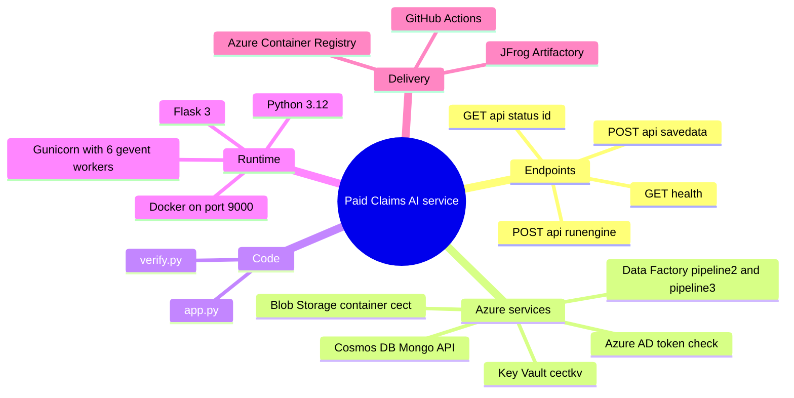

---

## 2. Business vocabulary you must know

| Term | Meaning (for this service) |
|---|---|
| **CECT** | *Claims Extract Comparison Tool*, an internal Optum Rx tool for QA of pharmacy-claims processing. |
| **RxClaim** | Optum Rx's pharmacy claims-adjudication platform. It decides whether a pharmacy claim is paid or rejected, and for how much. |
| **Paid claim** | A claim that RxClaim adjudicated as **paid**. The "Paid Claims AI" feature examines these. |
| **Detailed Comparison Report** | A CECT report comparing claim results between two runs or environments. It is the **input** to the AI engine (`detailCompReportFileName` → ADF parameter `RxClaimFile`). |
| **BDT** | *Benefit Design Template*: an Excel file describing a client's pharmacy-benefit plan design (copays, coverage rules, …). In the UI, file names must start with `BDT_`. |
| **cBDT** | *Client BDT*: client-specific BDT files, prefixed `cBDT_`. |
| **BDT/cBDT version** | A unique, user-chosen ID that groups one set of BDT/cBDT files. It becomes the **Blob Storage folder name** (`cect/<version>/…`). |
| **Format files** | Extra template/format files uploaded with the BDT set (`formatFiles` → ADF `FormFfile`). |
| **RxComet** | A specific BDT source/format. When checked, the RxComet **mapping file** is appended to the file list. In the UI, file names must start with `RxComet_`. |
| **Non-standard plan code** | Plans whose codes need a **plan-code mapping file** (`planCodeMappingFile`). |
| **Medicare** | Flag telling the pipeline the plan is a Medicare plan (`isMedicare` → ADF `IsMedicare`). |
| **AI rules file** | A file of rules produced or consumed by the AI engine (`aiRulesFileName`). `isSaveAIRulesFile` asks for it to be kept 🔎. |
| **Output name** | Name of the report the AI engine should produce (`outputName`). |
| **request id** | The ID the **CECT core backend** assigns to a request. This service stores it as `request_id` and uses it in `GET /api/status/<id>`. |
| **Run ID** | The ID Azure Data Factory gives to one execution of a pipeline (`run_id`). |

---

## 3. Where this service fits in CECT

This repository is one piece of a larger system. The browser **never calls this service directly**; the CECT core backend does.

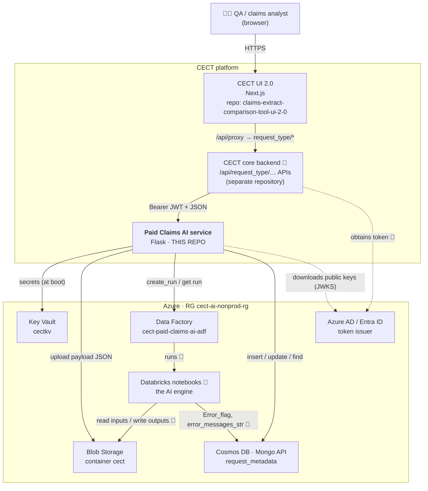

### How UI form fields become this service's fields

The UI and this service **do not use the same field names**. The core backend 🔎 translates between them (assigns `id`, turns a version *ID* into a version *string*, turns a report request ID into a file name, and so on).

**Journey A: "Upload BDT/cBDT"** (UI file `surfaces/cect-ui/src/pages/BdtCBdtForm.tsx` → `POST /api/savedata`)

| UI sends (`fields.*`) | This service reads (`fields.*`) | Then sent to ADF `pipeline2` as |
|---|---|---|
| *(none; backend adds it)* 🔎 | `id` | (only stored in Cosmos as `request_id`) |
| `version` | `version` | `foldername` |
| `files` (file names) | `files` | `FileList` (+ RxComet mapping file) |
| `formatFiles` | `formatFiles` | `FormFfile` |
| `isRxComet` | `isRxComet` | *(controls whether the mapping file is appended)* |
| `rxCometMappingFile` | `rxCometMappingFile` | appended to `FileList` |
| `isNonStandardPlanCode` | `isNonStandardPlanCode` | ⚠️ *not forwarded* |
| `planCodeMappingFile` | `planCodeMappingFile` | `PlanCodeMappingFile` |
| `isMedicare` | `isMedicare` | `IsMedicare` |
| `client`, `shortNote`, `msId` | *(ignored, but saved in `payload.json`)* | — |

**Journey B: "Launch Paid Claims AI"** (UI file `surfaces/cect-ui/src/pages/PaidClaimAIReportRequestForm.tsx` → `POST /api/runengine`)

| UI sends (`fields.*`) | This service reads (`fields.*`) | Then sent to ADF `pipeline3` as |
|---|---|---|
| *(none; backend adds it)* 🔎 | `id` | `request_id` |
| `outputName` | `outputName` | `outputName` |
| `bdtCbdtVersionId` (an ID) | `bdtCbdtVersion` (the version **string**) 🔎 | `foldername` |
| `isSaveAIRulesFile` | `isSaveAIRulesFile` | ⚠️ *not forwarded* (only in the blob JSON) |
| `detailCompRequestId` | `detailCompReportFileName` 🔎 | `RxClaimFile` (as a 1-item list) |
| *(none)* | `aiRulesFileName` 🔎 | `aiRulesFileName` |
| `environment`, `jobNumber`, `compRequestId`, `client`, `shortNote`, `msId` | *(not read)* | — |

---

## 4. Crash course: the technologies used

| Technology | What it is (beginner version) | Where it is used here |
|---|---|---|
| **Python 3.12** | The programming language. | All code. |
| **Flask 3** | A tiny web framework. You write a function and attach a URL to it with `@app.route(...)`. | [`app.py:64`](../app.py#L64) creates `app = Flask(__name__)`. |
| **Gunicorn** | A production web server for Python apps. It starts several *worker processes*, each running a copy of the app. | [`docker-startup.sh`](../docker-startup.sh) |
| **gevent** | Lets one worker handle many requests at once by switching between them while each waits on the network ("green threads" / greenlets). | `--worker-class gevent` |
| **Azure AD (Entra ID)** | Microsoft's identity service. Callers get a signed **JWT** ("access token") and send it as `Authorization: Bearer <token>`. | [`verify.py`](../verify.py) |
| **JWT / PyJWT** | A JSON Web Token is a signed JSON blob. `PyJWT` checks the signature and claims. | `jwt.decode(...)` in [`verify.py:28`](../verify.py#L28) |
| **Azure Key Vault** | A safe for secrets (passwords, connection strings). | [`app.py:22-37`](../app.py#L22) |
| **Azure Blob Storage** | Cloud file storage. Files ("blobs") live in *containers*. A `/` in the name acts like a folder. | Container `cect`, [`app.py:40-41`](../app.py#L40) |
| **Azure Data Factory (ADF)** | A cloud service that runs *pipelines* (workflows) that move and transform data. Starting one returns a **run ID**. | `adf_client.pipelines.create_run(...)` |
| **Azure Databricks** 🔎 | A managed Spark and notebook platform. ADF pipelines often call notebooks; this is where the "AI engine" runs. | Not in this repo. |
| **Cosmos DB (Mongo API)** | A cloud database that speaks the MongoDB protocol, so the normal `pymongo` driver works. | Database `cect-paid-claims-ai-cosmosmongodb`, collection `request_metadata`. |
| **loguru** | A friendlier Python logging library. | `logger.info(...)`, `logger.error(...)` |
| **Docker** | Packages the app and its dependencies into an *image* that runs the same everywhere. | [`Dockerfile`](../Dockerfile) |
| **GitHub Actions** | CI/CD: builds the Docker image and pushes it to a registry. | [`.github/workflows/docker-build-and-push.yml`](../.github/workflows/docker-build-and-push.yml) |

### Flask in 30 seconds

```python
from flask import Flask, request, jsonify

app = Flask(__name__)

@app.route('/hello/<name>', methods=['GET'])   # URL pattern → function
def hello(name):
    token = request.headers.get('Authorization')  # read a header
    return jsonify({"msg": f"hi {name}"}), 200    # (body, HTTP status)
```

Everything in `app.py` follows this shape. `request` is a Flask "magic" object that always refers to **the request currently being handled**, even with many requests in flight.

### Gunicorn + gevent in 30 seconds

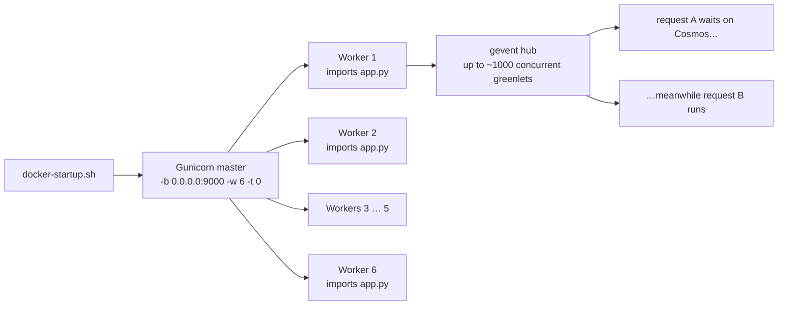

> ⚠️ Because Gunicorn does **not** use `--preload` here, **each of the 6 workers imports `app.py` separately**. All module-level code ([§7](#7-what-happens-when-the-app-boots)) runs **6 times** per container start.

---

## 5. Repository tour

```text
CECT-PAID_CLAIMS-AI/
├── app.py                      ← THE service: boot code + 4 Flask routes (389 lines)
├── verify.py                   ← Azure AD JWT verification (49 lines)
├── requirements.txt            ← pinned Python dependencies
├── Dockerfile                  ← 3-stage image build (current)
├── Dockerfile_old              ← previous single-stage build (legacy, unused)
├── docker-startup.sh           ← container entrypoint: starts Gunicorn on :9000
├── Jenkinsfile                 ← legacy Jenkins pipeline (build + push to ACR)
├── vitals.yaml                 ← Optum "vitals" metadata (placeholder values)
├── technical_design.md         ← older design notes (partly out of date, see §16)
├── .github/workflows/
│   └── docker-build-and-push.yml  ← current CI: build, scan, push image
└── docs/
    └── CECT-Paid-Claims-AI-Beginner-KT-Guide.md / .html   ← this guide
```

### `app.py` map by line range

| Lines | Block | Runs when |
|---|---|---|
| 1–19 | Imports | Import time |
| 22–37 | Read 5 secrets from Key Vault | **Import time** (per worker) |
| 39–47 | Blob client + hard-coded Azure names | Import time |
| 49–60 | ADF credential, **lists every resource group**, ADF client | Import time |
| 64 | `app = Flask(__name__)` | Import time |
| 66–212 | `save_data()`: `POST /api/savedata` | Per request |
| 217–337 | `run_engine()`: `POST /api/runengine` | Per request |
| 340–381 | `get_status(id)`: `GET /api/status/<id>` | Per request |
| 383–385 | `health_check()`: `GET /health` | Per request |
| 387–388 | `app.run()` for local dev only | `python app.py` |

### What every import is for

| Import (`app.py`) | Used? | Purpose |
|---|---|---|
| `Flask, request, jsonify` | ✅ | Web framework, current request, JSON responses |
| `typing.List` (×2) | ❌ | Unused (duplicated on line 11) |
| `BlobServiceClient` | ✅ | Upload blobs |
| `BlobClient` | ❌ | Imported but never referenced by name |
| `ContainerClient` | ⚠️ | Instantiated on lines 124 and 262, but the object is **never used** |
| `os` | ❌ | Unused |
| `json` | ✅ | Write the payload file |
| `DefaultAzureCredential` | ✅ | Identity used to read Key Vault |
| `DataFactoryManagementClient` | ✅ | Start and inspect ADF pipelines |
| `CreateRunResponse` | ✅ | Type hint for `create_run` result |
| `SecretClient` | ✅ | Key Vault client |
| `MongoClient` | ✅ | Cosmos DB (Mongo API) |
| `ResourceManagementClient` | ⚠️ | Only used to *print* resource-group names at boot |
| `ClientSecretCredential` | ✅ | Service-principal identity for ADF |
| `azure.mgmt.datafactory.models import *` | ❌ | Wildcard import; pollutes the namespace |
| `datetime, timedelta`, `time` | ❌ | Unused (left from a commented-out polling loop) |
| `verify_azure_token` | ✅ | Token check |
| `loguru.logger` | ✅ | Logging |

---

## 6. System architecture

### 6.1 Container view: inside the running service

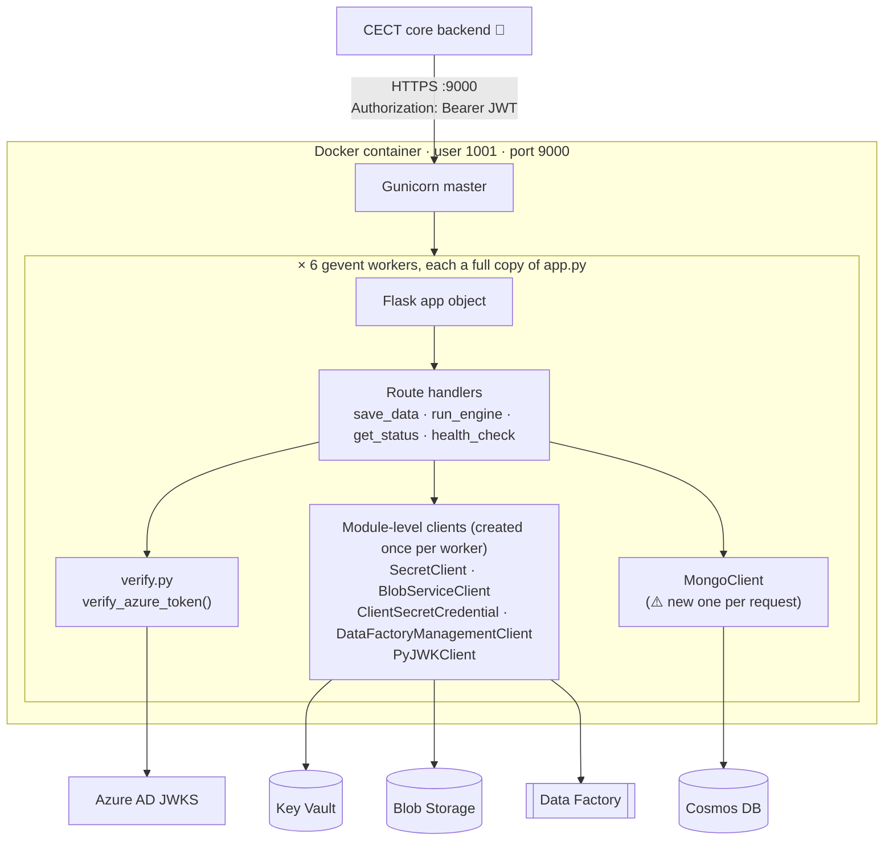

### 6.2 Deployment view: Azure resources

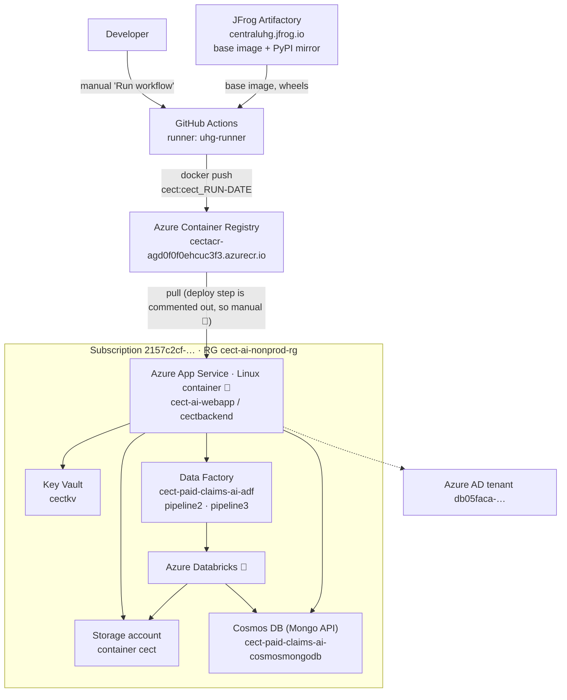

### 6.3 Logical layers inside one request

Each POST handler is a straight pipeline of these layers. There are no classes and no separate modules; everything is inline in the route function.

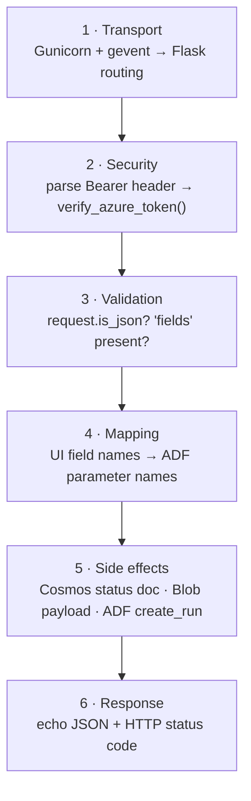

### 6.4 Architectural style in one sentence

> A **stateless, synchronous REST facade** in front of an **asynchronous, event-free batch back end**. The caller fires a job and then **polls** for completion. This is the *Asynchronous Request-Reply* cloud pattern ([§15](#15-design-patterns-catalog)).

---

## 7. What happens when the app boots

When Gunicorn starts a worker, Python executes **all top-level code** in `app.py` (and in `verify.py`, which it imports). That code makes **real network calls**.

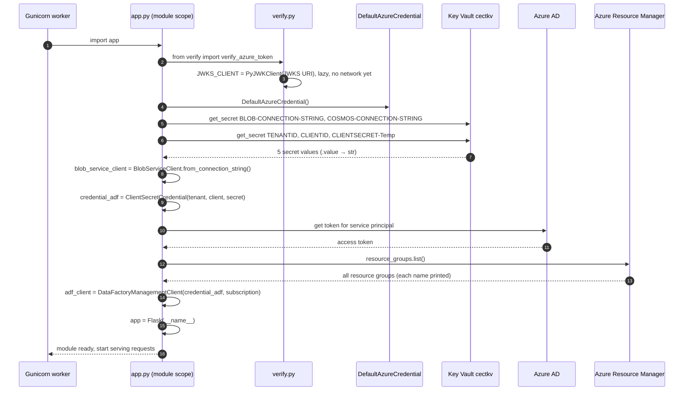

### Global objects created at boot

| Name | Type | Line | Used by |
|---|---|---|---|
| `kvuri` | `str` = `https://cectkv.vault.azure.net/` | 22 | `client` |
| `credential` | `DefaultAzureCredential` | 23 | Key Vault |
| `client` | `SecretClient` | 24 | Reading secrets (⚠️ the same name is **re-used** for a local `MongoClient` inside each route) |
| `connection_string` | `str` (Blob) | 33 | `blob_service_client`, `ContainerClient` |
| `connection_string_cosmos` | `str` (Cosmos) | 34 | `MongoClient(...)` in every route |
| `tenant_id`, `client_id`, `client_secret` | `str` | 35–37 | `credential_adf` |
| `container_name` | `"cect"` | 40 | Blob uploads |
| `blob_service_client` | `BlobServiceClient` | 41 | Blob uploads |
| `subscription_id` | `'2157c2cf-7d28-401e-8657-e226eb1dd761'` | 43 | ARM, ADF |
| `resource_group_name` | `'cect-ai-nonprod-rg'` | 44 | ADF calls |
| `factory_name` | `'cect-paid-claims-ai-adf'` | 45 | ADF calls |
| `pipeline_name` | `'pipeline3'` (AI engine) | 46 | `run_engine` |
| `pipeline_name_save` | `'pipeline2'` (save BDT/cBDT) | 47 | `save_data` |
| `credential_adf` | `ClientSecretCredential` | 49 | ARM, ADF |
| `resource_client` | `ResourceManagementClient` | 55 | Boot-time listing only |
| `adf_client` | `DataFactoryManagementClient` | 60 | All routes |
| `app` | `Flask` | 64 | Gunicorn target `app:app` |
| `JWKS_CLIENT` (in `verify.py`) | `PyJWKClient` | 17 | `verify_azure_token` |

> ⚠️ **Boot is fragile.** If Key Vault, Azure AD, or ARM is unreachable, or the identity lacks *Reader* on the subscription, the **import raises and the worker dies**. Gunicorn keeps restarting it, and the container never becomes healthy. Look here first when "the app won't start".

> 🔐 **Two identities are in play.** `DefaultAzureCredential` (in App Service this is usually a Managed Identity 🔎) reads Key Vault. A **service principal** (`CLIENTID` + `CLIENTSECRET-Temp`) talks to ARM and ADF. The `-Temp` suffix suggests a rotation workaround that was never cleaned up.

---

## 8. Authentication: `verify.py`

### 8.1 JWT primer for beginners

A JWT is three Base64 chunks joined by dots. Azure AD signs it with a **private key**. Anyone can verify it with the matching **public key**, which Azure publishes at a *JWKS* URL.

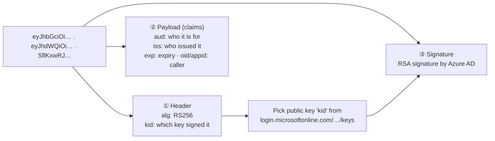

### 8.2 Constants

| Constant | Value | Meaning |
|---|---|---|
| `AZURE_AD_APP_ID` | `api://c1653e1e-442d-4713-b9f8-05596e492604` | Expected **audience** (`aud`). The token must be issued *for this API*. |
| `AZURE_AD_TENANT_ID` | `db05faca-c82a-4b9d-b9c5-0f64b6755421` | The Optum Azure AD tenant. |
| `AZURE_AD_JWKS_URI` | `https://login.microsoftonline.com/<tenant>/discovery/v2.0/keys` | Where public signing keys are published. |
| `AZURE_AD_ISSUERS` | `https://sts.windows.net/<tenant>/` (v1 tokens) and `https://login.microsoftonline.com/<tenant>/v2.0` (v2 tokens) | Accepted **issuers** (`iss`). |
| `JWKS_CLIENT` | `PyJWKClient(AZURE_AD_JWKS_URI)` | Downloads and caches the keys (PyJWT caches the key set for about 5 minutes by default). |

### 8.3 `verify_azure_token(ad_token)`: logic

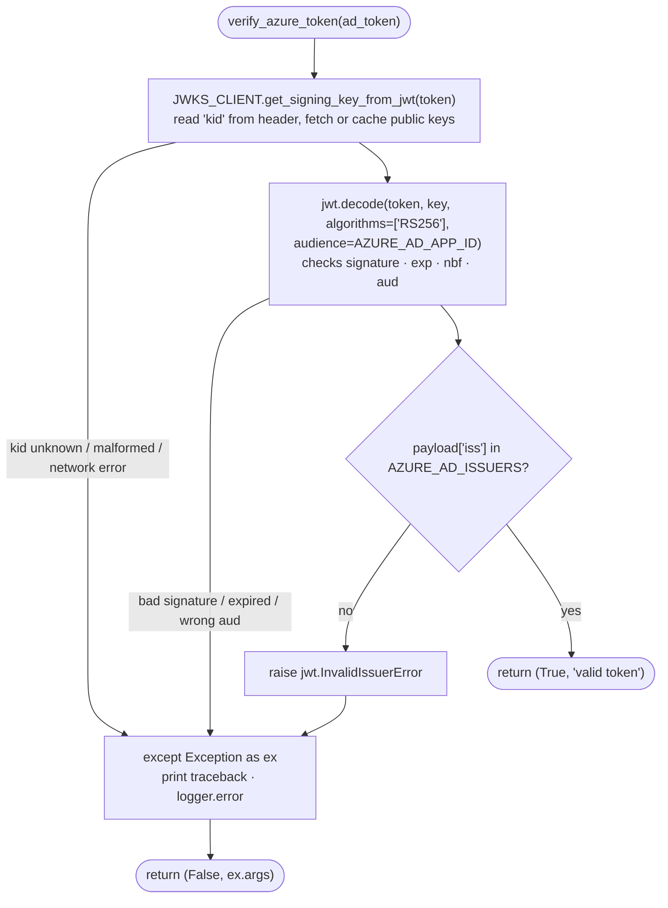

### 8.4 Sequence, as seen from a route

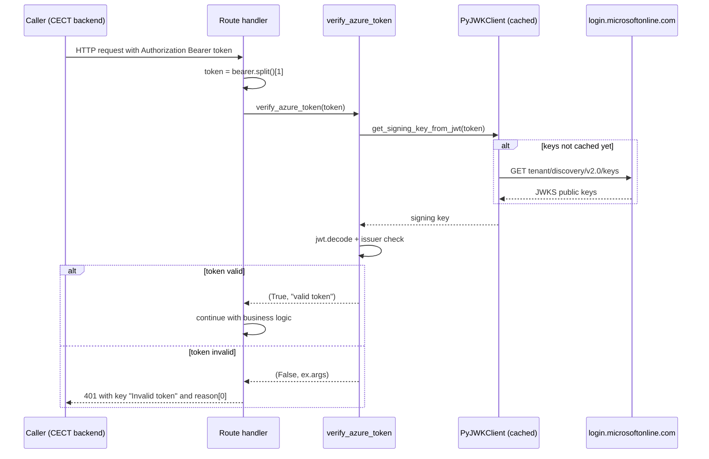

### 8.5 How each route uses it (copy-pasted three times)

```python
bearer = request.headers.get('Authorization')    # e.g. "Bearer eyJ0eXAi..."
print("bearer :", bearer)                         # ⚠️ prints the token to logs
token = bearer.split()[1]                         # ⚠️ crashes if header missing
print("token :", token)                           # ⚠️ prints the token again
valid_token, reason = verify_azure_token(token)
if valid_token:
    logger.info("Valid Token")
else:
    return jsonify({"Invalid token": str(reason[0])}), 401
```

**Usage example** (from a Python shell):

```python
from verify import verify_azure_token

ok, reason = verify_azure_token("eyJ0eXAiOiJKV1Qi...")
if ok:
    print("accepted")                 # reason == "valid token"
else:
    print("rejected:", reason)        # reason is a tuple, e.g. ('Signature has expired',)
```

### 8.6 What is and is not checked

| Check | Done? | Where |
|---|---|---|
| Signature (RS256, Azure AD key) | ✅ | `jwt.decode` |
| Expiry (`exp`) / not-before (`nbf`) | ✅ when present (PyJWT default) | `jwt.decode` |
| Audience (`aud`) = this API | ✅ | `audience=AZURE_AD_APP_ID` |
| Issuer (`iss`) = Optum tenant | ✅ | manual check, line 36 |
| **Roles / scopes** (`roles`, `scp`) | ❌ ⚠️ | not checked. Any client in the tenant that can obtain a token for this audience is accepted |
| Specific caller (`appid` / `azp` allow-list) | ❌ ⚠️ | not checked |
| `/health` protected | ❌ (by design) | health probes must be anonymous |

---

## 9. API reference

All endpoints except `/health` require `Authorization: Bearer <Azure AD access token for api://c1653e1e-…>`.

### 9.1 `POST /api/savedata`: register BDT/cBDT files

**Request body**

```json
{
  "fields": {
    "id": "665f1c2e9b1d4a0012ab34cd",
    "version": "ACME_2026_Q4_v1",
    "files": ["BDT_ACME_2026.xlsx", "cBDT_ACME_RETAIL.xlsx"],
    "formatFiles": ["Format_A.xlsx"],
    "isRxComet": false,
    "rxCometMappingFile": "",
    "isNonStandardPlanCode": true,
    "planCodeMappingFile": "PlanCodeMap_ACME.xlsx",
    "isMedicare": false
  }
}
```

| Field | Type | Required | Default | Used for |
|---|---|---|---|---|
| `id` | string | effectively yes | `None` → stored as `"None"` ⚠️ | Cosmos `request_id` |
| `version` | string | effectively yes | `None` → folder `"None"` ⚠️ | Blob folder and ADF `foldername` |
| `files` | string[] | no | `[]` | ADF `FileList` |
| `formatFiles` | string[] | no | `[]` | ADF `FormFfile` |
| `isRxComet` | bool | no | `false` | If true, appends `rxCometMappingFile` to `FileList` |
| `rxCometMappingFile` | string | no | `""` | see above |
| `isNonStandardPlanCode` | bool | no | `false` | Logged and echoed only, **not sent to ADF** |
| `planCodeMappingFile` | string | no | `""` | ADF `PlanCodeMappingFile` |
| `isMedicare` | bool | no | `false` | ADF `IsMedicare` |

**Success: `200 OK`**

```json
{
  "received": {
    "id": "665f1c2e9b1d4a0012ab34cd",
    "version": "ACME_2026_Q4_v1",
    "files": ["BDT_ACME_2026.xlsx", "cBDT_ACME_RETAIL.xlsx"],
    "format_files": ["Format_A.xlsx"],
    "isRxComet": false,
    "rxCometMappingFile": "",
    "isNonStandardPlanCode": true,
    "planCodeMappingFile": "PlanCodeMap_ACME.xlsx",
    "isMedicare": false
  }
}
```

> Note: the response key is `format_files` (snake_case), but the request key is `formatFiles`. If `isRxComet` is true, `files` in the response **already includes** the mapping file.

**curl**

```bash
curl -s -X POST "https://<host>/api/savedata" -H "Authorization: Bearer $TOKEN" -H "Content-Type: application/json" -d @savedata.json
```

### 9.2 `POST /api/runengine`: run the AI engine

**Request body**

```json
{
  "fields": {
    "id": "6660a7d19b1d4a0012ab99ef",
    "outputName": "ACME_PaidClaims_AI_Nov",
    "bdtCbdtVersion": "ACME_2026_Q4_v1",
    "isSaveAIRulesFile": true,
    "detailCompReportFileName": "DetailedComparison_12345.xlsx",
    "aiRulesFileName": "AIRules_ACME_2026_Q4_v1.json"
  }
}
```

| Field | Type | Used for |
|---|---|---|
| `id` | string | Cosmos `request_id` **and** ADF `request_id` (so the notebook can write back 🔎) |
| `outputName` | string | ADF `outputName` |
| `bdtCbdtVersion` | string | Blob folder and ADF `foldername` (points at the folder written by `/api/savedata`) |
| `isSaveAIRulesFile` | bool | Echoed and stored in the blob JSON only (⚠️ not an ADF parameter) |
| `detailCompReportFileName` | string | ADF `RxClaimFile` = `[detailCompReportFileName]` |
| `aiRulesFileName` | string | ADF `aiRulesFileName` |

**Success: `200 OK`**

```json
{
  "received": {
    "id": "6660a7d19b1d4a0012ab99ef",
    "output": "ACME_PaidClaims_AI_Nov",
    "version": "ACME_2026_Q4_v1",
    "isSaveAiRulesFile": true,
    "detailCompReportFileName": "DetailedComparison_12345.xlsx",
    "aiRulesFileName": "AIRules_ACME_2026_Q4_v1.json"
  }
}
```

> Note the renamed keys in the echo: `outputName` → `output`, `bdtCbdtVersion` → `version`, `isSaveAIRulesFile` → `isSaveAiRulesFile`.

### 9.3 `GET /api/status/<id>`: poll a request

**Success: `200 OK`**

```json
{ "status": "InProgress", "message": "" }
```

| `status` value | Comes from | Meaning |
|---|---|---|
| `Queued`, `InProgress`, `Succeeded`, `Failed`, `Canceling`, `Cancelled` | ADF `PipelineRun.status` | Normal ADF lifecycle |
| Value of `Error_flag` (e.g. `"True"`) | Cosmos document 🔎 | The notebook reported an error. `message` = `"Notebook Execution Failed due to Error - " + error_messages_str` |

| HTTP | When |
|---|---|
| 401 | Token invalid |
| 404 | `{"error": "Document not found"}`: no document with that `request_id` |
| 500 | ⚠️ Unhandled exception (missing header, no `run_id` on the document, ADF error), returned as Flask's HTML error page |

### 9.4 `GET /health`

Always `200 {"status": "ok"}`. It does **not** check Key Vault, Cosmos, or ADF. If the app booted, it answers.

---

## 10. Function-by-function walkthrough

### 10.1 `save_data()`: [`app.py:66-212`](../app.py#L66)

**Signature:** `def save_data() -> (Response, int)` · **Route:** `POST /api/savedata`
**Purpose:** record a "save BDT/cBDT" job, drop the payload in Blob Storage, and start ADF `pipeline2`.
**Side effects:** 1 Cosmos insert, 1 local file write, 1 blob upload, 1 ADF pipeline run, 1 Cosmos update.

| Step | Lines | What happens |
|---|---|---|
| 1 | 69–77 | Parse the Bearer token and verify it. On failure, return `401`. |
| 2 | 78–84 | Reject non-JSON (`400`) or a body without `fields` (`400`). |
| 3 | 86–96 | Pull the 9 known keys out of `fields`, with defaults. |
| 4 | 99–103 | Open a **new** `MongoClient` and select `cect-paid-claims-ai-cosmosmongodb.request_metadata`. |
| 5 | 107–114 | `insert_one({request_id, stage: 'Uploading BDT/cBDT', status: 'InProgress'})` |
| 6 | 117–121 | Dump **all of `fields`** to a local file `payload.json` (⚠️ shared file name). |
| 7 | 124 | Build a `ContainerClient` (⚠️ unused). |
| 8 | 130–133 | Upload the file as blob `cect/<version>/payload.json` (`overwrite=True`). |
| 9 | 151–153 | If `isRxComet`, append `rxCometMappingFile` to `files`. |
| 10 | 156–163 | Build ADF parameters `{FileList, foldername, FormFfile, PlanCodeMappingFile, IsMedicare}`. |
| 11 | 166–171 | `adf_client.pipelines.create_run(rg, factory, 'pipeline2', parameters=…)` returns a `run_id`. |
| 12 | 173–180 | `print` every field (debug). |
| 13 | 185–197 | Build the echo response. |
| 14 | 198–202 | `update_one` → `status: 'Succeeded', run_id` (meaning *pipeline started*, not *finished*). |
| 15 | 204 | Return `200`. |
| ✗ | 205–211 | Any exception in steps 5–14: `update_one` → `status: 'Failed'`, return `500 {"error": str(e)}`. |
| — | 212 | `client.close()`: ⚠️ **unreachable** (comes after both `return`s). |

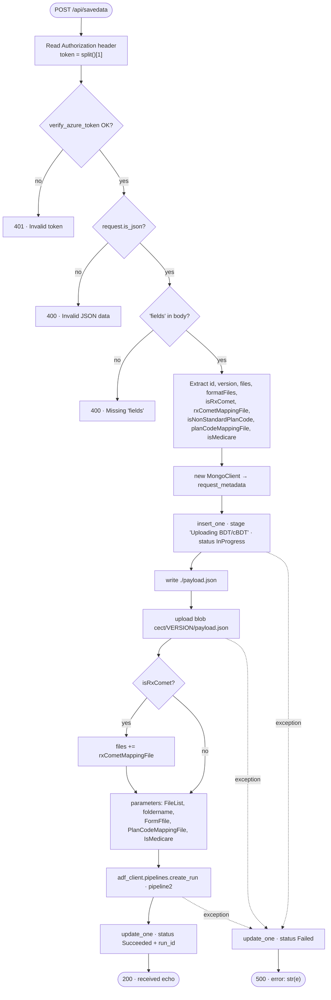

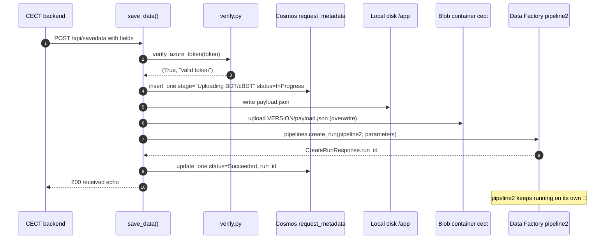

**Usage (Python `requests`):**

```python
import requests
resp = requests.post(
    f"{BASE_URL}/api/savedata",
    headers={"Authorization": f"Bearer {token}"},
    json={"fields": {"id": "req-1", "version": "ACME_v1",
                     "files": ["BDT_ACME.xlsx"], "isMedicare": False}},
    timeout=60,
)
print(resp.status_code, resp.json())
```

---

### 10.2 `run_engine()`: [`app.py:217-337`](../app.py#L217)

**Signature:** `def run_engine() -> (Response, int)` · **Route:** `POST /api/runengine`
**Purpose:** record an "AI engine" job and start ADF `pipeline3`, which runs the AI processing 🔎.

| Step | Lines | What happens |
|---|---|---|
| 1 | 219–227 | Token check (same copy-pasted block). |
| 2 | 228–233 | JSON and `fields` checks → `400`. |
| 3 | 235–240 | Read `id, outputName, bdtCbdtVersion, isSaveAIRulesFile, detailCompReportFileName, aiRulesFileName`. |
| 4 | 242–246 | New `MongoClient`, select `request_metadata`. |
| 5 | 249–255 | `insert_one({request_id, stage: 'RUNNINAIENGINE', status: 'InProgress'})` (sic, the typo is part of the data contract). |
| 6 | 256–259 | Dump `fields` to local `payloadrun.json`. |
| 7 | 268–271 | Upload as `cect/<bdtCbdtVersion>/payloadrunengine.json` (⚠️ same blob name for every run on that version). |
| 8 | 287–293 | Parameters `{RxClaimFile: [detailCompReportFileName], foldername, outputName, aiRulesFileName, request_id}`. |
| 9 | 295–300 | `create_run(..., 'pipeline3', parameters)` |
| 10 | 301–311 | *(Commented-out polling loop: the original design blocked until done.)* |
| 11 | 314–323 | Build the echo response (renamed keys). |
| 12 | 324–328 | `update_one` → `status: 'InProgress', run_id`. |
| 13 | 329 | Return `200`. |
| ✗ | 330–336 | Exception → `status: 'Failed'` → `500`. |

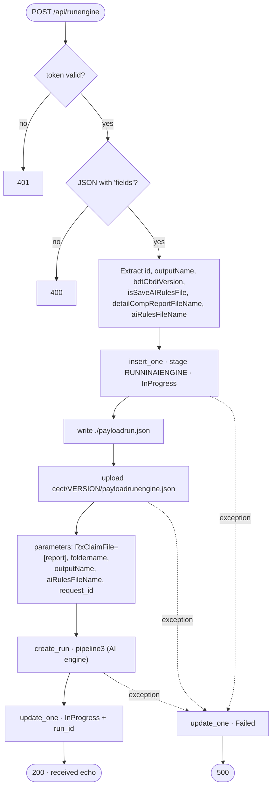

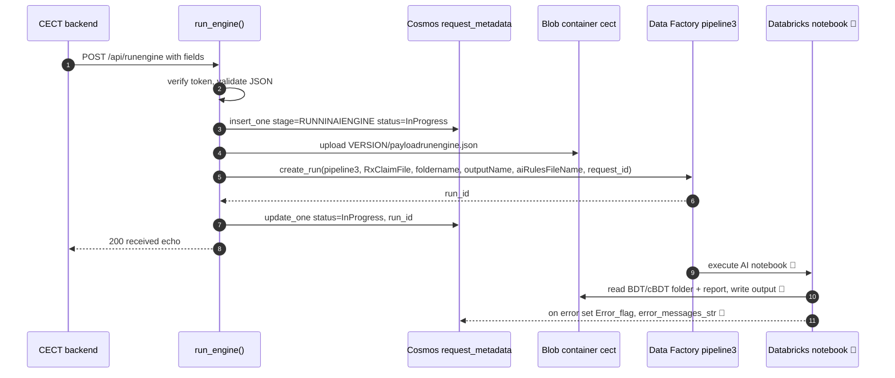

---

### 10.3 `get_status(id)`: [`app.py:340-381`](../app.py#L340)

**Signature:** `def get_status(id: str) -> (Response, int)` · **Route:** `GET /api/status/<id>`
**Purpose:** combine **two sources of truth** (the Cosmos document and the live ADF run) into one `{status, message}`.

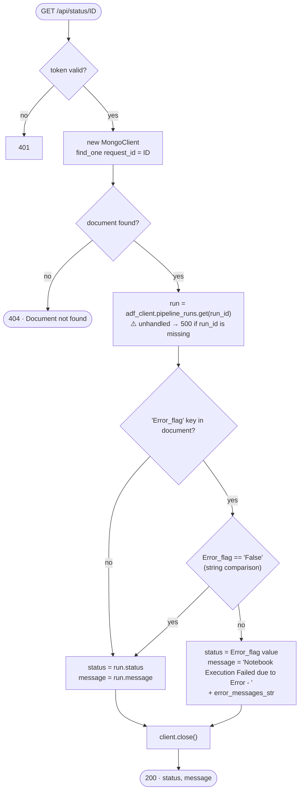

**Truth table**

| `Error_flag` in doc | ADF run status | Returned `status` | Returned `message` |
|---|---|---|---|
| *(absent)* | `InProgress` | `InProgress` | ADF message (usually empty) |
| *(absent)* | `Failed` | `Failed` | ADF error message |
| `"False"` | `Succeeded` | `Succeeded` | `""` |
| `"True"` | anything | `"True"` ⚠️ | `Notebook Execution Failed due to Error - <details>` |
| `False` (a **boolean**, not a string) | `Succeeded` | `False` ⚠️ | `Notebook Execution Failed due to Error - ` ⚠️ *(false alarm)* |

> 🔎 Callers presumably treat any status other than an ADF value as "failed". Confirm with the CECT core backend team.

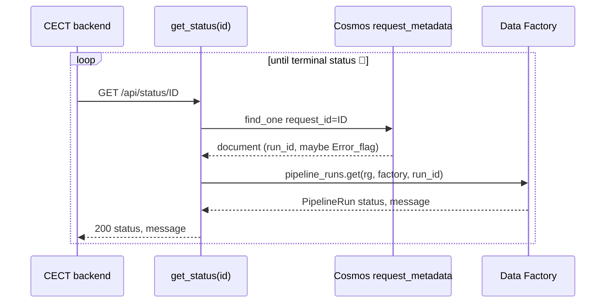

**Usage:**

```bash
curl -s "https://<host>/api/status/6660a7d19b1d4a0012ab99ef" -H "Authorization: Bearer $TOKEN"
```

---

### 10.4 `health_check()`: [`app.py:383-385`](../app.py#L383)

```python
@app.route('/health', methods=['GET'])
def health_check():
    return jsonify({'status': 'ok'}), 200
```

It is a **liveness** probe only. Point App Service's *Health check* setting at `/health`.

---

### 10.5 `verify_azure_token(ad_token)`: [`verify.py:20-49`](../verify.py#L20)

Covered in depth in [§8](#8-authentication-verifypy). Contract:

| Input | Output on success | Output on failure |
|---|---|---|
| `ad_token: str` (raw JWT without the `Bearer ` prefix) | `(True, "valid token")` | `(False, ex.args)`, where `ex.args` is a **tuple** (usually one message string) |

It never raises; every exception is caught and converted.

---

### 10.6 Module-level boot code: [`app.py:22-64`](../app.py#L22)

It is not a function, but it behaves like a constructor for the whole service. See [§7](#7-what-happens-when-the-app-boots).

---

## 11. Data model & storage

### 11.1 Request, parameter, and document shapes (class diagram)

Python here uses plain `dict`s; nothing is declared as a class. The diagram makes the **implicit** shapes explicit.

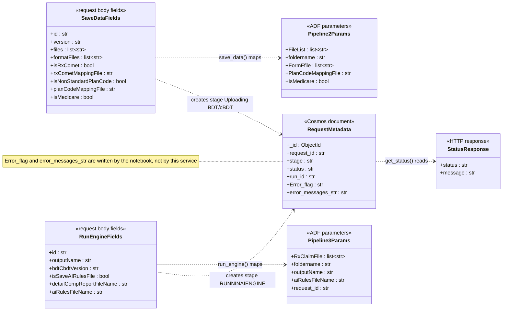

### 11.2 Entity-relationship view

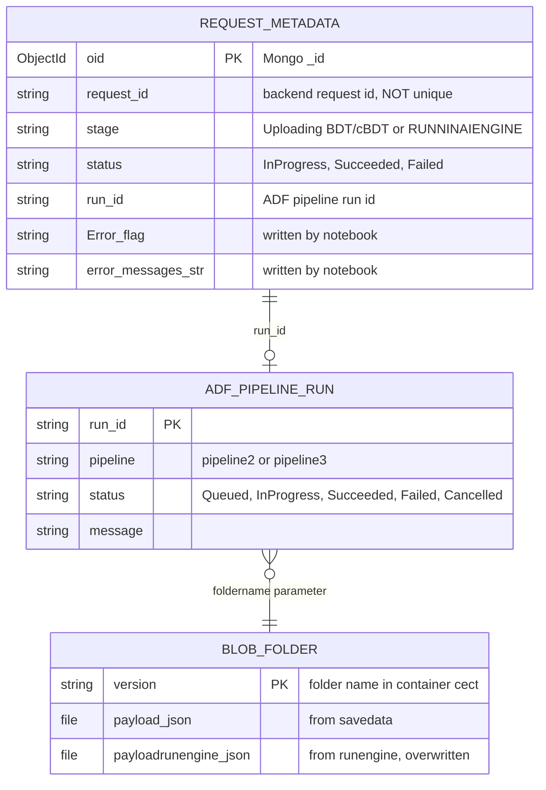

### 11.3 Blob Storage layout (container `cect`)

```text
cect/
└── <BDT/cBDT version>/                 e.g. ACME_2026_Q4_v1/
    ├── payload.json                    ← written by POST /api/savedata (full 'fields' object)
    ├── payloadrunengine.json           ← written by POST /api/runengine (overwritten on every run for this version ⚠️)
    └── … BDT/cBDT files, AI rules, outputs …   ← written by ADF / Databricks 🔎
```

### 11.4 Cosmos DB location

| Item | Value |
|---|---|
| Connection string | Key Vault secret `COSMOS-CONNECTION-STRING` |
| Database | `cect-paid-claims-ai-cosmosmongodb` |
| Collection | `request_metadata` |
| Indexes | None created by this code 🔎. Recommend an index on `request_id` |

### 11.5 Status lifecycle

**What this service writes to `status`:**

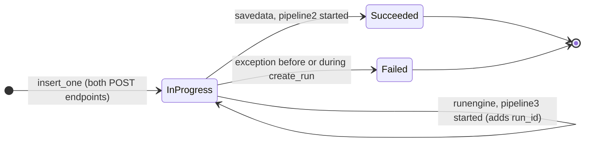

**What `GET /api/status` reports** (the ADF lifecycle, possibly overridden by the notebook):

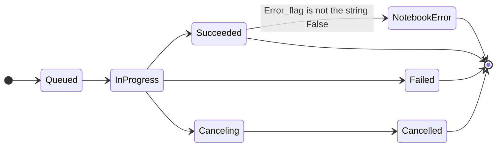

> ⚠️ The Cosmos `status` field is **never updated after the pipeline starts**. Only `GET /api/status` (which asks ADF live) knows the real outcome. Don't build reports on the `status` field alone.

---

## 12. Code-structure class diagram

Modules are drawn as classes (`<<module>>`), next to the Azure / Mongo / JWT SDK classes they use.

```mermaid
classDiagram
    direction TB
    class app_py {
        <<module>>
        +credential : DefaultAzureCredential
        +client : SecretClient
        +connection_string : str
        +connection_string_cosmos : str
        +container_name : str
        +blob_service_client : BlobServiceClient
        +subscription_id : str
        +resource_group_name : str
        +factory_name : str
        +pipeline_name : str
        +pipeline_name_save : str
        +credential_adf : ClientSecretCredential
        +resource_client : ResourceManagementClient
        +adf_client : DataFactoryManagementClient
        +app : Flask
        +save_data() Response
        +run_engine() Response
        +get_status(id) Response
        +health_check() Response
    }
    class verify_py {
        <<module>>
        +AZURE_AD_APP_ID : str
        +AZURE_AD_TENANT_ID : str
        +AZURE_AD_JWKS_URI : str
        +AZURE_AD_ISSUERS : set
        +JWKS_CLIENT : PyJWKClient
        +verify_azure_token(ad_token) tuple
    }
    class SecretClient {
        +get_secret(name) KeyVaultSecret
    }
    class BlobServiceClient {
        +from_connection_string(conn) BlobServiceClient
        +get_blob_client(container, blob) BlobClient
    }
    class BlobClient {
        +upload_blob(data, overwrite) dict
    }
    class DataFactoryManagementClient {
        +pipelines : PipelinesOperations
        +pipeline_runs : PipelineRunsOperations
    }
    class PipelinesOperations {
        +create_run(rg, factory, pipeline, parameters) CreateRunResponse
    }
    class PipelineRunsOperations {
        +get(rg, factory, run_id) PipelineRun
    }
    class CreateRunResponse {
        +run_id : str
    }
    class PipelineRun {
        +status : str
        +message : str
    }
    class MongoClient {
        +get_database(name) Database
        +close()
    }
    class Collection {
        +insert_one(doc)
        +update_one(filter, update)
        +find_one(filter) dict
    }
    class PyJWKClient {
        +get_signing_key_from_jwt(token) PyJWK
    }
    class Flask {
        +route(rule, methods)
        +run()
    }
    app_py --> verify_py : imports verify_azure_token
    app_py --> Flask : creates app
    app_py --> SecretClient : reads 5 secrets
    app_py --> BlobServiceClient
    BlobServiceClient ..> BlobClient : creates
    app_py --> DataFactoryManagementClient
    DataFactoryManagementClient *-- PipelinesOperations
    DataFactoryManagementClient *-- PipelineRunsOperations
    PipelinesOperations ..> CreateRunResponse : returns
    PipelineRunsOperations ..> PipelineRun : returns
    app_py ..> MongoClient : new per request
    MongoClient ..> Collection : db then collection
    verify_py --> PyJWKClient : singleton
```

---

## 13. End-to-end user journeys

### 13.1 Journey A: upload a BDT/cBDT set

```mermaid
sequenceDiagram
    autonumber
    actor U as Analyst
    participant UI as CECT UI (BdtCBdtForm)
    participant CB as CECT core backend 🔎
    participant AI as Paid Claims AI (Flask)
    participant M as Cosmos request_metadata
    participant BL as Blob cect
    participant ADF as ADF pipeline2
    U->>UI: Tab 7 BDT/cBDT, Upload, fill form, Submit
    UI->>CB: GET bdt_cbdt_files/versions (uniqueness check)
    UI->>CB: POST bdt_cbdt_files/validate
    CB-->>UI: 200 OK
    UI->>CB: POST bdt_cbdt_files/submit
    CB->>AI: POST /api/savedata fields + id 🔎
    AI->>M: insert_one InProgress
    AI->>BL: VERSION/payload.json
    AI->>ADF: create_run(pipeline2)
    AI->>M: update_one Succeeded + run_id
    AI-->>CB: 200 received
    CB-->>UI: success
    ADF->>BL: copy / convert BDT files into VERSION folder 🔎
    U->>UI: BDT/cBDT tab shows the request status 🔎
```

### 13.2 Journey B: launch a Paid Claims AI report and wait for it

```mermaid
sequenceDiagram
    autonumber
    actor U as Analyst
    participant UI as CECT UI (PaidClaimAIReportRequestForm)
    participant CB as CECT core backend 🔎
    participant AI as Paid Claims AI (Flask)
    participant M as Cosmos request_metadata
    participant ADF as ADF pipeline3
    participant NB as Databricks AI notebook 🔎
    U->>UI: Reports tab, pick a Detailed Comparison row, Launch Paid Claims AI
    UI->>CB: POST paid_claims_ai_report/validate
    CB-->>UI: 200 OK
    UI->>CB: POST paid_claims_ai_report/submit
    CB->>CB: versionId to version, detailCompRequestId to file name 🔎
    CB->>AI: POST /api/runengine
    AI->>M: insert_one stage RUNNINAIENGINE
    AI->>ADF: create_run(pipeline3)
    AI->>M: update_one run_id
    AI-->>CB: 200 received
    CB-->>UI: 201 Created (UI also treats 504 as success)
    par Azure processes the job
        ADF->>NB: run AI notebook
        NB->>M: Error_flag / error_messages_str 🔎
    and Backend polls for status 🔎
        loop every few seconds
            CB->>AI: GET /api/status/ID
            AI->>ADF: pipeline_runs.get(run_id)
            AI-->>CB: status, message
        end
    end
    U->>UI: Reports tab shows final status and logs
```

---

## 14. The "AI" part: a Gen AI engineer's view

### 14.1 What lives where

| Concern | In this repo? | Where it actually lives |
|---|---|---|
| HTTP API, auth, job tracking | ✅ | `app.py`, `verify.py` |
| Starting the AI job | ✅ | `run_engine()` → ADF `pipeline3` |
| Model calls, prompts, rule extraction, claim evaluation | ❌ | ADF `pipeline3` → Databricks notebook(s) 🔎 |
| AI error reporting | Read only | Notebook writes `Error_flag` and `error_messages_str` to `request_metadata` 🔎; `get_status` reads them |
| AI artefacts (rules file, output report) | ❌ | Blob folder `cect/<version>/` 🔎 |

### 14.2 The contract between this service and the AI engine

This is the **only** interface the AI side can rely on, so treat it as an API contract.

| Direction | Channel | Keys |
|---|---|---|
| Service → AI | ADF pipeline parameters | `RxClaimFile` (list with one file name), `foldername`, `outputName`, `aiRulesFileName`, `request_id` |
| Service → AI | Blob `cect/<foldername>/payloadrunengine.json` | the full `fields` object, including `isSaveAIRulesFile` |
| Service → AI | Blob `cect/<foldername>/payload.json` (+ files from `pipeline2`) | the BDT/cBDT set definition |
| AI → Service | Cosmos `request_metadata` document with `request_id` | `Error_flag` (**string** `"True"`/`"False"`), `error_messages_str` |
| AI → Service | ADF run status | `Succeeded` / `Failed` + `message` |

### 14.3 Likely processing inside `pipeline3` 🔎

The diagram below is **inferred from parameter names only**. Validate it against the actual ADF pipeline JSON and the notebooks before using it in design discussions.

```mermaid
flowchart LR
    subgraph IN["Inputs from this service"]
        p1["RxClaimFile<br/>detailed comparison report"]
        p2["foldername<br/>BDT/cBDT version folder"]
        p3["aiRulesFileName"]
        p4["outputName"]
        p5["request_id"]
    end
    subgraph NB["pipeline3 → Databricks notebook 🔎"]
        s1["Load BDT/cBDT files<br/>from the version folder"]
        s2["Derive or load AI rules<br/>(aiRulesFileName)"]
        s3["Evaluate each paid claim<br/>against the rules"]
        s4["Write report = outputName<br/>to blob"]
        s5["On error: set Error_flag,<br/>error_messages_str in Cosmos"]
    end
    p2 --> s1
    p3 --> s2
    s1 --> s2 --> s3
    p1 --> s3
    s3 --> s4
    p4 --> s4
    p5 --> s5
    s3 -.-> s5
```

### 14.4 Gen AI hardening checklist (for the notebook owners)

These are recommendations, not current behaviour. Use them as questions to raise in the KT session.

| # | Topic | Question / recommendation |
|---|---|---|
| 1 | **Traceability** | Record `model_name`, `model_version`, `prompt_version`, and `rules_file_hash` on the `request_metadata` document, so any AI output can be reproduced. |
| 2 | **Determinism** | Are generation settings (temperature, seed) fixed? Claims QA needs repeatable results. |
| 3 | **Structured output** | Is model output validated against a JSON schema before it is written to the report? Reject and flag on schema failure. |
| 4 | **Evaluation** | Is there a golden set of claims with known-correct verdicts, run on every prompt or model change? Track precision and recall per rule type. |
| 5 | **Data protection** | Paid claims can include member data (PHI). Confirm which fields reach the model, that the endpoint is approved for PHI, and that prompts and responses are not logged in clear text. |
| 6 | **Human in the loop** | AI verdicts should be *suggestions* reviewed by an analyst, and the report should say so. |
| 7 | **Error contract** | Always write `Error_flag` as the **string** `"True"` or `"False"`. A boolean `False` makes `get_status` report a failure ([§20](#20-known-issues-risks--tech-debt), K5). |
| 8 | **Cost & latency** | Log token counts and duration per `request_id`. Add a per-request budget. |
| 9 | **Idempotency** | Re-running the same `request_id` must not double-write outputs. Write to `cect/<version>/<request_id>/…` rather than shared names. |
| 10 | **Rules caching** | `isSaveAIRulesFile` hints at caching generated rules per version. Make sure the cache key includes the model and prompt version. |

---

## 15. Design patterns catalog

### 15.1 Summary table

| # | Pattern | Category | Where | Why it is here |
|---|---|---|---|---|
| 1 | **Asynchronous Request-Reply** | Cloud / integration | `POST /api/runengine` + `GET /api/status/<id>` | AI jobs take minutes, and HTTP calls should not block that long |
| 2 | **Facade / thin API gateway** | Structural (GoF) | `app.py` routes | Hides 4 Azure SDKs and Mongo behind 3 simple endpoints |
| 3 | **Claim Check** | Integration | Payload JSON uploaded to blob; the pipeline gets a folder *reference* | Keeps big or variable payloads out of pipeline parameters |
| 4 | **Job status ledger** (a state machine persisted in a DB) | Data / integration | `request_metadata` documents | Gives every job a durable ID and status |
| 5 | **Command + handle** | Behavioural (GoF) | `create_run(pipeline, parameters)` → `run_id` | A pipeline run is a parameterised command executed remotely; `run_id` is its handle |
| 6 | **Singleton (module-level)** | Creational | SDK clients at module scope, `JWKS_CLIENT` | One client per process, reused across requests (connection pooling, key cache) |
| 7 | **Adapter / Data Mapper** | Structural | UI-shaped `fields` → ADF parameter names; `verify_azure_token` turns exceptions into `(bool, reason)` | Decouples external naming and error styles |
| 8 | **Guard Clause (fail fast)** | Idiom | Early `return 401/400` | Keeps the happy path flat |
| 9 | **Template Method (implicit, copy-pasted)** | Behavioural | `save_data` and `run_engine` share one skeleton | Same steps, different stage, blob, and pipeline. A candidate for a real shared helper |
| 10 | **Aggregator / precedence rule** | Integration | `get_status` merges the Cosmos `Error_flag` with ADF status | The notebook knows about business errors that ADF reports as `Succeeded` |
| 11 | **External Configuration Store / Secret Store** | Cloud | Key Vault `cectkv` | No secrets in code or images |
| 12 | **Health Endpoint Monitoring** | Cloud | `GET /health` | Lets App Service restart dead instances |
| 13 | **Result tuple** | Idiom | `return True, "valid token"` / `False, ex.args` | Error handling without exceptions at the call site |
| 14 | **Pre-fork workers + cooperative multitasking** | Concurrency | Gunicorn `-w 6` + gevent | Uses multiple CPUs plus cheap concurrency for I/O-bound work |
| 15 | **Multi-stage build** | Build | `Dockerfile` | Compilers stay out of the runtime image |
| 16 | **Immutable, uniquely tagged artefacts** | DevOps | `IMAGE_TAG=cect_<run>-<date>` | Every build is traceable and rollback-able |
| 17 | **Least-privilege container** | Security | `USER 1001` | Doesn't run as root |

### 15.2 Asynchronous Request-Reply (the core pattern)

```mermaid
sequenceDiagram
    participant C as Client
    participant API as This service
    participant W as Long-running worker (ADF + Databricks)
    C->>API: POST /api/runengine (start job)
    API->>W: start (create_run)
    API-->>C: 200 accepted + echo (id known to client)
    loop polling
        C->>API: GET /api/status/id
        API->>W: what is the state?
        W-->>API: InProgress
        API-->>C: InProgress
    end
    C->>API: GET /api/status/id
    API-->>C: Succeeded / Failed / notebook error
```

> 📘 The textbook version returns `202 Accepted` with a `Location: /api/status/<id>` header. This service returns `200` and relies on the caller already knowing the `id`. It works, but a `202` would be more self-describing.

### 15.3 Claim Check

```mermaid
flowchart LR
    A["Caller payload<br/>(fields)"] --> S["This service"]
    S -->|"① store the full payload"| B[("Blob cect/VERSION/payload*.json")]
    S -->|"② send only small refs:<br/>foldername, file names"| P["ADF pipeline"]
    P -->|"③ redeem the 'claim ticket'"| B
```

### 15.4 Facade

```mermaid
flowchart LR
    caller["CECT backend"] --> facade["Facade: 3 endpoints<br/>savedata · runengine · status"]
    facade --> kv["Key Vault SDK"]
    facade --> blob["Blob SDK"]
    facade --> adf["ADF management SDK"]
    facade --> mongo["PyMongo"]
    facade --> jwt["PyJWT"]
```

### 15.5 Implicit Template Method: the shared skeleton

```mermaid
flowchart TB
    a["verify token"] --> b["validate JSON"] --> c["insert status doc<br/>(stage = X)"] --> d["upload payload<br/>(blob = Y)"] --> e["create_run<br/>(pipeline = Z, params = P)"] --> f["update status doc"] --> g["return echo"]
```

| Hook | `save_data` | `run_engine` |
|---|---|---|
| X stage | `Uploading BDT/cBDT` | `RUNNINAIENGINE` |
| Y blob | `<version>/payload.json` | `<bdtCbdtVersion>/payloadrunengine.json` |
| Z pipeline | `pipeline2` | `pipeline3` |
| P params | 5 BDT params | 5 AI params |
| status after start | `Succeeded` | `InProgress` |

[§21](#21-recommended-target-design) turns this into one real helper function.

### 15.6 Anti-patterns present (learn from these)

| Anti-pattern | Where | Consequence |
|---|---|---|
| **Copy-paste programming** | Auth block ×3, Mongo setup ×3, error handler ×2 | A fix in one place gets missed in the others |
| **Import-time side effects** | `app.py:22-60` | Slow, fragile boot; very hard to unit-test |
| **Shared mutable temp file** | `payload.json` / `payloadrun.json` | Concurrent requests can upload each other's payloads |
| **Hard-coded environment config** | `app.py:43-47`, `verify.py:9-10` | Promoting to prod needs a code change |
| **Resource leak / unreachable cleanup** | `client.close()` after `return` | Mongo connections and monitor threads pile up |
| **Leaking secrets to logs** | `print("bearer :", bearer)` | Tokens are readable in App Service logs |
| **Leaking internals to callers** | `return jsonify({"error": str(e)}), 500` | Exception text (hosts, paths) is exposed |
| **Magic strings** | `'RUNNINAIENGINE'`, `'pipeline3'`, `'False'` | Typos become contracts |

---

## 16. Build, packaging & CI/CD

### 16.1 Dockerfile (3 stages)

```mermaid
flowchart TB
    subgraph S1["Stage 1 · python"]
        a1["FROM centraluhg.jfrog.io/…/uhg-goldenimages/python:3.12-latest-dev"]
        a2["USER root · ARG JFROG_TOKEN · ARG JFROG_USERNAME"]
    end
    subgraph S2["Stage 2 · python-build-stage (FROM python)"]
        b1["apk add bash curl python3-dev gcc gnupg unzip wget openssl-dev"]
        b2["COPY requirements.txt"]
        b3["pip wheel → /usr/src/app/wheels<br/>(index: JFrog PyPI mirror, using JFROG creds)"]
    end
    subgraph S3["Stage 3 · python-run-stage (FROM python)"]
        c1["COPY --from=build /usr/src/app/wheels /wheels"]
        c2["pip install --no-index --find-links=/wheels"]
        c3["WORKDIR /app · COPY . /app/"]
        c4["chown 1001:0 · chmod g+rwx"]
        c5["EXPOSE 9000 · USER 1001"]
        c6["ENTRYPOINT bash ./docker-startup.sh"]
    end
    a1 --> a2
    b1 --> b2 --> b3
    c1 --> c2 --> c3 --> c4 --> c5 --> c6
    S1 --> S2 --> S3
    b3 -. "wheels only, no compilers" .-> c1
```

| Why it is done this way | Benefit |
|---|---|
| Wheels are built in stage 2 and installed offline in stage 3 | `gcc` and other build tools never reach the runtime image |
| `USER 1001` | Runs as non-root (an Optum and App Service requirement) |
| `chown 1001:0` + `g+rwx` | Works on platforms that run containers with a random UID in group 0 |

### 16.2 `docker-startup.sh`

```bash
gunicorn -b 0.0.0.0:9000 app:app -w 6 -t 0 --worker-class gevent
```

| Flag | Meaning |
|---|---|
| `-b 0.0.0.0:9000` | Listen on all interfaces, port 9000 (App Service needs `WEBSITES_PORT=9000` 🔎) |
| `app:app` | Module `app.py`, object `app` |
| `-w 6` | 6 worker processes |
| `-t 0` | ⚠️ **No worker timeout**: a hung request is never killed |
| `--worker-class gevent` | Cooperative green-thread workers. Gunicorn monkey-patches sockets so pymongo and Azure SDK I/O yield |

### 16.3 GitHub Actions: `.github/workflows/docker-build-and-push.yml`

```mermaid
flowchart TD
    T["workflow_dispatch<br/>(manual, no inputs)"] --> C1["cleanup: chown workspace"]
    C1 --> C2["actions/checkout@v4"]
    C2 --> C3["IMAGE_TAG = cect_RUN_NUMBER-YYYYMMDD-HHMMSS"]
    C3 --> C4["docker login centraluhg.jfrog.io<br/>(JFROG_USERNAME / JFROG_TOKEN)"]
    C4 --> C5["uhg-pipelines/epl-jf/configure-saas-connection@v4<br/>project cect · pip-setup"]
    C5 --> C6["docker login ACR<br/>cectacr-agd0f0f0ehcuc3f3.azurecr.io"]
    C6 --> C7["uhg-pipelines/epl-docker/build-scan-push@v4<br/>ask-id AIDE_0092688 · score 9<br/>enable-prisma: false · enable-xray: false"]
    C7 --> C8[("ACR: cect:IMAGE_TAG")]
    C8 -.-> D["Azure login + webapps-deploy<br/>⚠️ commented out, so deployment is manual 🔎"]
```

| Secret | Used for |
|---|---|
| `JFROG_USERNAME`, `JFROG_TOKEN` | Pull the base image and PyPI packages from Artifactory |
| `ACR_USERNAME`, `ACR_PASSWORD` | Push to Azure Container Registry |
| `TWISTCLI_USERNAME`, `TWISTCLI_PASSWORD` | Prisma/Twistlock scan (currently **disabled**) |

> ⚠️ **Build-arg name mismatch:** the workflow passes `JFROG_USER=…`, but the Dockerfile declares `ARG JFROG_USERNAME`. So inside the build `JFROG_USERNAME` is empty and the pip index URL becomes `https://:<token>@…`. It may still work if Artifactory accepts token-only auth. Verify, then align the names.

### 16.4 Legacy delivery files

| File | Status |
|---|---|
| `Jenkinsfile` | Legacy. Builds `cect:v2` and pushes to `cectacr.azurecr.io` (a different ACR host from the current workflow). Sonar and Prisma stages are commented out. |
| `Dockerfile_old` | Legacy single-stage build on a Chainguard image, with `chmod 777`. Not used. |
| `technical_design.md` | Partly stale. It says the workflow deploys to App Service and scans with Twistlock at a minimum score of 9.0; both steps are disabled today. It also names a Chainguard base image; the current one is the UHG golden image. |
| `vitals.yaml` | Placeholder values (`com.optum.myorg.myapp`, ASK `UHGWM110-027861` vs `AIDE_0092688` in CI). |

---

## 17. Configuration & secrets

### 17.1 Key Vault `https://cectkv.vault.azure.net/`

| Secret name | Becomes | Used for |
|---|---|---|
| `BLOB-CONNECTION-STRING` | `connection_string` | Blob uploads |
| `COSMOS-CONNECTION-STRING` | `connection_string_cosmos` | Mongo connections |
| `TENANTID` | `tenant_id` | ADF service principal |
| `CLIENTID` | `client_id` | ADF service principal |
| `CLIENTSECRET-Temp` | `client_secret` | ADF service principal (`CLIENTSECRET` is commented out on line 30) |

### 17.2 Hard-coded values (change these per environment)

| Value | File:line | Notes |
|---|---|---|
| Key Vault URI `cectkv` | `app.py:22` | |
| `subscription_id` | `app.py:43` | |
| `resource_group_name = 'cect-ai-nonprod-rg'` | `app.py:44` | ⚠️ "nonprod" is baked into code |
| `factory_name = 'cect-paid-claims-ai-adf'` | `app.py:45` | |
| `pipeline_name = 'pipeline3'`, `pipeline_name_save = 'pipeline2'` | `app.py:46-47` | Non-descriptive names; a rename in ADF breaks the service |
| `container_name = "cect"` | `app.py:40` | |
| DB `cect-paid-claims-ai-cosmosmongodb`, collection `request_metadata` | `app.py:101,103` (and repeated) | |
| `AZURE_AD_APP_ID`, `AZURE_AD_TENANT_ID` | `verify.py:9-10` | |

### 17.3 Environment variables

The code reads **none** directly. `DefaultAzureCredential` may read the standard `AZURE_CLIENT_ID`, `AZURE_TENANT_ID`, `AZURE_CLIENT_SECRET`, or Managed Identity endpoint variables, depending on where it runs.

---

## 18. Logging & observability

| Mechanism | Where | Notes |
|---|---|---|
| `print(...)` | Boot (resource groups), every route (bearer, token, fields) | Goes to stdout → App Service log stream. ⚠️ Includes **tokens** |
| `loguru.logger.info` | "Valid Token", full payload (`save_data` line 81) | |
| `loguru.logger.debug` | `verify.py` | `logger.debug("verify token payload", payload)` never prints the payload (no `{}` placeholder). That is accidentally good for privacy |
| `loguru.logger.error` | `verify.py:47` | Token failure reason |
| `traceback.print_exc()` inside an f-string | `verify.py:45` | Prints the traceback to stderr, then the literal text `Error in verify token:: None` |
| Request tracing / correlation IDs | ❌ | None. Recommend logging `request_id` and `run_id` on every line |
| Metrics / App Insights | ❌ | None in code 🔎 |

**Debugging a failed request, step by step**

1. `GET /api/status/<id>` → note `status` and `message`.
2. Look up the Cosmos `request_metadata` document by `request_id`. Check `stage`, `status`, `run_id`, `Error_flag`, and `error_messages_str`.
3. ADF Studio → *Monitor* → *Pipeline runs* → search by `run_id` → open the failed activity.
4. If it was a notebook activity, open the Databricks run link from the activity output 🔎.
5. Check `cect/<version>/payloadrunengine.json` to see exactly what was sent. Remember that it may have been overwritten by a later run.

---

## 19. Running locally & testing

### 19.1 Prerequisites

- Python **3.12**
- Azure CLI, logged in with an identity that can **read secrets in `cectkv`**, **list resource groups** in the subscription, and reach Cosmos and ADF
- ⚠️ Running locally talks to **real nonprod Azure resources**: `POST` calls start real pipelines.

### 19.2 Run it

```bash
python3.12 -m venv .venv
```

```bash
source .venv/bin/activate
```

```bash
pip install -r requirements.txt
```

```bash
az login
```

```bash
python app.py
```

`python app.py` starts the Flask dev server on `http://127.0.0.1:5000`. To mimic production instead:

```bash
gunicorn -b 0.0.0.0:9000 app:app -w 1 --worker-class gevent
```

### 19.3 Get a token and call it

```bash
TOKEN=$(az account get-access-token --resource api://c1653e1e-442d-4713-b9f8-05596e492604 --query accessToken -o tsv)
```

```bash
curl -s http://127.0.0.1:5000/health
```

```bash
curl -s http://127.0.0.1:5000/api/status/some-request-id -H "Authorization: Bearer $TOKEN"
```

> If `az account get-access-token` fails with a consent error, the app registration has not pre-authorised Azure CLI. Ask the team for a client-credentials token from the CECT core backend's service principal instead.

### 19.4 Docker

```bash
docker build --build-arg JFROG_USERNAME=<you> --build-arg JFROG_TOKEN=<token> -t cect-ai:local .
```

```bash
docker run --rm -p 9000:9000 -e AZURE_CLIENT_ID=<id> -e AZURE_TENANT_ID=<tenant> -e AZURE_CLIENT_SECRET=<secret> cect-ai:local
```

### 19.5 Unit testing (none exist today: here is how to start)

The import-time Azure calls are the main obstacle. Patch the SDK classes **before** importing `app`:

```python
# tests/conftest.py
import sys
from unittest.mock import MagicMock, patch
import pytest

@pytest.fixture
def app_module(monkeypatch, tmp_path):
    monkeypatch.chdir(tmp_path)                     # payload.json is written to cwd
    secret = MagicMock(value="dummy")
    with patch("azure.identity.DefaultAzureCredential"), \
         patch("azure.identity.ClientSecretCredential"), \
         patch("azure.keyvault.secrets.SecretClient") as kv, \
         patch("azure.storage.blob.BlobServiceClient"), \
         patch("azure.mgmt.resource.ResourceManagementClient"), \
         patch("azure.mgmt.datafactory.DataFactoryManagementClient"):
        kv.return_value.get_secret.return_value = secret
        sys.modules.pop("app", None)
        import app
        yield app
```

```python
# tests/test_app.py
from unittest.mock import MagicMock

def test_runengine_starts_pipeline3(app_module, monkeypatch):
    monkeypatch.setattr(app_module, "verify_azure_token", lambda t: (True, "valid token"))
    monkeypatch.setattr(app_module, "MongoClient", MagicMock())
    monkeypatch.setattr(app_module, "ContainerClient", MagicMock())
    app_module.adf_client.pipelines.create_run.return_value = MagicMock(run_id="run-1")

    client = app_module.app.test_client()
    resp = client.post("/api/runengine",
                       headers={"Authorization": "Bearer x"},
                       json={"fields": {"id": "r1", "bdtCbdtVersion": "v1",
                                        "outputName": "out", "detailCompReportFileName": "d.xlsx",
                                        "aiRulesFileName": "rules.json"}})

    assert resp.status_code == 200
    args, kwargs = app_module.adf_client.pipelines.create_run.call_args
    assert args[2] == "pipeline3"
    assert kwargs["parameters"]["RxClaimFile"] == ["d.xlsx"]

def test_rejects_bad_token(app_module, monkeypatch):
    monkeypatch.setattr(app_module, "verify_azure_token", lambda t: (False, ("expired",)))
    resp = app_module.app.test_client().get("/api/status/x", headers={"Authorization": "Bearer x"})
    assert resp.status_code == 401
```

Useful additional tests: missing `fields` → 400; `isRxComet=True` appends the mapping file; `Error_flag="True"` → notebook error message; document without `run_id` (documents bug K4).

---

## 20. Known issues, risks & tech debt

### 20.1 Impact vs effort

```mermaid
%%{init: {"quadrantChart": {"chartWidth": 860, "chartHeight": 600, "pointLabelFontSize": 13}}}%%
quadrantChart
    title Fix priority (impact vs effort)
    x-axis Low effort --> High effort
    y-axis Low impact --> High impact
    quadrant-1 Plan it
    quadrant-2 Do it now
    quadrant-3 Quick wins later
    quadrant-4 Reconsider
    K1 shared temp file: [0.10, 0.95]
    K2 token in logs: [0.30, 0.90]
    K3 missing header 500: [0.08, 0.80]
    K4 status crash: [0.30, 0.74]
    K5 Error_flag type: [0.10, 0.64]
    K6 blob overwrite: [0.32, 0.58]
    K7 duplicate request_id: [0.14, 0.53]
    K9 import side effects: [0.66, 0.56]
    K10 hardcoded config: [0.60, 0.70]
    K11 no role check: [0.62, 0.84]
    K12 no timeout: [0.15, 0.38]
    K19 no tests: [0.84, 0.64]
```

### 20.2 Issue register

| ID | Severity | Where | Problem | Impact | Suggested fix |
|---|---|---|---|---|---|
| **K1** | 🔴 High | `app.py:120,132,258,270` | All requests write to the **same local file** (`payload.json` / `payloadrun.json`) in `/app`, then re-read it to upload. 6 processes plus greenlets share that directory. | Request A's blob can contain request B's payload: a wrong job definition with no error raised. | Upload from memory: `blob_client.upload_blob(json.dumps(fields, indent=4), overwrite=True)` |
| **K2** | 🔴 High | `app.py:70,72,220,222,343,345` | Bearer header and token are `print`ed. | Valid access tokens sit in log storage, readable by anyone with log access. | Delete the prints. Never log tokens. |
| **K3** | 🔴 High | `app.py:71,221,344` | `bearer.split()[1]` with no header → `AttributeError`; with `"Bearer"` alone → `IndexError`. | Unauthenticated calls get **500** instead of **401**, and noisy errors. | Use an auth decorator that validates the header format ([§21](#21-recommended-target-design)). |
| **K4** | 🔴 High | `app.py:363-364` | `get_status` has no `try`. A document without `run_id` (it failed before `create_run`) or an ADF error → unhandled exception. | Pollers get a 500 HTML page and may retry forever. | If there is no `run_id`, return the stored `status`. Wrap ADF calls. |
| **K5** | 🟠 Medium | `app.py:369` | `Error_flag == 'False'` is a string comparison. | If the notebook writes a boolean `False`, a successful run is reported as a notebook failure, with status `False`. | Normalise: `str(flag).strip().lower() == "false"`, and document the contract. |
| **K6** | 🟠 Medium | `app.py:268` | Blob `<version>/payloadrunengine.json` is shared by **every** AI run on that version. | Concurrent or rapid runs overwrite each other's work order 🔎 (if the notebook reads it). | Write to `<version>/<request_id>/payloadrunengine.json`. |
| **K7** | 🟠 Medium | `app.py:114,255,358` | `insert_one` on every call. `request_id` is not unique, and `find_one` returns an arbitrary (usually the oldest) match. | Retries create duplicates, and status may reflect an old attempt. | `update_one(..., upsert=True)` plus a unique index on `request_id` (+ `stage`). |
| **K8** | 🟠 Medium | `app.py:99,212,242,337,352` | A new `MongoClient` per request. `client.close()` is unreachable in both POST handlers. | Connection churn, leaked monitor threads, more Cosmos RU and latency. | One module-level `MongoClient` (it is thread- and greenlet-safe, with built-in pooling). |
| **K9** | 🟠 Medium | `app.py:22-60` | Network calls at import (Key Vault ×5, ARM list, printed) in each of the 6 workers. | Slow, fragile startup. Needs subscription-wide *Reader* just to print names. Hard to test. | Remove the RG listing. Lazy-init clients in an app factory. |
| **K10** | 🟠 Medium | `app.py:31,43-47`; `verify.py:9-10` | Environment names, IDs, and `CLIENTSECRET-Temp` are hard-coded. | Prod needs a code change, and the secret-rotation state is unclear. | Read from environment variables / App Settings, with Key Vault references. |
| **K11** | 🟠 Medium | `verify.py:28-37` | No `roles`/`scp` or caller-`appid` check. | Any tenant app that can get a token for the audience can start pipelines. | Require an app role (e.g. `CECT.Pipeline.Run`) or allow-list the backend's `appid`. |
| **K12** | 🟠 Medium | `docker-startup.sh` | `-t 0` disables Gunicorn worker timeouts. | Hung SDK calls block a worker forever. | Use `-t 120` (or similar) plus SDK timeouts. |
| **K13** | 🟡 Low | `app.py:200` vs `326` | `savedata` sets `Succeeded` when the pipeline *starts*; `runengine` sets `InProgress`. | Misleading DB status. | Use `Submitted` consistently, or update the status from ADF / the notebook. |
| **K14** | 🟡 Low | `app.py:77` | 401 body uses the key `"Invalid token"` and `reason[0]`, which raises if `ex.args` is empty. | Odd contract, and a possible 500. | `{"error": "invalid_token"}` with a generic message. |
| **K15** | 🟡 Low | `app.py:211,336` | `str(e)` is returned to the caller. | Leaks internal detail. | Log details server-side and return a generic message plus a correlation ID. |
| **K16** | 🟡 Low | `app.py` (many places) | Dead code: unused `ContainerClient`, unused imports, wildcard import, large commented blocks; `Dockerfile_old`, `Jenkinsfile`. | Noise for new readers. | Delete (git history keeps it). |
| **K17** | 🟡 Low | `verify.py:39,45` | Logging bugs (see §18). Mixed `print` and `logger`. | Confusing logs. | `logger.exception("verify token failed")`. |
| **K18** | 🟡 Low | CI workflow | Build-arg name mismatch; Prisma scan disabled; deploy step commented out; `technical_design.md` stale. | Supply-chain and process gaps. | Align names, re-enable the scan, automate deploy with approvals. |
| **K19** | 🟡 Low | repo | No tests, no linter, `loguru` and `gunicorn` unpinned, `pydantic` installed but unused. | Regressions go unnoticed. | Add the pytest suite (§19.5), `ruff`, and pin versions. |
| **K20** | 🟡 Low | `app.py:94,238` | `isNonStandardPlanCode` and `isSaveAIRulesFile` are never sent to ADF. | Possibly intentional (the pipeline infers or reads the blob JSON 🔎), but undocumented. | Confirm with the ADF owners and document it. |
| **K21** | 🟡 Low | `app.py:88,235,341,371` | `id` shadows the built-in; typo `error_massage`; `version` is used as a blob path without validation. | Readability. Odd blob names if the input contains `/` or `..`. | Rename, and validate `version` against `^[A-Za-z0-9_.-]+$`. |

---

## 21. Recommended target design

A refactor that keeps the **same HTTP contract** while fixing K1–K12. It is shown as a class diagram, followed by key code.

```mermaid
classDiagram
    direction LR
    class Settings {
        +key_vault_uri : str
        +subscription_id : str
        +resource_group : str
        +factory_name : str
        +pipeline_save : str
        +pipeline_ai : str
        +blob_container : str
        +mongo_db : str
        +from_env() Settings
    }
    class AuthGuard {
        +require_azure_ad(view) view
        -verify_azure_token(token) tuple
    }
    class StatusRepository {
        -collection : Collection
        +start(request_id, stage) void
        +mark_submitted(request_id, stage, run_id) void
        +mark_failed(request_id, stage, error) void
        +find(request_id) dict
    }
    class PayloadStore {
        -blob_service : BlobServiceClient
        +put_json(folder, request_id, name, data) str
    }
    class PipelineGateway {
        -adf : DataFactoryManagementClient
        +start(pipeline, params) str
        +status(run_id) PipelineRun
    }
    class JobService {
        +submit_job(spec, fields) dict
        +get_status(request_id) dict
    }
    class JobSpec {
        +stage : str
        +pipeline : str
        +folder_key : str
        +payload_name : str
        +build_params(fields, request_id) dict
    }
    class Routes {
        +save_data()
        +run_engine()
        +get_status(id)
        +health()
    }
    Routes --> AuthGuard : decorated by
    Routes --> JobService
    JobService --> StatusRepository
    JobService --> PayloadStore
    JobService --> PipelineGateway
    JobService ..> JobSpec : uses (Strategy)
    Settings <.. JobService
```

**Auth decorator (fixes K2, K3, K14, and removes the duplication):**

```python
from functools import wraps
from flask import request, jsonify
from loguru import logger
from verify import verify_azure_token

def require_azure_ad(view):
    @wraps(view)
    def wrapper(*args, **kwargs):
        scheme, _, token = request.headers.get("Authorization", "").partition(" ")
        if scheme.lower() != "bearer" or not token:
            return jsonify({"error": "missing_bearer_token"}), 401
        ok, reason = verify_azure_token(token)
        if not ok:
            logger.warning("token rejected: {}", reason)
            return jsonify({"error": "invalid_token"}), 401
        return view(*args, **kwargs)
    return wrapper
```

**One generic job submitter (fixes K1, K6, K7, K8, K13, K15):**

```python
mongo = MongoClient(settings.cosmos_conn)                       # once per process
jobs = mongo[settings.mongo_db]["request_metadata"]

def submit_job(spec, fields):
    rid = str(fields["id"])
    folder = str(fields[spec.folder_key])
    key = {"request_id": rid, "stage": spec.stage}
    jobs.update_one(key, {"$set": {"status": "InProgress"}}, upsert=True)
    try:
        blob = f"{folder}/{rid}/{spec.payload_name}"
        blob_service.get_blob_client(settings.blob_container, blob) \
                    .upload_blob(json.dumps(fields, indent=4), overwrite=True)
        run = adf.pipelines.create_run(settings.resource_group, settings.factory_name,
                                       spec.pipeline, parameters=spec.build_params(fields, rid))
        jobs.update_one(key, {"$set": {"status": "Submitted", "run_id": run.run_id}})
        return {"request_id": rid, "run_id": run.run_id}
    except Exception:
        logger.exception("submit failed for {}", rid)
        jobs.update_one(key, {"$set": {"status": "Failed"}})
        raise
```

**Safe status (fixes K4, K5):**

```python
doc = jobs.find_one({"request_id": rid}, sort=[("_id", -1)])    # newest attempt
if doc is None:
    return jsonify({"error": "Document not found"}), 404
if not doc.get("run_id"):
    return jsonify({"status": doc.get("status", "Unknown"), "message": "Pipeline not started"}), 200
flag = doc.get("Error_flag")
if flag is not None and str(flag).strip().lower() != "false":
    return jsonify({"status": "Failed",
                    "message": "Notebook Execution Failed due to Error - " + (doc.get("error_messages_str") or "")}), 200
run = adf.pipeline_runs.get(settings.resource_group, settings.factory_name, doc["run_id"])
return jsonify({"status": run.status, "message": run.message}), 200
```

> ⚠️ Changing the error `status` from the raw `Error_flag` value to `"Failed"` changes the HTTP contract. Coordinate with the CECT core backend first.

---

## 22. Recipes: "How do I…?"

### …add a new endpoint?

1. Add a function in `app.py` decorated with `@app.route('/api/<name>', methods=[...])`.
2. Copy the token-check block (or, better, apply the `require_azure_ad` decorator from §21).
3. Validate input and return `jsonify(...), <code>`.
4. Add a test using `app.test_client()` (§19.5).
5. Tell the CECT core backend team; the UI never calls this service directly.

### …pass a new parameter to the AI pipeline?

1. Declare the parameter on **ADF `pipeline3`** (in ADF Studio) **first**. Activities can only use declared pipeline parameters.
2. Read it from `fields` in `run_engine()` (around line 235).
3. Add it to the `parameters` dict (line 287).
4. Ask the core-backend team to send it, and the notebook owners to consume it.

### …point the service at another environment (e.g. prod)?

Today this means editing `app.py:22,43-47` and `verify.py:9-10`, then rebuilding. Prefer the `Settings.from_env()` refactor (§21) so only App Settings change.

### …rotate the ADF client secret?

1. Create the new secret on the service principal.
2. Update Key Vault secret `CLIENTSECRET-Temp` (or switch the code back to `CLIENTSECRET`).
3. **Restart the App Service.** Secrets are read only once, at boot.

### …find out why a user's AI report failed?

Follow the 5 steps in [§18](#18-logging--observability).

### …deploy a new version?

1. Merge to the release branch.
2. GitHub → Actions → *Deploy Python app to Azure* → **Run workflow**.
3. Note the image tag `cect_<run>-<date>` from the logs.
4. In the Azure Portal, set the App Service container image to that tag and restart (the deploy step is commented out) 🔎.
5. Check `GET /health`, then submit a test request.

---

## Appendix A: Function reference

| Function | File:line | HTTP | Inputs | Returns | External calls |
|---|---|---|---|---|---|
| `save_data()` | [`app.py:67`](../app.py#L67) | `POST /api/savedata` | Bearer token; JSON `fields` (9 keys) | 200 echo / 400 / 401 / 500 | Cosmos insert+update, Blob upload, ADF `pipeline2` |
| `run_engine()` | [`app.py:218`](../app.py#L218) | `POST /api/runengine` | Bearer token; JSON `fields` (6 keys) | 200 echo / 400 / 401 / 500 | Cosmos insert+update, Blob upload, ADF `pipeline3` |
| `get_status(id)` | [`app.py:341`](../app.py#L341) | `GET /api/status/<id>` | Bearer token; path `id` | 200 `{status, message}` / 401 / 404 / 500 | Cosmos find, ADF `pipeline_runs.get` |
| `health_check()` | [`app.py:384`](../app.py#L384) | `GET /health` | — | 200 `{status: ok}` | none |
| `verify_azure_token(ad_token)` | [`verify.py:20`](../verify.py#L20) | — | raw JWT string | `(True, "valid token")` / `(False, ex.args)` | Azure AD JWKS (cached) |
| *module boot* | [`app.py:22-64`](../app.py#L22) | — | Key Vault access | global clients | Key Vault ×5, Azure AD, ARM |

## Appendix B: Dependencies explained

| Package | Version | Why it is needed |
|---|---|---|
| `Flask` | 3.1.3 | Web framework |
| `Werkzeug`, `Jinja2`, `MarkupSafe`, `itsdangerous`, `click`, `blinker` | pinned | Flask's own dependencies |
| `gunicorn` | `>=23.0.0` (unpinned ⚠️) | Production server |
| `gevent` | 26.4.0 | Async worker class |
| `azure-identity` | 1.19.0 | `DefaultAzureCredential`, `ClientSecretCredential` |
| `azure-keyvault-secrets` | 4.9.0 | `SecretClient` |
| `azure-storage-blob` | 12.23.1 | Blob uploads |
| `azure-mgmt-datafactory` | 9.0.0 | Start and inspect pipelines |
| `azure-mgmt-resource` | 23.1.1 | Resource-group listing at boot (removable) |
| `azure-core`, `azure-common`, `azure-mgmt-core`, `isodate` | pinned | Azure SDK plumbing |
| `msal`, `msal-extensions`, `portalocker` | pinned | Azure AD token acquisition (used by azure-identity) |
| `pymongo` | 4.18.2 | Cosmos DB Mongo API driver |
| `PyJWT` + `cryptography`, `cffi`, `pycparser` | 2.15.0 / 50.0.0 | JWT verification (RS256 needs `cryptography`) |
| `requests`, `urllib3`, `certifi`, `idna`, `charset-normalizer` | pinned | HTTP client stack (PyJWKClient, Azure SDK) |
| `loguru` | unpinned ⚠️ | Logging |
| `pydantic`, `pydantic_core`, `annotated-types` | 2.13.4 | ❌ Unused (import commented out on line 2). A good candidate for request validation |
| `typing_extensions`, `six`, `packaging` | pinned | Utility dependencies |

## Appendix C: Azure resource inventory

| Resource | Name / ID | Source |
|---|---|---|
| Tenant | `db05faca-c82a-4b9d-b9c5-0f64b6755421` | `verify.py:10` |
| API app registration (audience) | `api://c1653e1e-442d-4713-b9f8-05596e492604` | `verify.py:9` |
| Subscription | `2157c2cf-7d28-401e-8657-e226eb1dd761` | `app.py:43`, workflow |
| Resource group | `cect-ai-nonprod-rg` | `app.py:44` |
| Key Vault | `cectkv` | `app.py:22` |
| Data Factory | `cect-paid-claims-ai-adf` (`pipeline2`, `pipeline3`) | `app.py:45-47` |
| Storage container | `cect` (account from connection string) | `app.py:40` |
| Cosmos DB database / collection | `cect-paid-claims-ai-cosmosmongodb` / `request_metadata` | `app.py:101-103` |
| Container registry (current) | `cectacr-agd0f0f0ehcuc3f3.azurecr.io`, image `cect` | workflow |
| Container registry (legacy) | `cectacr.azurecr.io`, image `cect:v2` | `Jenkinsfile` |
| App Service | `cect-ai-webapp` (workflow comment) / `cectbackend` (old design doc) 🔎 | — |
| ASK ID | `AIDE_0092688` (CI) · `UHGWM110-027861` (vitals) | — |

## Appendix D: HTTP responses & error catalogue

| Endpoint | Code | Body | Cause |
|---|---|---|---|
| all protected | 401 | `{"Invalid token": "<reason>"}` | Signature, expiry, audience, or issuer failure |
| all protected | 500 (HTML) | Flask error page | Missing or malformed `Authorization` header (K3) |
| POST endpoints | 400 | `{"error": "Invalid JSON data"}` | `Content-Type` is not JSON |
| POST endpoints | 400 | `{"error": "Missing 'fields' in JSON data"}` | Body lacks `fields` |
| POST endpoints | 500 | `{"error": "<exception text>"}` | Cosmos, Blob, or ADF failure (document marked `Failed`) |
| status | 404 | `{"error": "Document not found"}` | Unknown `request_id` |
| status | 500 (HTML) | Flask error page | No `run_id` on the document, or an ADF error (K4) |
| health | 200 | `{"status": "ok"}` | Always |

---

## Glossary

| Term | Definition |
|---|---|
| **ADF** | Azure Data Factory, a cloud workflow (pipeline) service. |
| **ARM** | Azure Resource Manager, the management API for Azure resources. |
| **Audience (`aud`)** | JWT claim naming the API a token was issued for. |
| **Blob** | A file in Azure Blob Storage. |
| **Claim (JWT)** | A key/value inside a token's payload. *Not the same as a pharmacy claim!* |
| **Cosmos DB (Mongo API)** | Azure's database service, accessed here with the MongoDB driver. |
| **`DefaultAzureCredential`** | An Azure SDK helper that tries env vars, Managed Identity, Azure CLI, and so on, in order. |
| **Greenlet** | A lightweight "green thread" used by gevent. |
| **Issuer (`iss`)** | JWT claim naming who signed the token. |
| **JWKS** | JSON Web Key Set, the published public keys used to verify JWT signatures. |
| **Managed Identity** | An Azure-managed identity for a resource (e.g. App Service), so no secrets are needed. |
| **Pipeline run** | One execution of an ADF pipeline, identified by `run_id`. |
| **Service principal** | An identity for an application. Here: `CLIENTID` + `CLIENTSECRET-Temp`. |
| **Worker (Gunicorn)** | A process that runs a copy of the app and serves requests. |

---

*End of guide. When the code changes, update this document in the same PR. It is only useful while it is true.*
