# 📘 CECT UI — Beginner's Knowledge-Transfer Guide

> **Claims Extract Comparison Tool (CECT) — Web UI 2.0**
> Repository: `claims-extract-comparison-tool-ui-2-0`
> Audience: someone who has **never seen this codebase** (and may be new to React / Next.js).
> Every function, line number and endpoint in this guide was read from the source on **2026-11-25** (branch `main`, commit `10d77c02`). Line numbers drift as code changes — treat them as a map, not a contract.

---

## 🧭 How to read this guide

| If you are… | Read these sections first |
|---|---|
| Brand new to the project | 1 → 2 → 3 → 5 → 9 |
| Going to fix a bug in a form | 9 → 10 → 11 → Appendix A |
| Going to touch login / sessions | 7 → 8 → 12 |
| Going to touch deployment | 4 → 6 → 15 |
| Reviewing architecture / design | 5 → 13 → 14 → 16 |

All diagrams are written in **Mermaid**. They render automatically on GitHub, in VS Code (with the *Markdown Preview Mermaid Support* extension), and in the companion HTML file [`CECT-UI-Beginner-KT-Guide.html`](CECT-UI-Beginner-KT-Guide.html).

---

## 📑 Table of Contents

1. [What is CECT? (The 2-minute version)](#1-what-is-cect-the-2-minute-version)
2. [Business vocabulary you must know](#2-business-vocabulary-you-must-know)
3. [Crash course: the technologies used](#3-crash-course-the-technologies-used)
4. [Repository layout — where everything lives](#4-repository-layout--where-everything-lives)
5. [System architecture](#5-system-architecture)
6. [Deployment architecture & server lifecycle](#6-deployment-architecture--server-lifecycle)
7. [Authentication & login flow](#7-authentication--login-flow)
8. [Session management, inactivity timeout & logout](#8-session-management-inactivity-timeout--logout)
9. [The Dashboard & multi-state (tenant) selection](#9-the-dashboard--multi-state-tenant-selection)
10. [The API client & the hardened proxy](#10-the-api-client--the-hardened-proxy)
11. [Feature walkthroughs (every tab, every form)](#11-feature-walkthroughs-every-tab-every-form)
12. [Shared UI components, popups & the component library](#12-shared-ui-components-popups--the-component-library)
13. [Class / data-model diagrams](#13-class--data-model-diagrams)
14. [Design patterns catalog](#14-design-patterns-catalog)
15. [Logging, observability, secrets & configuration](#15-logging-observability-secrets--configuration)
16. [Testing, linting & CI/CD](#16-testing-linting--cicd)
17. [Known issues, tech debt & gotchas](#17-known-issues-tech-debt--gotchas)
18. [Recipes: "How do I…?"](#18-recipes-how-do-i)
19. [Appendix A — Function reference (every function)](#appendix-a--function-reference-every-function)
20. [Appendix B — Backend endpoint catalogue](#appendix-b--backend-endpoint-catalogue)
21. [Appendix C — Browser storage keys](#appendix-c--browser-storage-keys)
22. [Appendix D — Environment variables](#appendix-d--environment-variables)
23. [Glossary](#glossary)

---

## 1. What is CECT? (The 2-minute version)

**CECT UI** is an internal Optum Rx web application used by pharmacy-claims QA / support engineers. It is a **"front door" for long-running backend batch jobs** that run against **RxClaim**, Optum Rx's pharmacy claims-adjudication platform.

The UI itself does **no heavy processing**. Its job is to:

1. **Authenticate** the user via Optum SSO (MSID / OIDC).
2. Let the user pick a **state** (a US state or `CORE`) — data is partitioned by state.
3. Show **forms** where the user describes a job ("load this trial claim file into environment X", "compare these two runs", "build a summary report").
4. **Validate** the form against the backend, then **submit** it.
5. Show **history tables** of previous jobs and their **logs**, so the user can track progress.

Think of it as a **dashboard of forms + job-history tables**:

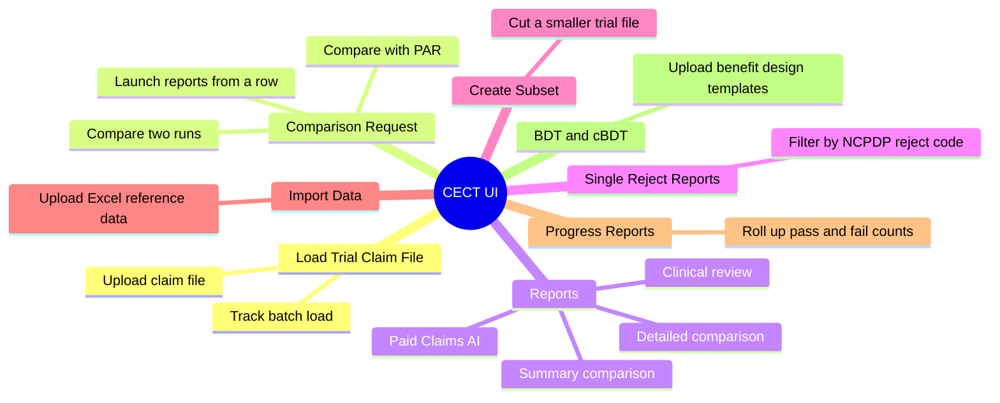

### The life of a job — in one picture

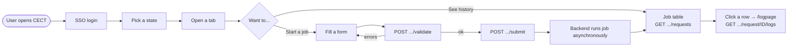

---

## 2. Business vocabulary you must know

You will see these words in field labels, variable names and endpoints. Learn them first — the code makes much more sense afterwards.

| Term | Meaning |
|---|---|
| **RxClaim** | Optum Rx's (AS/400-style) pharmacy-claims processing platform. Field names like *Library*, *Reply File*, *Wave*, *Data Queue* are RxClaim batch-job parameters. |
| **Trial claim** | A *test* claim pushed through RxClaim to see how it would adjudicate — not a real production claim. |
| **Trial Claim Batch Load** | Loading a whole file of trial claims into an RxClaim environment. |
| **Comparison request** | A job that **diffs** results of two runs (e.g. before vs. after a benefit/plan change). |
| **PAR** | A variant of comparison ("Compare Request with PAR") that compares against a PAR extract. |
| **Detailed / Summary / Clinical review report** | Report jobs generated *from* a finished comparison request. |
| **Single reject report** | A report filtered by **NCPDP reject codes** (e.g. `75`, `79`) from a comparison. |
| **Paid Claims AI report** | A newer report type produced by the CECT Paid-Claims AI service. |
| **Subset** | A smaller trial-claim file cut out of a bigger one. |
| **BDT / cBDT** | *Benefit Design Template* / *client BDT* — Excel files that describe a client's plan design. |
| **Environment** | An RxClaim region/instance the job runs against (fetched from `/api/rxclaim/environments`). |
| **Hist Org Code** | Historical organisation code, used to scope comparisons. |
| **State / stateCode** | ⚠️ *Geography*, **not** React state. Data is partitioned per US state; `CORE` means the cross-state core book and is sent to the backend as `ZZ`. |
| **ODI-Gov** | A separate deployment for **government** (state Medicaid) customers. Stricter rules: hidden tabs, state-based access, one session per user. Controlled by `CECT_IS_ODI_GOV_ENV`. |
| **MSID** | Optum's internal user ID / SSO identity provider. |
| **AD / MSAD groups** | Active Directory groups in the ID token; used for authorization. |
| **Skyline** | Optum Rx's internal Next.js "micro-product" template/platform this repo was generated from. |

---

## 3. Crash course: the technologies used

If you are new to the front-end world, here is the minimum you need.

| Layer | Technology | What it does here | Beginner analogy |
|---|---|---|---|
| Language | **TypeScript** | JavaScript + types | Java-like type checking for JS |
| UI library | **React 18** | Builds the UI from *components* (functions returning HTML-like JSX) | Each screen is a function |
| Framework | **Next.js 16 – Pages Router** | Every file in `src/pages/` becomes a URL; files in `src/pages/api/` become **server-side** HTTP endpoints | A web server + router in one |
| Components | **MUI v5** (Material UI), `material-react-table`, `@mui/x-date-pickers`, `react-dropzone`, `react-multi-select-component` | Buttons, tables, dialogs, date pickers, file drop zones | A widget toolkit |
| Styling | `@emotion/styled`, `@mui/styles` (`makeStyles`) | CSS-in-JS | CSS written inside TS files |
| HTTP | **axios** (browser), Node `http/https` (server proxy) | Calls the backend | `HttpClient` |
| Auth | `@uhg-optum-coreplatform/security-as-a-service-pkg`, `jsonwebtoken`, Node `crypto` (HMAC) | OAuth2 code exchange, JWT decoding, signed cookies | Spring Security, roughly |
| Logging | **winston** + `winston-splunk-httplogger` | Ships logs to **Splunk HEC** | log4j → Splunk |
| APM | `@elastic/apm-rum` | Browser performance traces to Elastic APM | New Relic / AppDynamics |
| Secrets | **HashiCorp Vault** (`node-vault`, AppRole) | Fetches SSO secret & Splunk token at start-up | A password safe |
| Build/Monorepo | npm **workspaces** + **Lerna** | One repo, multiple packages | Maven multi-module |
| Tests | **Jest** + React Testing Library, **Storybook** | Unit tests & component catalog | JUnit + a UI gallery |
| Runtime | **Node 24** Chainguard image on **Kubernetes** | Production container | — |

### Three React ideas you need

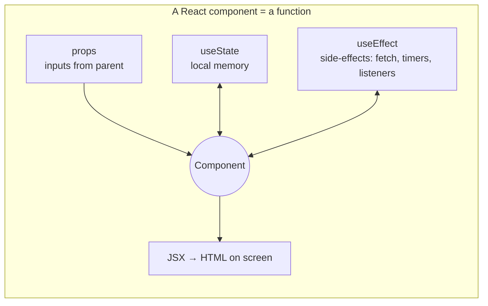

* **`useState`** — a variable that, when changed, re-renders the screen.
* **`useEffect(fn, [deps])`** — run `fn` after render; `[]` means "once on mount". Return a function to clean up.
* **Props** — read-only inputs passed from parent to child (e.g. `<ErrorPopup isOpen={true} />`).

### Two Next.js ideas you need

* **File-system routing**: `src/pages/Dashboard.tsx` → `http://host/Dashboard`. `src/pages/api/proxy.ts` → `http://host/api/proxy` (runs on the **server**, never in the browser).
* **`getServerSideProps`**: a function exported from a page that runs **on the server for every request**, before the page is sent to the browser. CECT uses it in `login.tsx` (to read SSO settings from env vars) and `index.tsx` (to perform the OAuth code exchange).

---

## 4. Repository layout — where everything lives

```text
claims-extract-comparison-tool-ui-2-0/
├── package.json                  ← root: npm workspaces, ALL dependencies, lint/format/build scripts
├── lerna.json, tsconfig*.json    ← monorepo + TypeScript config
├── jest.config.js, test-setup.js ← unit-test config
├── .eslintrc.js, prettier.config.js, .editorconfig
├── .husky/                       ← git hooks (pre-commit, pre-push)
├── .storybook/                   ← Storybook (component gallery) config
├── .github/
│   ├── workflows/cect-ui-build-deploy-workflow.yaml ← manual build+deploy pipeline
│   └── CODEOWNERS
├── deployment.yaml               ← Kubernetes Service + HPA + Deployment template
├── secrets.yaml, vitals.yaml, sonar.properties
├── server/OptumRootChainCert.pem ← corporate root CA (used to reach Vault)
├── static/fonts/                 ← Optum Sans / Proxima Nova fonts
├── docs/                         ← Skyline platform docs + THIS GUIDE
│
├── packages/cect-ui/cect-ui-components/   ← 📦 shared library  (@optum-rx/cect-ui-components)
│   └── src/
│       ├── common/
│       │   ├── cect-endpoints.ts  ← ⭐ API client: endpoint enum, getData/postData, stateCode logic
│       │   ├── getSecrets.js      ← reads secrets from Vault into process.env
│       │   └── vaultClient.js     ← Vault AppRole login + Splunk lifecycle logger
│       ├── header/Header/         ← ⭐ Header (logo, state dropdown, user menu, sign-out), Dock
│       ├── footer/Footer/         ← Footer (copyright + Terms of Use)
│       ├── header/useHeader, footer/useFooter ← scaffold hooks (unused placeholders)
│       └── index.ts               ← barrel export
│
└── surfaces/cect-ui/                      ← 🖥️ the Next.js application  (@optum-rx/cect-ui)
    ├── Dockerfile, next.config.js, package.json
    ├── server-lifecycle.js        ← ⭐ production entrypoint: Vault → logger → Next server → graceful shutdown
    ├── public/images/
    └── src/
        ├── pages/                 ← every .tsx here is a URL
        │   ├── _app.tsx           ← ⭐ global shell: theme, header/footer, inactivity timer, APM
        │   ├── index.tsx          ← ⭐ "/" — OAuth callback, creates session cookie
        │   ├── login.tsx, logout.tsx, LogoutPage.tsx, SessionExpired.tsx, health-check.tsx
        │   ├── Dashboard.tsx      ← ⭐ tab host + state selection
        │   ├── *Tab.tsx           ← job-history tables (one per tab)
        │   ├── *Form.tsx / *Request.tsx ← job-submission forms
        │   ├── logpage.tsx        ← shared "view logs for a job" page
        │   └── api/               ← server-side endpoints (BFF)
        │       ├── proxy.ts       ← ⭐ authenticated, allow-listed reverse proxy to backend
        │       ├── envConfig.tsx  ← exposes selected env vars to the browser
        │       ├── client-log.ts  ← receives browser logs → Splunk
        │       ├── session/extend.ts, session/logout.ts
        │       └── v1/ui-state.ts (state-selection cookie), v1/auth.ts (legacy stub)
        ├── server/auth-session.ts ← ⭐ HMAC-signed HttpOnly session cookie
        ├── common/                ← popups, banners, details.ts (user-session helpers), utils
        └── utils/clientLogger.ts, serverLogger.ts
```

### Monorepo relationships

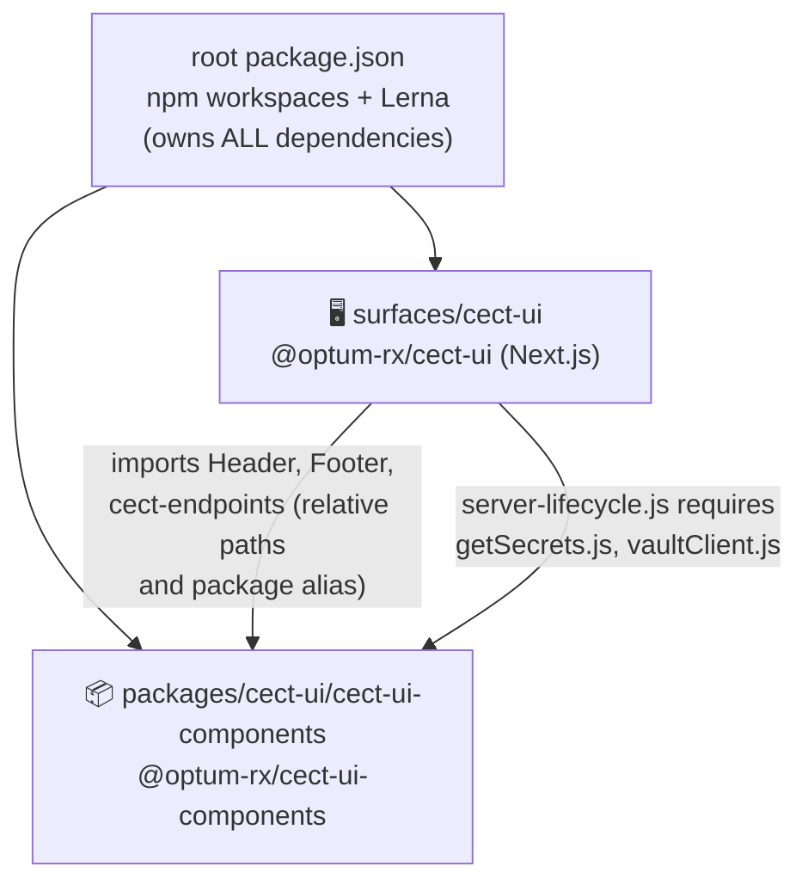

> 💡 **Gotcha:** the surface imports the library in **two different ways** — sometimes via the package alias `@optum-rx/cect-ui-components/src/common/cect-endpoints`, sometimes via long relative paths `../../../../packages/cect-ui/...`. Both resolve to the same file.

---

## 5. System architecture

### 5.1 Big picture (C4 "container" view)

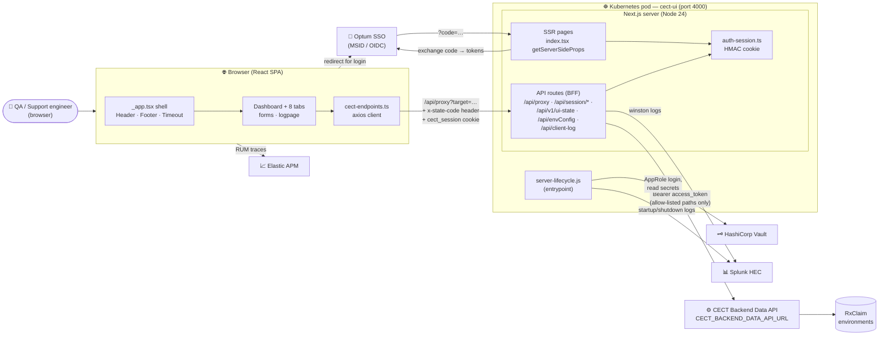

### 5.2 Layered view

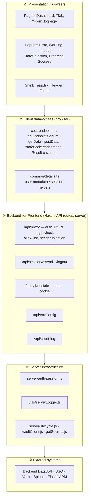

**Key architectural decisions (and why):**

| Decision | Why it matters |
|---|---|
| **BFF proxy (`/api/proxy`)** — the browser never calls the backend directly | The access token stays in an **HttpOnly cookie** on the server; the browser cannot read or leak it. The proxy also enforces an allow-list (prevents SSRF) and same-origin checks (CSRF). |
| **Signed stateless session cookie** (no server-side session store) | Pods can be restarted/scaled without losing sessions. The cookie is HMAC-SHA256 signed so it cannot be forged. |
| **State code on every job request** | Multi-tenant data partitioning — the backend routes work by state. |
| **Validate-then-submit** for every job | Backend checks the job definition first and returns field-level errors before anything is queued. |
| **Pages Router + client-side rendering** | Almost all pages are rendered in the browser; only `/` (OAuth callback), `/login` (builds SSO settings from env) and `/health-check` use `getServerSideProps`. |

---

## 6. Deployment architecture & server lifecycle

### 6.1 Build → image → cluster

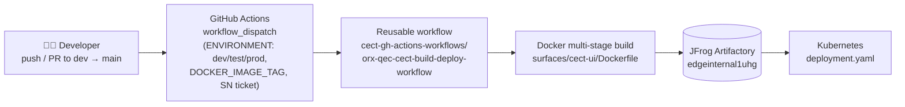

### 6.2 Docker multi-stage build

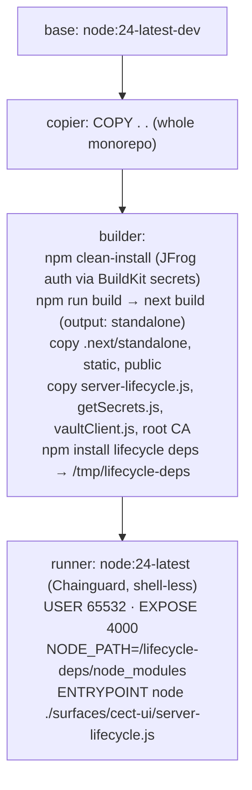

### 6.3 Kubernetes topology

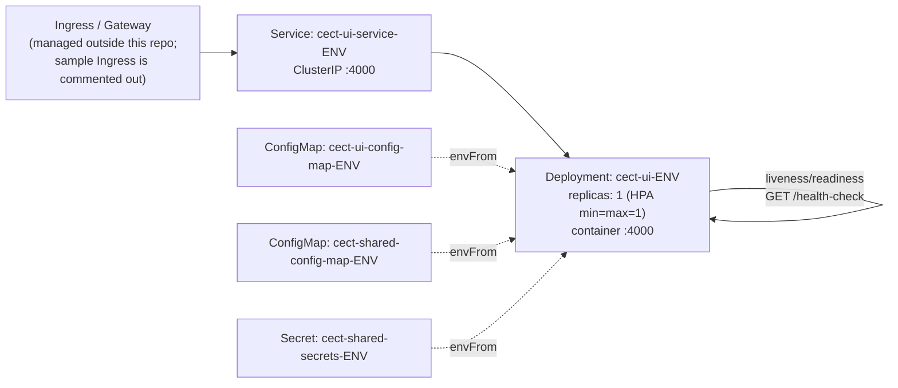

> `##sub-environment##`, `##k8s-namespace##` and `##docker-image-url##` in `deployment.yaml` are placeholders substituted by the reusable pipeline.

### 6.4 `server-lifecycle.js` — what actually runs in the container

This wrapper exists so that **startup and shutdown events reach Splunk**, and so secrets are loaded **before** Next.js reads `process.env`.

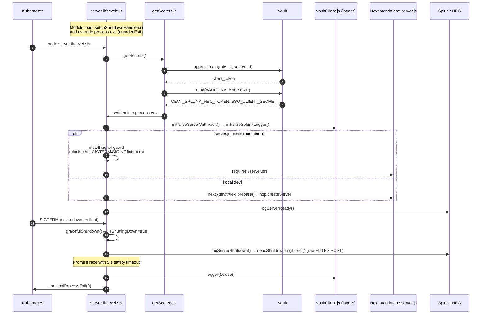

**Why the signal guard?** Next.js standalone registers its own `SIGTERM` handler that calls `process.exit(0)` immediately — before the async Splunk log can be sent. The wrapper overrides `process.on/addListener/once` to swallow any other `SIGTERM`/`SIGINT` registration and overrides `process.exit` to be a no-op while shutdown is in progress.

---

## 7. Authentication & login flow

### 7.1 Pages involved

| URL | File | Role |
|---|---|---|
| `/login` | `pages/login.tsx` | `getServerSideProps` reads `SSO_CLIENT_ID`, `SSO_REDIRECT_URL`, `ACTION`, `SSO_RESPONSE_TYPE`, `SSO_SCOPE`, `SSO_CLIENT_SECRET`, `SSO_ACR_VALUES`; shows a config error if any are missing. The client then calls `idpLogin(msidSettings)` once (guarded by a `useRef`) which redirects to Optum SSO. |
| `/` | `pages/index.tsx` | **OAuth callback**. `getServerSideProps` exchanges `?code` for tokens, enforces AD groups, sets the `cect_session` cookie, then the client stores user info in `sessionStorage` and routes to `/Dashboard`. |
| `/unauthorized` | *(no page file — Next 404)* | Redirect target when the user is not in a required AD group. |
| `/Dashboard` | `pages/Dashboard.tsx` | First real screen. |

### 7.2 Login sequence

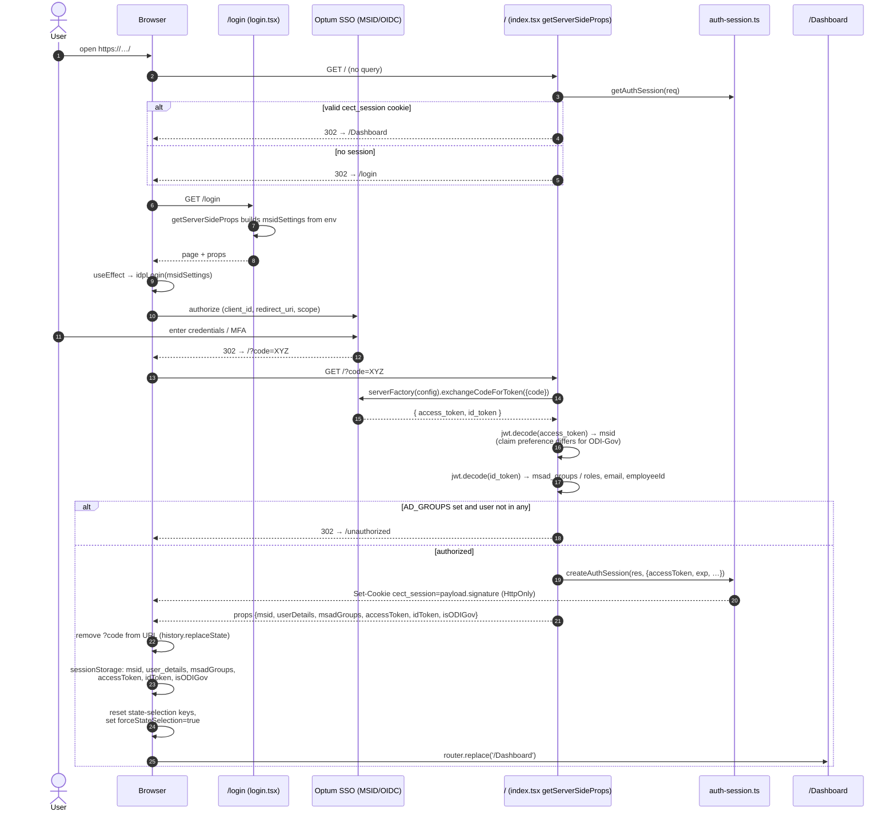

### 7.3 How the user identity is resolved (`index.tsx:182-208`)

| Data | Normal (commercial) | ODI-Gov |
|---|---|---|
| `msid` (first non-empty claim of access token) | `msid → username → upn → preferred_username → sub` | `username → msid → upn → preferred_username → sub` |
| Groups (from ID token) | `msad_groups` | `roles` |
| Employee ID (from ID token) | `employeeId` | `employeeID` |
| Redirect URI trailing slash | stripped | kept |

### 7.4 The session cookie (`server/auth-session.ts`)

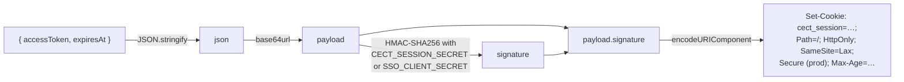

**Verification** (`decodeSessionCookie`): split on `.`, recompute the HMAC, compare with `crypto.timingSafeEqual` (prevents timing attacks), JSON-parse, check types, and `getAuthSession` additionally rejects if `expiresAt <= now`.

> ⚠️ **Important:** two copies of the access token exist: the secure **HttpOnly cookie** (used by the proxy) and a **copy in `sessionStorage`** (`accessToken`, `idToken`) set by `index.tsx` and read by `details.ts` to extract `empId` / expiry. The cookie is the one that actually authorizes API calls.

---

## 8. Session management, inactivity timeout & logout

### 8.1 Three clocks

| Clock | Where | Default | What happens |
|---|---|---|---|
| **Cookie expiry** | `auth-session.ts` | JWT `exp`, or 30 min if absent | Proxy returns **401** when expired. |
| **Inactivity warning** | `_app.tsx` | `SESSION_INACTIVE_TIME − SESSION_EXPIRY_AFTER_INACTIVE_TIME` = 30 − 5 = **25 min** | `TimeoutWarningPopup` shows a countdown. |
| **Inactivity expiry** | `_app.tsx` | `SESSION_INACTIVE_TIME` = **30 min** | `router.replace('/SessionExpired')`. |

Activity = any `mousemove` or `keydown` on `window`. Pages `/logout`, `/sessionexpired`, `/login` are excluded.

### 8.2 Inactivity state machine

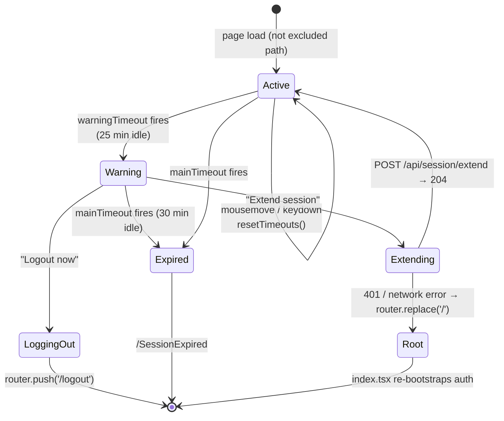

### 8.3 Extend session sequence

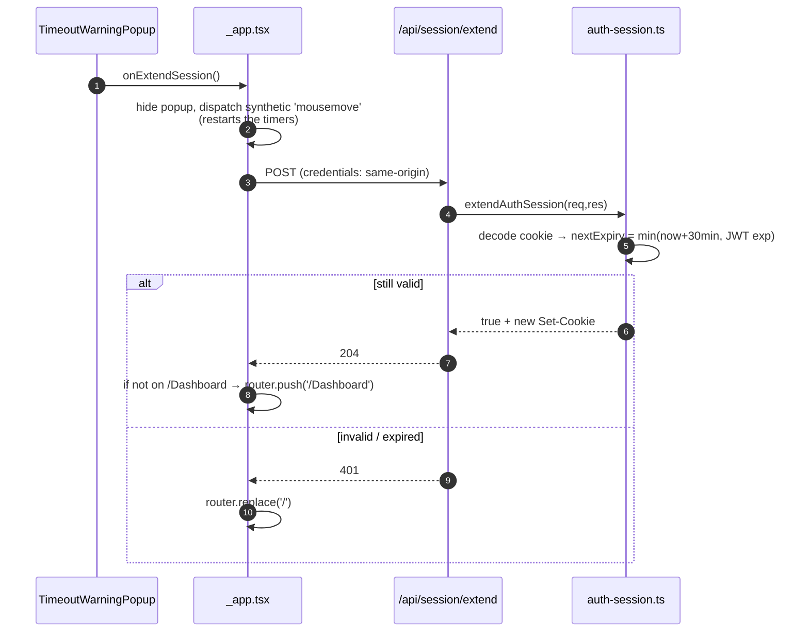

### 8.4 Logout paths

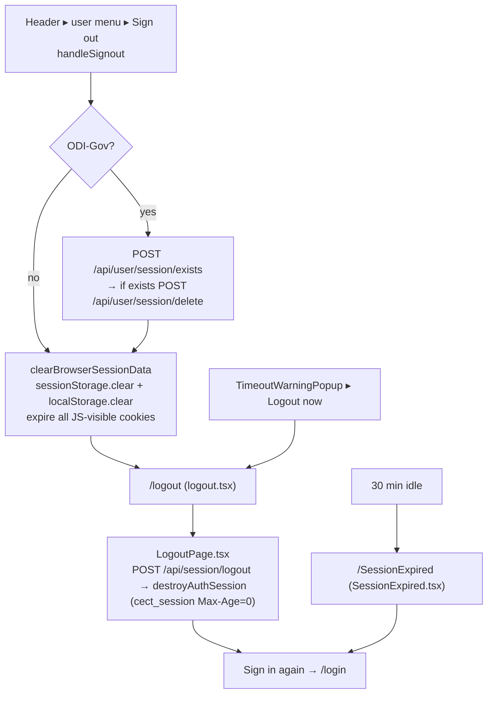

> Note: `cect_session` and `cectUiState` are **HttpOnly**, so `clearBrowserSessionData` (JavaScript) cannot delete them — that is why the server endpoint `/api/session/logout` exists.

### 8.5 Single-session enforcement & user metadata (`common/details.ts`)

Called once from the Dashboard on first load (`saveUserDetailsFromAccessToken`):

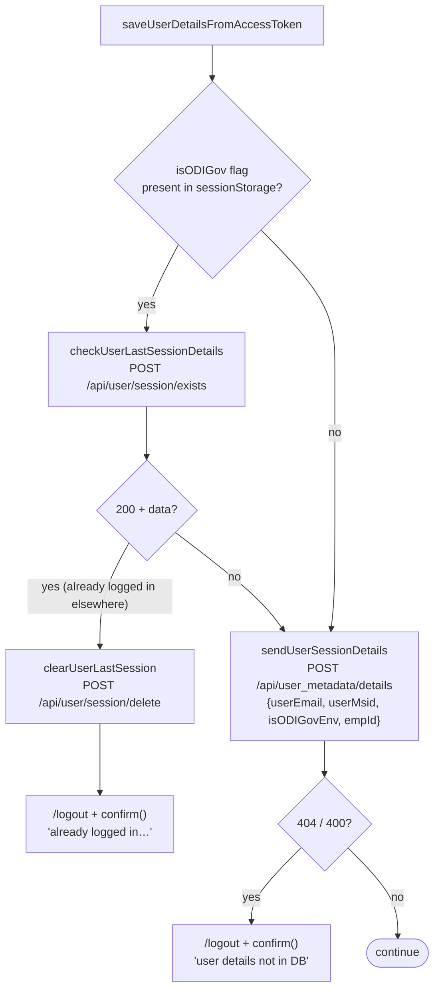

> ⚠️ `if (isODIGov)` checks the **string** from `sessionStorage`, so `"false"` is truthy too — in practice the single-session check runs for **every** user whenever the key exists. See §17.

---

## 9. The Dashboard & multi-state (tenant) selection

`pages/Dashboard.tsx` is the **tab host**. It (1) bootstraps user/session info, (2) forces the user to choose a **state**, (3) restores the correct tab when returning from a form or log page, and (4) renders the 8 tabs.

### 9.1 Tabs

| Index | Label | Component | Hidden for ODI-Gov? |
|---|---|---|---|
| 0 | Load Trial Claim File | `TrialClaimBatchLoadTab` | ✅ hidden |
| 1 | Comparison Request | `ComparsionRequestTab` | — (default tab for ODI-Gov) |
| 2 | Reports | `ReportsTab` | — |
| 3 | Single Reject Reports | `SingleRejectReportTab` | — |
| 4 | Create Subset | `CreateSubsetTab` | — |
| 5 | Import Data | `ImportDataTab` | — |
| 6 | Progress Reports | `ProgressReportTab` | — |
| 7 | BDT/cBDT | `BDTcBDTRequestTab` | ✅ hidden |

`CustomTabPanel` renders **only** the active tab's children (`value === index && …`) — inactive tabs are unmounted, so each tab refetches its data when shown.

### 9.2 Dashboard bootstrap flow

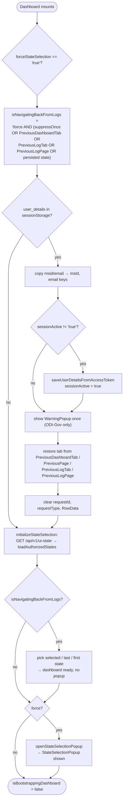

### 9.3 Loading authorized states

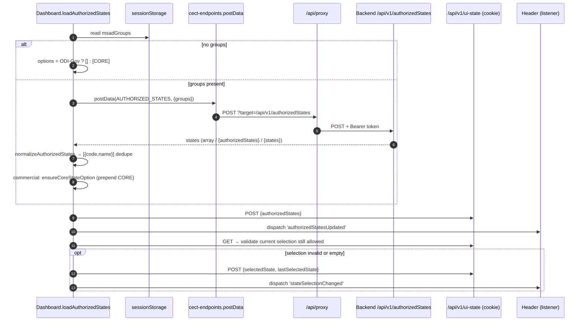

### 9.4 Where the selected state lives (three places, kept in sync)

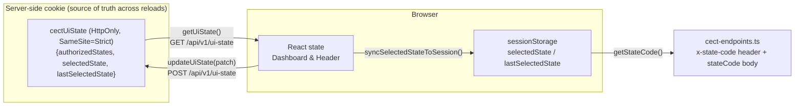

### 9.5 Cross-component events (the "event bus")

Dashboard, Header and the popups talk via **`window` custom events** rather than React context:

| Event | Fired by | Listened by | Effect |
|---|---|---|---|
| `stateSelectionChanged` (detail = code) | Dashboard, Header `handleStateSelect` | Dashboard, Header | Header updates dropdown; Dashboard jumps to tab 0 (or 1 for ODI-Gov) and bumps the `refreshKey` to remount that tab. |
| `authorizedStatesUpdated` | Dashboard `loadAuthorizedStates` | Header | Header reloads dropdown options. |
| `openStateSelectionPopup` | *(any component)* | Dashboard | Re-opens the state popup. |
| `themeLoaded` | `_app.tsx` | *(none in repo)* | Runtime theme loaded. |

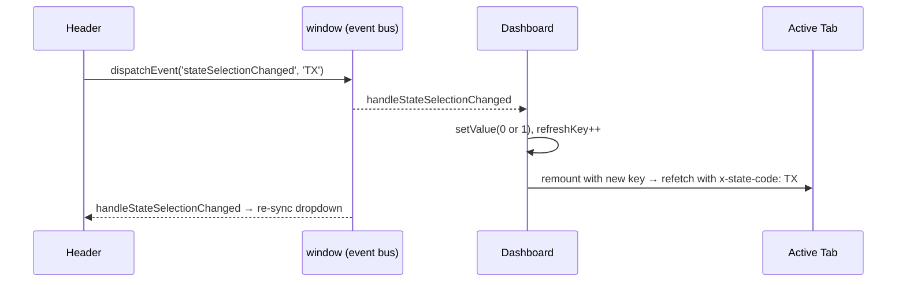

### 9.6 "Return to the right tab" — the navigation-memory mechanism

Forms and the log page are **separate pages**, so when the user comes back, Dashboard must reopen the tab they came from. This is done with `localStorage` breadcrumbs:

| Key | Written by | Read by Dashboard → tab |
|---|---|---|
| `PreviousPage` | Forms on mount (`router.asPath`); PAR form on Back | `/ComparsionRequestForm`, `/CompareRequestWithPARForm`, `/Detailed…`, `/Summary…`, `/Clinical…`, `/SingleRejectReportRequest` → 1; `/CreateSubsetForm` → 4; `/ImportDataForm` → 5; `/BdtCBdtForm` → 7; `/PaidClaimAIReportRequest` → 2 |
| `PreviousLogPage` / `PreviousLogTab` | `logpage.tsx` Back button | Tab index directly |
| `PreviousDashboardTab` | Form "Back" links | Tab index directly |
| `requestId`, `requestType`, `RowData` | Tabs when a row is clicked | `logpage.tsx`, report forms |

```mermaid
sequenceDiagram
    actor U as User
    participant T as ComparsionRequestTab (tab 1)
    participant LS as localStorage
    participant F as DetailedComparsionReportRequest
    participant D as Dashboard
    U->>T: select a row, choose "Detailed report"
    T->>LS: RowData, requestId
    T->>F: router.push('/DetailedComparsionReportRequest')
    U->>F: Submit, then Back
    F->>LS: (on mount) PreviousPage = '/DetailedComparsionReportRequest'
    F->>LS: (Back link) PreviousDashboardTab = '2'
    F->>D: navigate to /Dashboard
    D->>LS: PreviousDashboardTab wins → setValue(2) → remove keys
```

---

## 10. The API client & the hardened proxy

Every backend call follows the same path: **component → `cect-endpoints.ts` → `/api/proxy` → backend**.

### 10.1 `cect-endpoints.ts` — the browser API client

File: `packages/cect-ui/cect-ui-components/src/common/cect-endpoints.ts`

| Export | Kind | Purpose |
|---|---|---|
| `apiEndpoints` | `enum` | ~55 relative backend paths (see [Appendix B](#appendix-b--backend-endpoint-catalogue)). |
| `pageName` | `enum` | App routes: `HOME_PAGE=/Dashboard`, `LOGIN`, `LOGOUT`, `UNAUTHORIZED`, `SESSION_EXPIRED`. |
| `apiTargetProxy` | axios instance | `baseURL = (NEXT_PUBLIC_PROXY_URL ‖ '/api/proxy') + '?target='`, JSON content type. |
| `getData(url)` | async fn | GET via proxy; returns a `Result` envelope. |
| `postData(url, body)` | async fn | POST via proxy; adds `stateCode`; returns a `Result` envelope. |
| `getEnvConfig()` | async fn | `GET /api/envConfig` (direct, not via proxy). |

Internal helpers: `isBrowser`, `isODIGovEnv`, `getSelectedStateForODI`, `getStateCode`, `shouldAttachStateCodeToPost`, `enrichPostPayloadWithStateCode`, `getStateCodeHeader`, `shouldAttachStateCodeToGet`, `getBackendapiTargetProxy`.

**The `Result` envelope** — callers never get exceptions for HTTP errors:

```ts
interface Result { statusCode: number; errorMessage: string; data: object }
// 2xx       → { statusCode: 200|201, errorMessage: "",                   data: response.data }
// 4xx/5xx   → { statusCode: 4xx|5xx, errorMessage: "Internal server error" | axios msg, data: {} }
// no reply  → the raw XMLHttpRequest (no statusCode!)   ⚠️
```

**State-code rules:**

```mermaid
flowchart TD
    A["getStateCode()"] --> B{"sessionStorage.selectedState<br/>or lastSelectedState?"}
    B -- empty --> C{"isODIGov?"}
    C -- yes --> C1["'' (empty)"]
    C -- no --> C2["'ZZ'"]
    B -- "'CORE'" --> D["'ZZ'"]
    B -- "e.g. 'TX'" --> E["'TX'"]

    P["postData(url, body)"] --> Q{"url starts with<br/>/api/request_type/ ?"}
    Q -- no --> Q1["send body as-is, no header"]
    Q -- yes --> R{"body is a plain object<br/>without stateCode, and not a<br/>PROGRESS_REPORT endpoint?"}
    R -- yes --> R1["body + { stateCode }"]
    R -- no --> R2["body as-is"]
    R1 & R2 --> S["header x-state-code"]

    G["getData(url)"] --> H{"/api/request_type/* OR<br/>ENVIRONMENTS OR CLAIM_DATA_QUEUE_LIST?"}
    H -- yes --> H1["header x-state-code"]
    H -- no --> H2["no header"]
```

### 10.2 `/api/proxy` — the Backend-for-Frontend gatekeeper

File: `surfaces/cect-ui/src/pages/api/proxy.ts` (523 lines). This is the most security-sensitive file in the repo.

```mermaid
flowchart TD
    IN(["Request /api/proxy?target=/api/…"]) --> LOG["Log request<br/>(redact empId, userEmail, email, employeeId;<br/>truncate body > 500 chars; strip CR/LF)"]
    LOG --> A1{"getAuthSession(req)<br/>valid cect_session?"}
    A1 -- no --> R401["401 Unauthorized"]
    A1 -- yes --> A2{"target param present?"}
    A2 -- no --> R400a["400 Missing target"]
    A2 -- yes --> A3{"SSO_ORIGIN set and<br/>request hostname matches?"}
    A3 -- no --> R403a["500 / 403 Invalid origin"]
    A3 -- yes --> A4{"method is not GET/HEAD/OPTIONS<br/>and Origin header ≠ same host?"}
    A4 -- yes --> R403b["403 Forbidden (CSRF guard)"]
    A4 -- no --> A5{"CECT_BACKEND_DATA_API_URL set?"}
    A5 -- no --> R500["500"]
    A5 -- yes --> A6{"target in ALLOWED_TARGET_PATTERNS?<br/>(~42 exact strings + 14 regexes)"}
    A6 -- no --> R400b["400 Invalid target"]
    A6 -- yes --> A7["Cache-Control: no-store"]
    A7 --> A8{"sensitive target (user_metadata/*,<br/>user/session/*) and method ≠ POST?"}
    A8 -- yes --> R405["405"]
    A8 -- no --> MAP["Map target → newTarget<br/>list & env endpoints: append ?stateCode=…<br/>log endpoints: re-encode ID"]
    MAP --> HOST{"resolved host ∈ ALLOWED_HOSTS?"}
    HOST -- no --> R400c["400"]
    HOST -- yes --> FWD["http(s).request(backend)<br/>Authorization: Bearer accessToken<br/>POST/PUT body + stateCode (if missing)"]
    FWD --> OUT(["Stream back status + body"])
```

**Defence-in-depth summary:**

| Threat | Mitigation in `proxy.ts` |
|---|---|
| Stolen token via XSS | Token lives in an HttpOnly cookie; injected server-side as `Authorization: Bearer`. |
| SSRF (proxy used to reach internal hosts) | Exact-match/regex allow-list of paths + `ALLOWED_HOSTS` check on the resolved URL. |
| CSRF | `Origin` must equal the request host for state-changing methods; cookie is `SameSite=Lax`. |
| Log injection | `sanitizeForLog` strips `\r\n`. |
| PII in logs | Body fields `empId/userEmail/email/employeeId` redacted. |
| Caching of user data | `Cache-Control: no-store, private` + `Pragma: no-cache`. |
| Wrong verb on sensitive endpoints | `SENSITIVE_TARGET_METHOD_POLICY` (POST-only). |

### 10.3 A generic request, end-to-end

```mermaid
sequenceDiagram
    autonumber
    participant F as Form component
    participant EP as cect-endpoints.postData
    participant AX as axios (apiTargetProxy)
    participant PX as /api/proxy (Next server)
    participant AS as auth-session
    participant BE as Backend Data API

    F->>EP: postData(IMPORT_DATA_VALIDATE, {environment, msId, fields})
    EP->>EP: enrichPostPayloadWithStateCode → + stateCode
    EP->>AX: POST /api/proxy?target=/api/request_type/import_excel_data/validate<br/>x-state-code: TX
    AX->>PX: HTTP (browser sends cect_session cookie automatically)
    PX->>AS: getAuthSession(req)
    AS-->>PX: { accessToken }
    PX->>PX: origin check · allow-list · method policy · map target
    PX->>BE: POST …/validate  Authorization: Bearer …
    BE-->>PX: 200 { errors: [] }
    PX-->>AX: 200 body
    AX-->>EP: response
    EP-->>F: { statusCode: 200, errorMessage: "", data: { errors: [] } }
```

---

## 11. Feature walkthroughs (every tab, every form)

### 11.0 Two shapes repeat everywhere

Once you understand these two shapes, you understand 80 % of the UI.

#### Shape A — the **Tab** (job history list)

```mermaid
flowchart LR
    M([mount]) --> U["read sessionStorage.user_details → user"]
    U --> W{"user.msid known?"}
    W -- yes --> FD["fetchData()<br/>getData(…_LIST)"]
    FD --> MAP["map rows: timestamp → renderDateFormat,<br/>userName ← requesterId"]
    MAP --> T["MaterialReactTable<br/>filters · single select · Refresh button"]
    T -- "📄 log icon<br/>handleClick(row)" --> LS["localStorage: requestId,<br/>requestType, RowData"] --> LP["/logpage"]
    T -- "'New …' button" --> FORM["/…Form page"]
```

#### Shape B — the **Form** (job submission) — *validate-then-submit*

```mermaid
sequenceDiagram
    autonumber
    actor U as User
    participant F as Form page
    participant API as postData()
    participant E as ErrorPopup
    participant P as ProgressMessageBanner
    participant S as SuccessMessageBanner
    F->>API: mount: getData(ENVIRONMENTS) (+ queues / hist codes)
    U->>F: fill controlled inputs (handleChange → setData)
    U->>F: Submit (handleSubmit)
    F->>P: progressOpen = true (button shows "Submitting...")
    F->>API: POST …/validate  {environment, msId, fields{…}} (+stateCode)
    alt data.errors.length > 0
        API-->>F: 200 { errors: [...] }
        F->>P: close
        F->>E: open with errors
    else statusCode == 200
        F->>API: POST …/submit (same payload)
        API-->>F: 201 Created
        F->>P: close
        F->>F: reset form
        F->>S: show "Form submitted successfully!"
    end
    U->>F: "Back" → PreviousDashboardTab = N,<br/>suppressStateSelectionOnce = true → /Dashboard
```

> ⚠️ **Common bug:** if `/submit` returns anything other than 201 (or `/validate` returns non-200 without `errors`), most forms never reset `progressOpen` — the button stays disabled. See §17.

> ⚠️ **No file content is ever uploaded.** Forms with file pickers (Create Subset, Import Data, BDT/cBDT) send **only the file names**. There is no `FormData`/multipart anywhere — the backend expects the files to already exist on a shared location (NAS).

### 11.1 Feature → page → endpoint map

```mermaid
flowchart LR
    subgraph Dashboard
      T0["Tab 0<br/>TrialClaimBatchLoadTab"]
      T1["Tab 1<br/>ComparsionRequestTab"]
      T2["Tab 2<br/>ReportsTab"]
      T3["Tab 3<br/>SingleRejectReportTab"]
      T4["Tab 4<br/>CreateSubsetTab"]
      T5["Tab 5<br/>ImportDataTab"]
      T6["Tab 6<br/>ProgressReportTab"]
      T7["Tab 7<br/>BdtCBdtRequestTab"]
    end
    T0 -- "New Trial Claim Job +" --> F0["/TrialClaimFileLoadRequestForm"]
    T0 -- "Launch Compare (row)" --> F1["/ComparsionRequestForm"]
    T1 -- "More Actions ▾" --> R1["/DetailedComparsionReportRequest"]
    T1 -- "More Actions ▾" --> R2["/SummaryComparsionReportRequest"]
    T1 -- "More Actions ▾" --> R3["/ClinicalComparsionReportRequest"]
    T1 -- "More Actions ▾" --> R4["/SingleRejectReportRequest"]
    T1 -- "ODI-Gov only" --> F1P["/CompareRequestWithPARForm"]
    T2 -- "Detailed row (non-ODI)" --> R5["/PaidClaimAIReportRequestForm"]
    T4 -- "Create Subset +" --> F4["/CreateSubsetForm"]
    T5 -- "New Import +" --> F5["/ImportDataForm"]
    T7 -- "Upload BDT/cBDT +" --> F7["/BdtCBdtForm"]
    T6 -. "inline submit<br/>(no separate page)" .-> T6
    T0 & T1 & T2 & T3 & T4 & T5 & T7 -- "📄 row icon" --> LOG["/logpage"]
```

| Tab | List endpoint (GET) | Form(s) | Validate / Submit endpoints (POST) |
|---|---|---|---|
| 0 Trial Claim | `rxclaim_batch_trial_claim/requests` | TrialClaimFileLoadRequestForm | `rxclaim_request_claim_submission/{validate,submit}` |
| 1 Comparison | `rxclaim_comparison_request/requests` | ComparsionRequestForm · CompareRequestWithPARForm | `rxclaim_request_comparison_extract/…` · `rxclaim_request_comparison_par_extract/…` |
| 2 Reports | `getAllRequests` | Detailed · Summary · Clinical · PaidClaimAI | `create_detailed_comparison_report/…` · `create_summary_comparison_report/…` · `create_clinical_review_report/…` · `paid_claims_ai_report/…` |
| 3 Single Reject | `create_single_reject_report/requests` | SingleRejectReportRequest | `create_single_reject_report/…` |
| 4 Create Subset | `create_trial_claim_subset_file/requests` | CreateSubsetForm | `create_trial_claim_subset_file/…` |
| 5 Import Data | `import_excel_data/requests` | ImportDataForm | `import_excel_data/…` |
| 6 Progress | `create_progress_report/getCompareJobs` | *(inline)* | `create_progress_report/…` |
| 7 BDT/cBDT | `bdt_cbdt_files/requests` | BdtCBdtForm | `bdt_cbdt_files/…` (+ `versions` GET) |

*(All paths are prefixed with `/api/request_type/`.)*

---

### 11.2 Tab 0 — Load Trial Claim File

**`TrialClaimBatchLoadTab.tsx`** (hidden for ODI-Gov)

| Column | Field |
|---|---|
| Date Run | `timestamp` |
| Client Name | `client` |
| Short Note | `jobNote` |
| Load File Name | `trialFileName` |
| Library | `library` |
| User | `userName` |
| Status | `status` |

| Function | What it does |
|---|---|
| `useEffect [user.msid != undefined]` | Loads `user_details`; once `msid` is known calls `callUserDetails()` and `fetchData()`. |
| `fetchData()` | `getData(TRIAL_CLAIM_BATCH_LOAD_LIST)` → format timestamps → `setRows`. |
| `useEffect [rowSelection]` | Stores selected row id in `localStorage.requestId`; enables **Launch Compare**. |
| `handleClick(row)` | Stores `requestId`, `requestType="TrailClaim"`, `RowData` for `/logpage`. |
| `callUserDetails()` | `checkUserActiveStatus()` (details.ts) → POST `user_metadata/userstatus`; logs out users inactive > 60 days. |

**`TrialClaimFileLoadRequestForm.tsx`**

| Field (`data.*`) | Default | Required |
|---|---|---|
| `environment` (select from `/rxclaim/environments`) | — | ✅ |
| `inputFileName`, `inputLibrary` | `*LIBL` | ✅ |
| `replyFileName`, `replyLibrary` | — | |
| `client`, `wave` | — | ✅ |
| `wavePart`, `shortNote` | — | |
| `member` | `*FIRST` | ✅ |
| Claim data queue (derived) | from `dataQueue[environment]` | ✅ (read-only) |
| `extract`, `overridePlanAndEligibility` | `N` | ✅ (2nd) |
| `planOverride`, `planFromDate` (MM/DD/YY), `priceScheduleOverride` | — | |
| `reasonCode` | — | ✅ |

| Function | What it does |
|---|---|
| `fetchEnvDetails()` | GET `ENVIRONMENTS` → `envList`. |
| `fetchDataQueueDetails()` | GET `CLAIM_DATA_QUEUE_LIST` → `{env: queue}` map. |
| `selectChange(e)` | Sets environment **and** auto-fills `claimDataQueue = dataQueue[env]` (derived field). |
| `handleChange(e)` | Generic controlled-input updater: `setData({...data, [name]: value})`. |
| `handleSubmit(e)` | Payload `{environment, fields:{…all fields…, claimDataQueue}, msId}` → `RXCLAIM_REQUEST_CLAIM_VALIDATE` → `…_SUBMIT`. |
| `handleShowError / handleCloseError / handleCloseSuccess` | Popup/banner toggles. |

---

### 11.3 Tab 1 — Comparison Request

**`ComparsionRequestTab.tsx`**

| Column | Field |
|---|---|
| Date Run · Client Name · Short Note · Job ID · User · Status | `timestamp` · `client` · `jobNote` · `jobNumber` · `userName←requesterId` · `status` |

| Function | What it does |
|---|---|
| `useEffect [rowSelection]` | Stores `requestId`; `getReportType(id)`; enables **More Actions**. |
| `fetchData()` | GET `COMPARSION_LIST` → map rows. |
| `selectChange(e)` | **Router for reports**: `createDetailedReport` → `/DetailedComparsionReportRequest`, `createSummaryReport` → `/Summary…`, `createClinicalReport` → `/Clinical…`, `createSingleRejectReport` → `/SingleRejectReportRequest`. |
| `getReportType(id)` | Saves the selected row as `localStorage.CompTabRowData` (read by the Paid Claims AI form). |
| `handleClick(row)` | Log navigation, `requestType="ComparsionLogs"`. |

> The "New Compare Request +" button is commented out — commercial users start a comparison only through **Launch Compare** on Tab 0. ODI-Gov users get **Compare request with PAR**.

**`ComparsionRequestForm.tsx`** — prefilled from the trial job selected on Tab 0.

```mermaid
sequenceDiagram
    participant T0 as TrialClaimBatchLoadTab
    participant LS as localStorage
    participant F as ComparsionRequestForm
    participant API as Backend
    T0->>LS: requestId = selected trial job
    T0->>F: Link → /ComparsionRequestForm
    F->>API: GET rxclaim_batch_trial_claim/request/{requestId}
    API-->>F: environment, startDate/endDate, startTime/endTime, jobNote, jobNumber
    F->>F: prefill addFrom/To Date & Time, trialClaimJobNumber
    F->>API: GET environments, GET histOrgCodes
    F->>API: POST rxclaim_request_comparison_extract/validate → /submit
```

| Field | Default | Required |
|---|---|---|
| `environment`, `carrier` | prefilled / — | ✅ |
| `account`, `group` | `*ALL` | ✅ |
| `fillFromDate`, `fillToDate`, `addFromDate`, `addToDate` (MM/DD/YY) | add-dates prefilled | ✅ |
| `addFromTime`, `addToTime` (HHMMSS) | prefilled | ✅ |
| `hstorig` (select from `histOrgCodes`) | `K` | ✅ |
| `trialClaimJobNumber` | prefilled | ✅ |
| `waveCycle` ("Cycle"), `jobNote` | — | |

Payload: `{environment, waveCycle, jobNote, trialClaimJobNumber, msId, id, fields:{carrier, account, group, fillFromDate, fillToDate, addFromDate, addToDate, addFromTime, addToTime, hstorig, trialClaimJobNumber}}`.

**`CompareRequestWithPARForm.tsx`** (ODI-Gov) — simplest, best-typed form: `{environment, clientName, jobNumber, shortNote, msId}` (flat — no `fields` wrapper) → `rxclaim_request_comparison_par_extract/{validate,submit}`. Accepts 200 or 201 as success. Has `handleClear()` and no progress banner.

---

### 11.4 Tab 2 — Reports

**`ReportsTab.tsx`** lists **all** report jobs (`GET getAllRequests`).

| Column | Field |
|---|---|
| Date Run · Client Name · Report Type · Short Note · User · Status | `timestamp` · `client` · `type` · `jobNote` · `userName` · `status` |

Report `type` values recognised: `Detailed Comparison`, `Summary Comparison`, `Clinical Review`, `Paid Claims AI Report` — they become `requestType` for `/logpage`.

| Function | What it does |
|---|---|
| `useEffect []` | Reads `user_details` (try/catch) and `isODIGov`. |
| `useEffect [user]` | Fetches when `msid` known; clears stale `ReportTabRowData`. |
| `fetchData()` | GET `GET_ALL_REPORTS` → map rows. |
| `useEffect [rowSelection]` | Enables **Launch Paid Claims AI** only if the selected row's type is `Detailed Comparison`. |
| `getReportType(id)` | Saves row as `ReportTabRowData`; returns its `type`. |
| `handleClick(row)` | Log navigation with `requestType = row.type`. |

**Comparison report forms** — Detailed / Summary / Clinical are ~95 % identical:

| Form | Fields | Endpoint pair |
|---|---|---|
| `DetailedComparsionReportRequest.tsx` | environment, jobNumber, outputName | `create_detailed_comparison_report` |
| `SummaryComparsionReportRequest.tsx` | environment, jobNumber, outputName | `create_summary_comparison_report` |
| `ClinicalComparsionReportRequest.tsx` | + `passingTiers` (multiline, default `"98\n00"`) | `create_clinical_review_report` |

Each: `fetchData()` prefills `environment`/`jobNumber` from `GET rxclaim_comparison_request/request/{requestId}`; payload `{environment, jobNumber, outputName, [passingTiers], compReqId: requestId, msId}`.

**`PaidClaimAIReportRequestForm.tsx`** — creates an AI-generated paid-claims report.

```mermaid
flowchart LR
    A["mount: read ReportTabRowData<br/>or CompTabRowData"] --> B["prefill read-only:<br/>environment, jobNumber, client, shortNote<br/>+ compRequestId or detailCompRequestId"]
    C["user types in Autocomplete"] --> D["useEffect [inputValue]<br/>200 ms debounce"]
    D --> E["GET bdt_cbdt_files/versions?q=…"]
    E --> F["filteredOptions (useMemo):<br/>contains-match, dedupe,<br/>sort by match position, top 15"]
    F --> G["user picks version label"]
    G --> H["handleSubmit: label → versionId<br/>{fields:{environment, jobNumber, outputName,<br/>isSaveAIRulesFile, bdtCbdtVersionId, msId,<br/>compRequestId, detailCompRequestId, client, shortNote}}"]
    H --> I["POST paid_claims_ai_report/validate → submit<br/>success = 201 or 504"]
```

Functions: `fetchData`, `fetchbdtCbdtVersionIds(query)`, `escapeRegExp` (result unused), `filteredOptions` (memo), `handleChange`, `handleAiRulesChange`, `handleSubmit`, popup toggles.

---

### 11.5 Tab 3 — Single Reject Reports

**`SingleRejectReportTab.tsx`** — columns: Date Run, Client Name, Reject Code (`reportName`), Comparison Job ID (`jobNumber`), User, Status. GET `create_single_reject_report/requests`.

**`SingleRejectReportRequest.tsx`** (734 lines — the most complex report form)

```mermaid
flowchart TD
    M([mount, msid known]) --> A["fetchData: GET comparison request/{requestId}<br/>→ environment, jobNumber, client, wave, waveCycle<br/>outputName = jobNumber_client_Wwave_CwaveCycle_R"]
    A --> B["GET getRejectCodes/{jobNumber}<br/>→ MultiSelect options"]
    M --> C["fetchCarrierFromLogs:<br/>GET comparison request/{id}/logs<br/>regex /Carrier:\s*(…)/ on log text"]
    M --> D[fetchEnvDetails]
    B --> S{"user selects reject codes"}
    S -- "includes '79'" --> T["show Threshold section<br/>defaults: Retail C2–C5 = 90, Mail C2–C5 = 80,<br/>Non-controlled Retail 75 / Mail 70"]
    S -- otherwise --> U["clear threshold fields"]
    T --> V["handleChange: validateThresholdInput<br/>/^[0-9.,\s]*$/ — invalid keystroke rejected"]
    V --> W["handleSubmit: validate → submit<br/>success = 201 or 504"]
    U --> W
```

| Function | Purpose |
|---|---|
| `isThresholdFieldsEnabled()` | `'79'` (refill-too-soon) selected → show thresholds. |
| `isControlledFieldsEnabled()` | `'79'` or `'88'` selected (88 path has no visible effect). |
| `validateThresholdInput(value, field)` | Character filter + validation dialog. |
| `fetchData()`, `fetchEnvDetails()`, `fetchCarrierFromLogs()` | Prefill. |
| `handleChange`, `selectChange`, `handleSubmit`, popup toggles, `handleCloseValidationError` | Form plumbing. |

---

### 11.6 Tab 4 — Create Subset

**`CreateSubsetTab.tsx`** — columns: Date Run, Client Name, Short Note, User, Status. GET `create_trial_claim_subset_file/requests`.

**`CreateSubsetForm.tsx`** — fields: environment, claim data queue (derived, read-only), *Trial Claim List File* (drag-drop or Browse — **name only**), inputFileName ✅, inputLibrary ✅, replyFileName, replyLibrary, client ✅, shortNote ✅.

| Function | Purpose |
|---|---|
| `useDropzone({onDrop})` | First dropped file → `selectedFile`, `claimFileName`. |
| `handleFileChange` / `handleClearFile` | Hidden `<input type=file>` Browse / clear (uses `fileInputRef`). |
| `selectChange` | Environment → derived queue. |
| `handleSubmit` | `{environment, msId, fields:{claimFileName, inputFileName, inputLibrary, replyFileName, replyLibrary, client, shortNote, claimDataQueue}}` → `create_trial_claim_subset_file/{validate,submit}`. |

---

### 11.7 Tab 5 — Import Data

**`ImportDataTab.tsx`** — columns: Date Run, Client Name, User, Status. GET `import_excel_data/requests`.

**`ImportDataForm.tsx`** — fields: environment ✅, jobNumber ✅, client ✅, Excel report file (**name only**, no extension check). Payload `{environment, msId, fields:{jobNumber, client, excelReportFileName}}` → `import_excel_data/{validate,submit}`.

---

### 11.8 Tab 6 — Progress Reports

**`ProgressReportTab.tsx`** — the only tab that submits **inline** and shows the **result in a second table**.

```mermaid
sequenceDiagram
    actor U as User
    participant T as ProgressReportTab
    participant API as Backend
    T->>API: GET create_progress_report/getCompareJobs
    API-->>T: [{client, compJobNumber, wave, waveCycle}]
    U->>T: multi-select jobs (rowSelection keyed by compJobNumber)
    T->>T: selectedRows = Object.keys(rowSelection)
    U->>T: Submit
    T->>API: POST …/validate  ["JOB1","JOB2"]  (array body → no stateCode)
    alt errors
        T->>T: ErrorPopup
    else 200
        T->>API: POST …/submit (same array)
        API-->>T: 201 [{client, wave, waveCycle, pass, fail, blocked, notReviewed, paid, rejected, complete}]
        T->>T: render result table
    end
```

Columns (jobs): Client Name, Job ID, Wave, Cycle. Columns (result): Client Name, Wave, Cycle, Pass, Fail, Blocked, NR, Paid, Rejected, Complete.

---

### 11.9 Tab 7 — BDT/cBDT

**`BdtCBdtRequestTab.tsx`** (exported as `BDTcBDTRequestTab`, hidden for ODI-Gov) — columns: Date Run, Client Name, Unique BDT/cBDT ID (`bdtCbdtVersion`), Short Note, User, Status. Sorting enabled (only tab).

**`BdtCBdtForm.tsx`** (822 lines) — registers a set of Excel rule files under a unique version ID.

```mermaid
flowchart TD
    S["Submit"] --> V1["GET bdt_cbdt_files/versions"]
    V1 --> V2{"version already exists?<br/>(trim, case-insensitive)"}
    V2 -- yes --> E1["Error: Version '…' already exists"]
    V2 -- no --> M{"RxComet checkbox?"}
    M -- yes --> R1{"≥1 NAS file AND every name starts with RxComet_<br/>AND mapping file chosen AND<br/>mapping name ≠ any NAS name?"}
    M -- no --> N1{"≥1 NAS file AND every name starts with BDT_ or cBDT_<br/>AND exactly one BDT_ file?"}
    R1 -- no --> E2["Error list → ErrorPopup"]
    N1 -- no --> E2
    R1 -- yes --> VAL
    N1 -- yes --> VAL["POST bdt_cbdt_files/validate<br/>{fields:{client, version, shortNote, isMedicare,<br/>files[names], isRxComet, rxCometMappingFile,<br/>formatFiles[names], isNonStandardPlanCode,<br/>planCodeMappingFile, msId}}"]
    VAL --> SUB["POST …/submit → 201 → reset all + success"]
```

Upload inputs: NAS files (multi, `.xlsx`), RxComet mapping file, optional format files (second dropzone), optional non-standard plan-code mapping file. Checkboxes: **RxComet**, **Medicare** (RxComet only), **Non-standard plan code**.

Handlers: `handleNASFileChange`, `handleNasFilesClear`, `handleRxCometFileChange`, `handleRxCometFileClear`, `handleFormatFileChange`, `handleFormatFilesClear`, `handlePlanCodeMappingFileChange`, `handlePlanCodeMappingFileClear`, `handleChangeRxComet`, `handleMedicareTypeChange`, `handleChangeNonStandardPlanCode`, two `useDropzone` `onDrop`s, `handleSubmit`, popup toggles.

---

### 11.10 The shared log viewer — `/logpage`

`logpage.tsx` is **one page for every job type**, configured by `localStorage.requestType`:

| `requestType` | Logs endpoint (`…/{id}/logs`) | Header | Back → tab |
|---|---|---|---|
| `TrailClaim` | `rxclaim_batch_trial_claim/request/` | RxClaim Trial Claim Batch Load List | 0 |
| `ComparsionLogs` | `rxclaim_comparison_request/request/` | RxClaim Comparison Submission List | 1 |
| `Detailed Comparison` | `create_detailed_comparison_report/request/` | Detailed Comparison Report | 2 |
| `Summary Comparison` | `create_summary_comparison_report/request/` | Summary Comparison Report | 2 |
| `Clinical Review` | `create_clinical_review_report/request/` | Clinical Review Report | 2 |
| `Paid Claims AI Report` | `paid_claims_ai_report/request/` | Paid Claims AI Report | 2 |
| `Single_Reject_code` | `create_single_reject_report/request/` | Single Reject Report | 3 |
| `CREATE_SUBSET_TAB` | `create_trial_claim_subset_file/request/` | Create Trial Claim Subset File | 4 |
| `IMPORT_DATA_TAB` | `import_excel_data/request/` | Import Excel Data | 5 |
| `BDTcBDT` | `bdt_cbdt_files/request/` | Upload BDT/cBDT | 7 |

It renders a header from `RowData` (status, submitted by, time; client/wave/cycle for trial & comparison) and a **card per log entry** (`timestamp`, `titleContent`, optional base64 PNG screenshot `imageContent`).

---

## 12. Shared UI components, popups & the component library

### 12.1 The app shell

```mermaid
flowchart TB
    subgraph MyApp["_app.tsx — MyApp"]
      TP["ThemeProvider (OptumDefault) + CssBaseline"]
      subgraph AppShell["AppShell (100vh flex column)"]
        HC["HeaderContainer → Header"]
        CC["ContentContainer (scrolls) → current page Component"]
        FC["FooterContainer → Footer"]
      end
      TW["TimeoutWarningPopup (global)"]
    end
    TP --> AppShell
    TP --> TW
    HC --> H1["Logo"]
    HC --> H2["State dropdown (native select)"]
    HC --> H3["User menu → Sign out"]
    HC --> H4["Dock: 'Claim Extract Comparison Tool'"]
```

### 12.2 Popups & banners (`surfaces/cect-ui/src/common/`)

| Component | Props | Controlled by | Used for |
|---|---|---|---|
| `ErrorPopup` | `isOpen, onClose, errorMessageList[]` | parent | Server validation errors (dialog titled "Submit?"). |
| `ProgressMessageBanner` (file `ProgressMessage.tsx`) | `isOpen, onClose` | parent | "Your form is being submitted…" snackbar. |
| `SuccessMessageBanner` | `isOpen, onClose` | parent | "Form submitted successfully!" (auto-hide 6 s). |
| `TimeoutWarningPopup` | `isOpen, remainingTime, onExtendSession, onLogoutNow` | `_app.tsx` | Inactivity countdown (internal 1 s interval, `formatTime`). |
| `StateSelectionPopup` | `isOpen, selectedState, lastSelectedState?, isLoading, stateOptions?, onStateChange, onContinue, onClose?` | Dashboard | Searchable radio list of states with "Last selected" badge and loading view. |
| `WarningPopup` | — (self-managed `isOpen`) | itself | US Government system-use / monitoring notice (ODI-Gov, once per session). |

### 12.3 Component library package (`@optum-rx/cect-ui-components`)

| Export | Real or scaffold? | Notes |
|---|---|---|
| `Header` | ✅ real | Logo, state dropdown synced with `/api/v1/ui-state`, user menu, sign-out, embeds `Dock`. |
| `Dock` | ✅ real | Product-name bar. |
| `Footer` | ✅ real | Copyright + Terms of Use link. |
| `useHeader`, `useFooter` | 🧱 scaffold | Generated by Skyline CLI; return dummy values; unused. |
| `*.types.ts`, `*.stories.tsx`, `*.test.tsx` | 🧱 scaffold | Types (`HeaderProps {text}`) don't match the real `Header` props (`content`). |
| `cect-endpoints.ts` | ✅ real | API client (§10). |
| `getSecrets.js`, `vaultClient.js` | ✅ real (server only) | Vault + lifecycle logger (§15). |

**Header functions:** `syncSelectedStateToSession`, `getUiState`, `updateUiState`, `normalizeStateCode` (match by code, then name, else first option), `checkUserLastSessionDetails`, `clearUserLastSession`, `clearBrowserSessionData`, `syncSelectedStateFromServer`, `handleStateSelect`, `handleMoreMenuClick`, `handleMoreMenuClose`, `handleSignout`, plus listeners for `stateSelectionChanged` and `authorizedStatesUpdated`.

---

## 13. Class / data-model diagrams

> React function components aren't classes, but a class diagram is still the clearest way to show **what each module holds (state/fields) and exposes (functions/props)**. `<<component>>`, `<<module>>`, `<<api route>>` are stereotypes.

### 13.1 Core modules

```mermaid
classDiagram
    direction LR
    class cect_endpoints {
        <<module>>
        +apiEndpoints enum
        +pageName enum
        +apiTargetProxy AxiosInstance
        +getData(url) Promise~Result~
        +postData(url, body) Promise~Result~
        +getEnvConfig() Promise~object~
        -getStateCode() string
        -enrichPostPayloadWithStateCode(url, body)
        -getStateCodeHeader()
        -shouldAttachStateCodeToGet(url) bool
        -shouldAttachStateCodeToPost(url) bool
        -isODIGovEnv() bool
    }
    class Result {
        +statusCode number
        +errorMessage string
        +data object
    }
    class auth_session {
        <<module, server>>
        +createAuthSession(res, opts)
        +getAuthSession(req) AuthSession
        +extendAuthSession(req, res) bool
        +destroyAuthSession(req, res)
        -getSessionSecret() string
        -signPayload(payload) string
        -encodeSessionCookie(s) string
        -decodeSessionCookie(v) StoredAuthSession
        -getCookieValue(header, name)
        -getCookieOptions(maxAge) string
        -getJwtExpiryMs(token) number
    }
    class AuthSession {
        +accessToken string
        +expiresAt number
        +employeeId string
        +msid string
        +email string
        +msadGroups string[]
        +isODIGov boolean
    }
    class StoredAuthSession {
        +accessToken string
        +expiresAt number
    }
    class proxy_handler {
        <<api route>>
        +handler(req, res)
        -SENSITIVE_TARGET_METHOD_POLICY
        -ALLOWED_TARGET_PATTERNS
        -sanitizeForLog(v) string
        -isAllowedHost(url) bool
    }
    class ui_state_handler {
        <<api route>>
        +handler(req, res) GET/POST/DELETE
        -parseCookies(header)
        -readUiState(req) UiState
        -writeUiStateCookie(res, s)
        -clearUiStateCookie(res)
        -mergeUiState(cur, patch) UiState
        -normalizeAuthorizedStates(v)
        -normalizeString(v)
    }
    class UiState {
        +authorizedStates StateOption[]
        +selectedState string
        +lastSelectedState string
    }
    class StateOption {
        +code string
        +name string
    }
    cect_endpoints ..> Result : returns
    cect_endpoints ..> proxy_handler : HTTP /api/proxy
    proxy_handler ..> auth_session : getAuthSession
    auth_session ..> AuthSession
    auth_session ..> StoredAuthSession : cookie payload
    ui_state_handler ..> UiState
    UiState o-- StateOption
```

### 13.2 UI component hierarchy

```mermaid
classDiagram
    direction TB
    class MyApp {
        <<component _app.tsx>>
        -SESSION_INACTIVE_TIME
        -SESSION_EXPIRY_AFTER_INACTIVE_TIME
        -showTimeoutWarning
        -warningCountdown
        +handleExtendSession()
        +handleLogoutNow()
    }
    class Header {
        <<component>>
        -selectedState
        -stateOptions
        -user
        -moreEl
        +handleStateSelect(e)
        +handleSignout()
        +syncSelectedStateFromServer()
    }
    class Footer {
        <<component>>
    }
    class Dock {
        <<component>>
    }
    class TimeoutWarningPopup {
        <<component>>
        +isOpen
        +remainingTime
        +onExtendSession()
        +onLogoutNow()
        -countdown
        -formatTime(s)
    }
    class Dashboard {
        <<page>>
        -value tab index
        -isODIGov
        -selectedState
        -stateOptions
        -lastSelectedState
        -isDashboardReady
        -trialClaimRefreshKey
        -comparisonRefreshKey
        +loadAuthorizedStates()
        +handleStateContinue()
        +openStateSelectionPopup()
        +handleStatePopupClose()
        +normalizeAuthorizedStates(data)
    }
    class StateSelectionPopup {
        <<component>>
    }
    class WarningPopup {
        <<component>>
    }
    class CustomTabPanel {
        <<component>>
        +index
        +value
    }
    class TabComponent {
        <<abstract shape>>
        -rows
        -user
        -dataLoading
        -rowSelection
        +fetchData()
        +handleClick(row)
    }
    class FormComponent {
        <<abstract shape>>
        -data
        -envList
        -isErrorOpen
        -successOpen
        -progressOpen
        -errorMsgList
        +handleChange(e)
        +selectChange(e)
        +handleSubmit(e)
        +fetchEnvDetails()
    }
    class LogPage {
        <<page logpage.tsx>>
        -apiData CardData[]
        -headerContData
        -header
        +fetchData()
    }
    MyApp *-- Header
    MyApp *-- Footer
    MyApp *-- TimeoutWarningPopup
    Header *-- Dock
    MyApp o-- Dashboard : Component
    Dashboard *-- StateSelectionPopup
    Dashboard *-- WarningPopup
    Dashboard *-- "8" CustomTabPanel
    CustomTabPanel o-- TabComponent
    TabComponent ..> FormComponent : navigates to
    TabComponent ..> LogPage : navigates to
    FormComponent *-- ErrorPopup
    FormComponent *-- ProgressMessageBanner
    FormComponent *-- SuccessMessageBanner
    class ErrorPopup {
        <<component>>
    }
    class ProgressMessageBanner {
        <<component>>
    }
    class SuccessMessageBanner {
        <<component>>
    }
```

### 13.3 Concrete tabs & forms ("realisations" of the two shapes)

```mermaid
classDiagram
    direction LR
    class TabComponent {
        <<shape>>
    }
    class FormComponent {
        <<shape>>
    }
    TabComponent <|.. TrialClaimBatchLoadTab
    TabComponent <|.. ComparsionRequestTab
    TabComponent <|.. ReportsTab
    TabComponent <|.. SingleRejectReportTab
    TabComponent <|.. CreateSubsetTab
    TabComponent <|.. ImportDataTab
    TabComponent <|.. ProgressReportTab
    TabComponent <|.. BDTcBDTRequestTab
    FormComponent <|.. TrialClaimFileLoadRequestForm
    FormComponent <|.. ComparsionRequestForm
    FormComponent <|.. CompareRequestWithPARForm
    FormComponent <|.. DetailedComparsionReportRequest
    FormComponent <|.. SummaryComparsionReportRequest
    FormComponent <|.. ClinicalComparsionReportRequest
    FormComponent <|.. SingleRejectReportRequest
    FormComponent <|.. PaidClaimAIReportRequestForm
    FormComponent <|.. CreateSubsetForm
    FormComponent <|.. ImportDataForm
    FormComponent <|.. BdtCBdtForm
```

> Today these are **copy-pasted**, not actually shared. The diagram shows the *implicit* abstraction that a refactor (a generic `JobListTab` + `useValidateSubmit` hook) could make explicit.

### 13.4 Job / request data model (as seen by the UI)

```mermaid
erDiagram
    USER ||--o{ JOB_REQUEST : submits
    JOB_REQUEST ||--o{ LOG_ENTRY : has
    TRIAL_CLAIM_JOB ||--o| COMPARISON_JOB : "Launch Compare"
    COMPARISON_JOB ||--o{ REPORT_JOB : "More Actions"
    REPORT_JOB ||--o| PAID_CLAIMS_AI_JOB : "from Detailed"
    BDT_VERSION ||--o{ PAID_CLAIMS_AI_JOB : "rules version"
    STATE ||--o{ JOB_REQUEST : partitions

    USER {
        string msid
        string email
        string empId
    }
    JOB_REQUEST {
        string id
        string timestamp
        string client
        string jobNote
        string status
        string requesterId
        string stateCode
    }
    TRIAL_CLAIM_JOB {
        string trialFileName
        string library
        string jobNumber
        string environment
    }
    COMPARISON_JOB {
        string jobNumber
        string environment
        string wave
        string waveCycle
    }
    REPORT_JOB {
        string type
        string outputName
        string compReqId
    }
    PAID_CLAIMS_AI_JOB {
        string bdtCbdtVersionId
        bool isSaveAIRulesFile
    }
    BDT_VERSION {
        string versionId
        string version
    }
    LOG_ENTRY {
        string id
        number timestamp
        string titleContent
        string imageContent
    }
    STATE {
        string code
        string name
    }
```

---

## 14. Design patterns catalog

| # | Pattern | Category | Where | How it shows up |
|---|---|---|---|---|
| 1 | **Backend-for-Frontend (BFF) / Gateway** | Architectural | `pages/api/proxy.ts` | Browser talks only to the Next server; the server talks to the backend with the token. |
| 2 | **Proxy** (GoF) | Structural | `proxy.ts` | Same interface as the backend, adds auth, validation, logging. |
| 3 | **Facade** | Structural | `cect-endpoints.ts` | `getData/postData` hide axios, proxy URL, headers, state code and error shapes behind two functions. |
| 4 | **Adapter** | Structural | `getData/postData` → `Result`; `normalizeAuthorizedStates` | Converts axios responses/exceptions and three possible backend shapes (array, `{authorizedStates}`, `{states}`) into one shape. |
| 5 | **Decorator / Interceptor** | Structural | `enrichPostPayloadWithStateCode`, `getStateCodeHeader`; proxy body enrichment | Transparently adds `stateCode` to every job request. |
| 6 | **Whitelist / Allow-list (Intercepting Filter chain)** | Security | `proxy.ts` | Sequential guards: session → target → origin → allow-list → method policy → host. |
| 7 | **Registry / Constant enum** | Creational-ish | `apiEndpoints`, `pageName` | One place lists every endpoint and route. |
| 8 | **Singleton (module-level)** | Creational | `apiTargetProxy`, winston `logger`, `serverLogger`, Vault `client` | Created once at import time, shared everywhere. |
| 9 | **Factory** | Creational | `serverFactory(config)` (security package), `_makeSignalGuard(orig)`, `createServer(type, server)` | Build configured objects/functions. |
| 10 | **Stateless signed token (HMAC cookie)** | Security | `auth-session.ts` | Session = `base64url(payload).HMAC`; no server store; constant-time compare. |
| 11 | **Sliding expiration** | Security | `extendAuthSession` | New expiry = `min(now + 30 min, JWT exp)`. |
| 12 | **Observer / Publish-Subscribe (event bus)** | Behavioral | `window.dispatchEvent(new CustomEvent(...))` | `stateSelectionChanged`, `authorizedStatesUpdated`, `openStateSelectionPopup`; Next `router.events.on('routeChangeComplete')`. |
| 13 | **State machine** | Behavioral | `_app.tsx` inactivity timers; Dashboard bootstrap flags | Active → Warning → Expired. |
| 14 | **Template / "shape" duplication** | Behavioral (implicit) | All Tabs & Forms | Same skeleton — fetch-on-mount, validate-then-submit — copy-pasted per feature. |
| 15 | **Two-phase commit-like Validate → Submit** | Behavioral / API | Every form | Dry-run validation before enqueueing a job. |
| 16 | **Strategy (implicit, via discriminator)** | Behavioral | `logpage.tsx` (`requestType` if-chain), `ComparsionRequestTab.selectChange` | Behaviour chosen by a string key. Best refactored to a lookup map. |
| 17 | **Container / Presentational** | React | Pages = containers (fetch + state); popups/banners = presentational (props only) | `ErrorPopup`, `SuccessMessageBanner`, `ProgressMessageBanner`, `StateSelectionPopup`. |
| 18 | **Controlled components** | React | All forms | `value={data.x}` + `onChange={handleChange}` with computed key `[e.target.name]`. |
| 19 | **Lifting state up** | React | `_app` ↔ `TimeoutWarningPopup`; Dashboard ↔ `StateSelectionPopup` | Parent owns `isOpen`, child calls callbacks. |
| 20 | **Composition / Layout (App Shell)** | React | `_app.tsx` | Header + scrollable content + Footer around every page. |
| 21 | **Key-based remount** | React | `key={trial-claim-${refreshKey}}` | Changing the key forces a fresh mount → refetch on state change. |
| 22 | **Debounce** | Performance | `PaidClaimAIReportRequestForm` (200 ms) | Throttles server-side autocomplete search. |
| 23 | **Memoization** | Performance | `useMemo` for table columns & `filteredOptions` | Avoids recomputing on every render. |
| 24 | **Guard / once-only ref** | React | `login.tsx loginStartedRef`, Dashboard `hasCalledSaveUserDetails` | Prevents double execution (StrictMode). |
| 25 | **Navigation memento (breadcrumb)** | UX | `localStorage` `PreviousPage`, `PreviousLogTab`, … | Saves where the user was so Dashboard can restore it. |
| 26 | **Graceful shutdown / Signal guard** | Ops | `server-lifecycle.js` | Intercepts SIGTERM, flushes logs, then exits. Monkey-patches `process.on` & `process.exit`. |
| 27 | **Wrapper / Bootstrapper** | Ops | `server-lifecycle.js` | Initialises secrets & logging before delegating to Next. |
| 28 | **Externalised configuration (12-factor)** | Ops | env vars via ConfigMap/Secret; `/api/envConfig`; Vault | Same image runs in dev/test/prod. |
| 29 | **Sanitisation / Redaction** | Security | `sanitizeForLog`, `sanitizeLogString`, `sanitizeLogMetadata`, `maskEmail` | Prevents log injection, prototype pollution, PII leakage. |
| 30 | **Feature flag / Tenant variant** | Product | `isODIGov` | Hides tabs, changes claims, enables single-session rule and PAR compare. |
| 31 | **Barrel export** | Module | `cect-ui-components/src/index.ts` | Re-exports components from one entry point. |

### Pattern spotlight: Facade + Decorator in `cect-endpoints.ts`

```mermaid
flowchart LR
    C["Any component"] -- "postData(url, body)" --> FA["Facade<br/>postData()"]
    FA --> DEC1["Decorator<br/>enrichPostPayloadWithStateCode"]
    DEC1 --> DEC2["Decorator<br/>getStateCodeHeader"]
    DEC2 --> AX["axios singleton<br/>apiTargetProxy"]
    AX --> AD["Adapter<br/>→ Result {statusCode, errorMessage, data}"]
    AD --> C
```

### Pattern spotlight: Observer (window event bus)

```mermaid
flowchart LR
    subgraph Publishers
      P1["Dashboard.loadAuthorizedStates"]
      P2["Dashboard.handleStateContinue / handleStatePopupClose"]
      P3["Header.handleStateSelect"]
    end
    BUS(("window<br/>EventTarget"))
    subgraph Subscribers
      S1["Header: authorizedStatesUpdated"]
      S2["Header: stateSelectionChanged"]
      S3["Dashboard: stateSelectionChanged"]
      S4["Dashboard: openStateSelectionPopup"]
    end
    P1 -- authorizedStatesUpdated --> BUS
    P1 & P2 & P3 -- stateSelectionChanged --> BUS
    BUS --> S1 & S2 & S3 & S4
```

---

## 15. Logging, observability, secrets & configuration

### 15.1 Four loggers

| Logger | File | Runs on | Transport |
|---|---|---|---|
| Proxy logger | `pages/api/proxy.ts` | server | Console + Splunk (batched 15 s) if token, url, sourcetype, index all set |
| `serverLogger` | `utils/serverLogger.ts` | server (`getServerSideProps`, API routes) | Console + Splunk (immediate) unless `DISABLE_SPLUNK_LOGGING=true` |
| Client logger `logger` | `utils/clientLogger.ts` → `/api/client-log` | browser → server | Console in browser + POST to `/api/client-log` which writes to winston/Splunk |
| Lifecycle logger | `vaultClient.js` | server-lifecycle | Console + Splunk; shutdown log sent via raw HTTPS to `/services/collector/event` |

```mermaid
flowchart LR
    B["Browser code<br/>logger.info(...)"] -- "console" --> BC[(DevTools)]
    B -- "POST /api/client-log" --> CL["client-log.ts<br/>sanitizeLogString · getSafeLogLevel ·<br/>sanitizeLogMetadata · add userAgent, ip"]
    CL --> W1["winston"] --> SP[("Splunk HEC")]
    SSR["getServerSideProps / API"] --> SL["serverLogger"] --> SP
    PX["proxy.ts"] --> PL["proxy winston"] --> SP
    LC["server-lifecycle"] --> VL["vaultClient logger<br/>logServerReady / logServerShutdown"] --> SP
    APP["_app.tsx routeChangeComplete"] --> APM[("Elastic APM RUM")]
```

### 15.2 Elastic APM

`_app.tsx` re-initialises `@elastic/apm-rum` on **every** `routeChangeComplete` (fetching `/api/envConfig` each time) and records a `RouteChange` transaction labelled with the URL.

### 15.3 Secrets flow

```mermaid
flowchart LR
    K8S["K8s Secret<br/>VAULT_ROLE_ID / VAULT_SECRET_ID / VAULT_APPROLE_PATH"] --> LC["server-lifecycle.js"]
    LC --> GS["getSecrets()"]
    GS -- "approleLogin (TLS w/ OptumRootChainCert.pem)" --> V[("Vault")]
    V -- "KV: VAULT_KV_BACKEND<br/>(default cect_api_dev_secrets_kv/data/cect-ui/dev)" --> GS
    GS -- "process.env.CECT_SPLUNK_HEC_TOKEN<br/>process.env.SSO_CLIENT_SECRET" --> NX["Next.js server"]
```

### 15.4 Configuration sources

```mermaid
flowchart TB
    E1[".env.local / .env<br/>(searched in surfaces/cect-ui, .., ../..)"] --> NC["next.config.js → env, publicRuntimeConfig"]
    E2["K8s ConfigMaps + Secret (envFrom)"] --> PE["process.env at runtime"]
    E3["Vault (getSecrets)"] --> PE
    PE --> EC["/api/envConfig → browser<br/>(SESSION_*, ELASTIC_*, CECT_APP_ENV, …)"]
    PE --> SRV["server code (auth, proxy, loggers)"]
```

Full list in [Appendix D](#appendix-d--environment-variables).

---

## 16. Testing, linting & CI/CD

| Tool | Config | Reality today |
|---|---|---|
| **Jest** (ts-jest, jsdom) | `jest.config.js` — coverage collected from `packages/**`, thresholds 50 % | Only 4 scaffold tests (Header, Footer, useHeader, useFooter). **No tests for `surfaces/cect-ui`.** The Header test passes `{text}` which no longer matches the real props. |
| **Storybook 8** | `.storybook/` | Stories for Header & Footer only. |
| **ESLint** (airbnb, sonarjs, jsx-a11y, react-hooks, prettier) | `.eslintrc.js` | `npm run lint`; Next build sets `eslint.ignoreDuringBuilds: true`. |
| **Prettier** | `prettier.config.js` | `npm run format`, `format:check`. |
| **Husky** | `.husky/pre-commit`, `pre-push` | Source shared `_/common.sh`. |
| **SonarQube** | `sonar.properties` | Static analysis in pipeline. |
| **CI/CD** | `.github/workflows/cect-ui-build-deploy-workflow.yaml` | `workflow_dispatch` only (manual). Inputs: ENVIRONMENT (dev/test/prod), BUILD_TYPE, ARTIFACT_TYPE, DOCKER_IMAGE_TAG, DOCKER_FILE, SN_CHANGE_TICKET. Delegates to the reusable workflow in `optum-rx-tech-ops/cect-gh-actions-workflows`. |

**Branching** (from recent merge commits): feature/hotfix branches → `dev` → `main` via PRs (e.g. `R26.11.25_hotfix`, `axios_high_1104`). See `docs/release_flow.md` and `docs/dev-docs/trunk-based-development.md`.

### Local development

```bash
npm install
```

```bash
npm run cect-ui
```

The second command runs `node server-lifecycle.js && next start` in the surface — it needs Vault credentials in `surfaces/cect-ui/.env`. To skip Vault, run Next directly:

```bash
npm run dev --workspace=@optum-rx/cect-ui
```

The app listens on **http://localhost:4000**. You will need at least `SSO_*`, `ACTION`, `CECT_BACKEND_DATA_API_URL`, `SSO_ORIGIN` and `CECT_SESSION_SECRET` in `.env` (see Appendix D).

---

## 17. Known issues, tech debt & gotchas

Read this before you change anything. Each item was verified in source.

### 🔴 High

| # | Issue | Where | Why it matters |
|---|---|---|---|
| H1 | **`SSO_CLIENT_SECRET` is sent to the browser** | `login.tsx:66,91` returns it in `msidSettings` props → serialised into `__NEXT_DATA__` | An OIDC client secret must never reach the client. Confirm whether `idpLogin` really needs it client-side. |
| H2 | **Forms can get stuck on "Submitting…"** | Trial claim form ~:138, Comparison ~:173, CreateSubset :152-176, ImportData :131-149, BDT :366-393, Detailed :108-124, Summary :105-121, Clinical :111-128, SingleReject :340-370, PaidClaimAI :202-218 | Non-201 submit (or non-200 validate without `errors`) never resets `progressOpen`; network errors throw on `res.data`. |
| H3 | **Server errors on 4xx are invisible** | `cect-endpoints.ts` sets `data: {}` on HTTP error | Forms only read `res.data.errors`, so a backend 400 with an error list shows nothing. |
| H4 | **File pickers send names only** | CreateSubset, ImportData, BDT forms | Users may believe files are uploaded; they are not. |
| H5 | **Single-session check runs for non-Gov users** | `details.ts:138` `if (isODIGov)` on the string `"false"` | `"false"` is truthy. |

### 🟠 Medium

| # | Issue | Where |
|---|---|---|
| M1 | `null != null != res.data` typo (always true) and unchecked `.map` on reject codes | `SingleRejectReportRequest.tsx:199-202` |
| M2 | Deselecting a row leaves stale selection / buttons enabled | `ProgressReportTab.tsx:148`, `ReportsTab.tsx:103`, TrialClaim & Comparison tabs |
| M3 | Countdown doesn't restart on the 2nd warning | `TimeoutWarningPopup.tsx:30-32` |
| M4 | Route `/PaidClaimAIReportRequest` doesn't exist (real: `…Form`) → tab restore never matches | `logpage.tsx:107`, `Dashboard.tsx:394,423` |
| M5 | `SessionExpired` cleans up less than Logout (keeps localStorage, `cectUiState` cookie) | `SessionExpired.tsx` |
| M6 | HTTP **504 treated as success** | SingleReject :347, PaidClaimAI :202 |
| M7 | `console.log` of payloads containing `msId` (PII) | SingleRejectReportRequest, PaidClaimAI |
| M8 | Endpoints without leading `/` (`CREATE_SUBSET_LOGS`, `IMPORT_DATA_LOGS`, `BDT_cBDT_LOGS`, `PAID_CLAIM_AI_REPORT_LOGS`) skip the `x-state-code` header | `cect-endpoints.ts:41-43,53` |
| M9 | Theme URL has an embedded SAS token that **expired 2025-06-01** | `_app.tsx:191` |
| M10 | APM is re-initialised (and `/api/envConfig` refetched) on every route change | `_app.tsx:209-239` |
| M11 | BDT dropzone: dropped NAS files skip `.xlsx` check; RxComet mapping drop area reuses the NAS dropzone; RxComet checkbox is uncontrolled | `BdtCBdtForm.tsx` |
| M12 | `createServer` in `vaultClient.js` references undefined `createHttpsServer` / `globalAgent` (dead code) | `vaultClient.js:156-214` |

### 🟡 Low / code-health

* **`useEffect(..., [user.msid != undefined])`** — boolean dependency copied across ~12 files; works by accident (runs twice).
* **Heavy duplication**: 8 near-identical tabs, 3 identical report forms, `CustomTextField` defined 3×, `getUiState/updateUiState/syncSelectedStateToSession` duplicated in Dashboard **and** Header, `maskEmail` in Logout and SessionExpired.
* **Giant if/else chains** in `proxy.ts` (target mapping, incl. duplicated `import_excel_data` branches) and `logpage.tsx` → should be lookup tables.
* **Components inside `pages/`** create accidental routes: `/ReportsTab`, `/LogoutPage`, `/TrialClaimBatchLoadTab`, etc.
* **`/unauthorized` page doesn't exist** — users blocked by AD group get a 404.
* **Unused**: `PAID_CLAIM_AI_REPORT_LIST`, `PAID_CLAIM_AI_REPORT`, `PROGRESS_REPORT_LIST` endpoints; `renderDateFormatToLocalDate`; `api/v1/auth.ts` stub; `useHeader/useFooter`.
* **Typos baked into identifiers**: `Comparsion`, `Trail`, `utiltyFunction`, `disableLunchComapre` — don't "fix" them piecemeal; routes, storage keys and endpoints depend on them.
* Missing React `key` on many `<option>` lists; `value` + `defaultValue` on the same input; nested `<p>` in `ErrorPopup`.
* `makeStyles` (`@mui/styles`) is deprecated in MUI v5.
* Styled components declared **inside** render (`AppShell`, `DockContainer`) are recreated on every render.
* HPA has `minReplicas = maxReplicas = 1` — no real autoscaling.

---

## 18. Recipes: "How do I…?"

### Add a new backend endpoint call

```mermaid
flowchart LR
    A["1. Add path to apiEndpoints<br/>(cect-endpoints.ts)"] --> B["2. Add exact string / regex to<br/>ALLOWED_TARGET_PATTERNS (proxy.ts)"]
    B --> C["3. Add mapping branch to newTarget<br/>(use withStateCode for list endpoints)"]
    C --> D["4. If sensitive, add to<br/>SENSITIVE_TARGET_METHOD_POLICY"]
    D --> E["5. Call getData / postData<br/>from the component"]
```

> Forgetting step 2 or 3 gives **400 Invalid target** — the most common "it works in Postman but not in the UI" problem.

### Add a new job type (tab + form)

1. Add `…/requests`, `…/validate`, `…/submit`, `…/request/` (logs) to `apiEndpoints` **and** the proxy allow-list/mapping.
2. Copy the closest Tab (e.g. `ImportDataTab.tsx`) → change endpoint, columns, `requestType`.
3. Copy the closest Form → change fields, payload, endpoints; set `PreviousDashboardTab` on Back.
4. Add a `<Tab>` + `<CustomTabPanel>` in `Dashboard.tsx` (pick an unused index; decide ODI-Gov visibility).
5. Add a branch in `logpage.tsx` for the new `requestType` (URL prefix, header, `PreviousLogTab`).
6. Add `PreviousPage` / `PreviousLogPage` mapping in Dashboard's tab-restore block.

### Debug "nothing happens when I submit"

1. DevTools → Network: look at `/api/proxy?target=…`. **401** → session cookie expired. **400 Invalid target** → allow-list. **403** → origin check.
2. Look at the `/validate` response body: is `errors` non-empty with HTTP 200?
3. If `/submit` returned something other than 201 the button stays disabled (H2).
4. Server logs (Splunk / pod console) — search `Proxy response error`.

### Change session timeout

Set `SESSION_INACTIVE_TIME` (minutes) and `SESSION_EXPIRY_AFTER_INACTIVE_TIME` (warning lead time) in the ConfigMap. Cookie lifetime is separately bounded by the JWT `exp` and the 30-minute `DEFAULT_SESSION_TTL_MS` in `auth-session.ts`.

---

## Appendix A — Function reference (every function)

Legend: **C** = client (browser), **S** = server, **↗** = calls backend via proxy.

### A.1 `surfaces/cect-ui/src/pages/_app.tsx` (C)

| Function | Signature | Purpose |
|---|---|---|
| `MyApp` | `({Component, pageProps}: AppProps)` | Root component: theme, shell, timeout popup. |
| `fetchEnvConfig` (effect) | `async () => void` | Loads `SESSION_INACTIVE_TIME`, `SESSION_EXPIRY_AFTER_INACTIVE_TIME` from `/api/envConfig`. |
| `handleExtendSession` | `() => void` | Hides popup, dispatches `mousemove`, POST `/api/session/extend`; on 2xx → Dashboard, else `/`. |
| `handleLogoutNow` | `() => void` | Hides popup, `router.push('/logout')`. |
| `resetTimeouts` (effect) | `() => void` | Clears and re-arms warning + expiry timers. |
| `handleActivity` (effect) | `() => void` | `mousemove`/`keydown` listener → `resetTimeouts`. |
| theme effect | — | `init()` runtime themes, `requireTheme(...)`, dispatch `themeLoaded`. |
| `handleRouteChange` (effect) | `async (url) => void` | Init Elastic APM, record `RouteChange` transaction. |
| `beforePopState` effect | — | Sets `suppressStateSelectionOnce` on browser back/forward. |

### A.2 `pages/index.tsx` (C + S)

| Function | Purpose |
|---|---|
| `Home(props)` | Shows `authError`; strips `?code`; stores `msid`, `user_details`, `msadGroups`, `accessToken`, `idToken`, `isODIGov` in sessionStorage; resets state-selection keys; routes to `/Dashboard` or `/login`. |
| `getServerSideProps({query, req, res})` (S) | No query → redirect by session; with `code` → `serverFactory(config).exchangeCodeForToken`, decode tokens, resolve msid/groups/email/employeeId, enforce `AD_GROUPS`, `createAuthSession`, return props. Errors → `authError` prop. |

### A.3 `pages/login.tsx`

| Function | Purpose |
|---|---|
| `Login(props)` (C) | Once-only (`useRef`) `idpLogin(msidSettings)`; renders spinner or config error. |
| `getServerSideProps()` (S) | Builds `msidSettings` from `SSO_*`/`ACTION` env vars; reports missing ones. |

### A.4 `pages/Dashboard.tsx` (C)

| Function | Purpose |
|---|---|
| `ensureCoreStateOption(states)` | Prepends `{CORE}` if missing. |
| `hasPersistedStateSelection()` | True if `selectedState`/`lastSelectedState` exist in sessionStorage. |
| `syncSelectedStateToSession(sel, last?)` | Writes/removes the two sessionStorage keys. |
| `getUiState()` | `GET /api/v1/ui-state` → normalised `UiState` (defaults on error). |
| `updateUiState(patch)` | `POST /api/v1/ui-state` (errors ignored). |
| `CustomTabPanel(props)` | Renders children only for the active tab (ARIA tabpanel). |
| `a11yProps(index)` | `id` / `aria-controls` for a `<Tab>`. |
| `Dashboard` | Page component. |
| `normalizeAuthorizedStates(data)` | Accepts array / `{authorizedStates}` / `{states}`, strings or objects (`code|stateCode|abbreviation`, `name|stateName`) → deduped `StateOption[]`. |
| `loadAuthorizedStates()` ↗ | POST `AUTHORIZED_STATES {groups}` → options; persists; fixes invalid selection; fires events. |
| `handleChange(e, v)` | Tab switch. |
| `handleStateContinue()` | Persist selected state, fire `stateSelectionChanged`, mark dashboard ready after 500 ms. |
| `openStateSelectionPopup()` | Reload states, clear current selection, show popup. |
| `handleStatePopupClose()` | Fall back to selected / last / first state and continue. |
| bootstrap effect (`initializeStateSelection`, `bootstrapDashboard`, `handleOpenStateSelection`, `handleStateSelectionChanged`) | See §9.2. |
| ODI-Gov tab effect | Forces tab 1 if tab 0/7 is selected for ODI-Gov. |

### A.5 `src/server/auth-session.ts` (S)

| Function | Exported | Purpose |
|---|---|---|
| `getSessionSecret()` | | `CECT_SESSION_SECRET` ‖ `SSO_CLIENT_SECRET`; throws in prod if missing; dev fallback. |
| `toBase64Url` / `fromBase64Url` | | Encoding helpers. |
| `signPayload(payload)` | | HMAC-SHA256 → base64url. |
| `encodeSessionCookie(session)` | | `payload.signature`. |
| `decodeSessionCookie(value)` | | Verify with `timingSafeEqual`, parse, type-check. |
| `getCookieValue(header, name)` | | Parse a cookie from the header. |
| `getCookieOptions(maxAge)` | | `Path=/; HttpOnly; SameSite=Lax; [Secure]; Max-Age`. |
| `createAuthSession(res, opts)` | ✅ | Set `cect_session` with expiry = JWT exp or now+30 min. |
| `getAuthSession(req)` | ✅ | Decode + reject expired. Returns token & expiry (groups/ODI not stored). |
| `getJwtExpiryMs(token)` | | Read `exp` from JWT payload. |
| `extendAuthSession(req, res)` | ✅ | Sliding renewal (min of +30 min and JWT exp). |
| `destroyAuthSession(req, res)` | ✅ | `Max-Age=0`. |

### A.6 API routes (S)

| File | Function | Purpose |
|---|---|---|
| `api/proxy.ts` | `handler(req,res)` | See §10.2. |
| | `withStateCode(path)` | Append `?stateCode=` from `x-state-code`. |
| | `isAllowedHost(url)` | Host in `ALLOWED_HOSTS`. |
| | `sanitizeForLog(v)` | Strip CR/LF. |
| `api/session/extend.ts` | `handler` | POST only → `extendAuthSession` → 204 / 401. |
| `api/session/logout.ts` | `handler` | POST only → `destroyAuthSession` → 204. |
| `api/v1/ui-state.ts` | `handler` | GET read · POST merge+write · DELETE clear the `cectUiState` cookie. |
| | `parseCookies`, `normalizeAuthorizedStates`, `normalizeString`, `readUiState`, `writeUiStateCookie`, `clearUiStateCookie`, `mergeUiState` | Helpers (blocks `__proto__`/`constructor`/`prototype` keys). |
| `api/envConfig.tsx` | `handler` | Returns whitelisted env vars to the browser. |
| `api/client-log.ts` | `handler` | Validate + sanitise browser log → winston/Splunk; tries `flush()`. |
| | `sanitizeLogString`, `getSafeLogLevel`, `sanitizeLogMetadata` | Control-char stripping, 2000-char cap, safe keys only. |
| `api/v1/auth.ts` | `handler` | **Legacy stub** — sets empty `sessionId` cookie, redirects to `/home`. Unused. |

### A.7 `common/details.ts` (C)

| Function | Exported | Purpose |
|---|---|---|
| `getEmpIdFromToken()` | | Decode `sessionStorage.idToken` → `employeeId` / `employeeID` (ODI-Gov). |
| `logout()` | ✅ | `sessionStorage.clear()`. |
| `checkUserActiveStatus(user)` ↗ | ✅ | POST `user_metadata/userstatus`; `'N'` or failure → `/logout` + confirm dialog. |
| `getAndSaveExpiryForAccessToken()` | ✅ | Decode access token `exp` → `sessionStorage.expiry`. |
| `sendUserSessionDetails(user)` ↗ | ✅ | POST `user_metadata/details` `{userEmail, userMsid, isODIGovEnv, empId}`; 404/400 → logout. |
| `checkUserLastSessionDetails(user)` ↗ | ✅ | POST `user/session/exists`. |
| `clearUserLastSession(user)` ↗ | ✅ | POST `user/session/delete`. |
| `saveUserDetailsFromAccessToken()` | ✅ | Orchestrates the above (§8.5). |

### A.8 `common/utilityFunctions/utiltyFunction.ts` (C)

| Function | Purpose |
|---|---|
| `renderDateFormat(s)` | `moment(new Date(s)).format("MM/DD/YY hh:mm A")` — used by every table. |
| `renderDateFormatToLocalDate(s)` | Chicago → local tz (unused, logically incorrect). |

### A.9 `utils/` loggers

| Function | Side | Purpose |
|---|---|---|
| `sendLogToServer(logData)` | C | POST `/api/client-log` (silently fails). |
| `createLog(level, msg, meta)` | C | Console + async send. |
| `logger.info/warn/error` | C | Public client API. |
| `serverLogger.info/warn/error` | S | Winston with `timestamp` + `context:'server-side'`. |

### A.10 Shared library (`packages/cect-ui/cect-ui-components/src`)

| File | Function | Purpose |
|---|---|---|
| `common/cect-endpoints.ts` | `isBrowser`, `isODIGovEnv`, `getSelectedStateForODI`, `getStateCode`, `shouldAttachStateCodeToPost`, `enrichPostPayloadWithStateCode`, `getStateCodeHeader`, `shouldAttachStateCodeToGet`, `getData`, `postData`, `getBackendapiTargetProxy`, `getEnvConfig` | §10.1 |
| `common/getSecrets.js` | `getSecrets()` | AppRole login, read KV, set `CECT_SPLUNK_HEC_TOKEN`, `SSO_CLIENT_SECRET`. Throws in browser. |
| `common/vaultClient.js` | `getEnvValue(key, default)` | Read from `.env` or `process.env`. |
| | `sanitizeLogString`, `sanitizeLogMetadata`, `sanitizeErrorForLog` | Log safety. |
| | `authenticateWithAppRole()` | `client.approleLogin` → `client.token`. |
| | `createServer(type, server)` | HTTP/HTTPS server factory (legacy, references undefined helpers). |
| | `logServerError`, `logServerReady` | Lifecycle events. |
| | `sendShutdownLogDirect(signal)` | Raw HTTPS POST to Splunk `/services/collector/event`. |
| | `logServerShutdown(signal)` | Winston log + direct send. |
| | `initializeSplunkLogger()` | Build console + Splunk transports. |
| | `initializeServerWithVault()` | Calls the above, returns logger. |
| `header/Header/header.tsx` | see §12.3 | Header behaviour. |
| `header/Header/Dock.tsx` | `Dock` | Product title bar. |
| `footer/Footer/footer.tsx` | `Footer` | Footer. |
| `header/useHeader`, `footer/useFooter` | `useHeader`, `useFooter` | Scaffold hooks. |

### A.11 `surfaces/cect-ui/server-lifecycle.js` (S)

| Function | Purpose |
|---|---|
| `startServer()` | `getSecrets` → `initializeServerWithVault` → standalone `require('./server.js')` (with signal guard) or dev `next()` + `http.createServer` → `logServerReady`. |
| `_makeSignalGuard(orig)` | Returns a `process.on`-like function that ignores `SIGTERM`/`SIGINT`. |
| `gracefulShutdown(signal)` | Once-only; await `logServerShutdown` (5 s race); close logger; real exit. |
| `setupShutdownHandlers()` | Registers SIGTERM, SIGINT, exit handlers at module load. |
| `guardedExit(code)` | Replacement `process.exit` that no-ops during shutdown. |

### A.12 Pages — tabs, forms, session pages

Detailed function tables for each tab and form are in **§11** (11.2 – 11.10). Remaining pages:

| File | Functions |
|---|---|
| `LogoutPage.tsx` | `Logout` (component); effect: `revokeServerSession` (POST `/api/session/logout`), `clearUiStateCookie` (DELETE `/api/v1/ui-state`), `clearBrowserSessionData`, `maskEmail`, `logger.info('User successfully logged out.')`. |
| `logout.tsx` | `LogoutPage` → `<Logout reason>`; `getInitialProps({query})` sets `reason` (`LOGIN_FAILED` support; unused downstream). |
| `SessionExpired.tsx` | `SessionExpired`; effect: `revokeServerSession`, `maskEmail`, log, `sessionStorage.clear()`, remove `ownerId`. |
| `health-check.tsx` | `HealthCheckPage`; `getServerSideProps` (forces SSR so probes hit Node). |
| `logpage.tsx` | `handleBackToDashboard`, `fetchData` (type → URL/header/back-tab), render log cards. |
| `common/StateSelectionPopup.tsx` | `handleCancel`, `filteredStates`, `availableStates`, sync effect, inline radio `onChange`. |
| `common/TimeoutWarningPopup.tsx` | countdown effects, `formatTime`. |
| `common/WarningPopup.tsx` | `handleClose`. |
| `common/ErrorPopup.tsx`, `ProgressMessage.tsx`, `SuccessMessageBanner.tsx` | Presentational only. |

---

## Appendix B — Backend endpoint catalogue

Prefix `RT` = `/api/request_type`. **Allowed** = accepted by the proxy allow-list.

| Enum constant | Path | Method | Used by | Allowed |
|---|---|---|---|---|
| `TRIAL_CLAIM_BATCH_LOAD_LIST` | `RT/rxclaim_batch_trial_claim/requests` | GET | Tab 0 | ✅ (+stateCode) |
| `TRIAL_CLAIM_BATCH_LOAD_LIST_LOGS` | `RT/rxclaim_batch_trial_claim/request/{id}[/logs]` | GET | ComparsionRequestForm, logpage | ✅ |
| `COMPARSION_LIST` | `RT/rxclaim_comparison_request/requests` | GET | Tab 1 | ✅ (+stateCode) |
| `COMPARSION_LOGS` | `RT/rxclaim_comparison_request/request/{id}[/logs]` | GET | report forms, logpage | ✅ |
| `GET_ALL_REPORTS` | `RT/getAllRequests` | GET | Tab 2 | ✅ (+stateCode) |
| `SINGLE_REJECT_REPORT_LIST` | `RT/create_single_reject_report/requests` | GET | Tab 3 | ✅ (+stateCode) |
| `SINGLE_REJECT_CODE_LIST` | `RT/create_single_reject_report/getRejectCodes/{job}` | GET | SingleRejectReportRequest | ✅ |
| `CREATE_SUBSET_REPORT_LIST` | `RT/create_trial_claim_subset_file/requests` | GET | Tab 4 | ✅ (+stateCode) |
| `IMPORT_DATA_REPORT_LIST` | `RT/import_excel_data/requests` | GET | Tab 5 | ✅ (+stateCode) |
| `PROGRESS_REPORT_JOBS` | `RT/create_progress_report/getCompareJobs` | GET | Tab 6 | ✅ (+stateCode) |
| `BDT_cBDT_REPORT_LIST` | `RT/bdt_cbdt_files/requests` | GET | Tab 7 | ✅ (+stateCode) |
| `BDT_cBDT_FILE_VERSIONS` | `RT/bdt_cbdt_files/versions[?q=]` | GET | BDT form, PaidClaimAI | ✅ |
| `*_LOGS` (detailed, summary, clinical, single-reject, subset, import, bdt, paid-AI) | `RT/<type>/request/{id}/logs` | GET | logpage | ✅ |
| `RXCLAIM_REQUEST_CLAIM_{VALIDATE,SUBMIT}` | `RT/rxclaim_request_claim_submission/…` | POST | Trial claim form | ✅ |
| `RXCLAIM_REQUEST_COMPARSION_{VALIDATE,SUBMIT}` | `RT/rxclaim_request_comparison_extract/…` | POST | Comparison form | ✅ |
| `RXCLAIM_REQUEST_COMPARSION_PAR_{VALIDATE,SUBMIT}` | `RT/rxclaim_request_comparison_par_extract/…` | POST | PAR form | ✅ |
| `RXCLAIM_REQUEST_DETAILED_COMPARSION_{…}` | `RT/create_detailed_comparison_report/…` | POST | Detailed form | ✅ |
| `RXCLAIM_REQUEST_SUMMARY_COMPARSION_{…}` | `RT/create_summary_comparison_report/…` | POST | Summary form | ✅ |
| `RXCLAIM_REQUEST_CLINICAL_REVIEW_{…}` | `RT/create_clinical_review_report/…` | POST | Clinical form | ✅ |
| `RXCLAIM_REQUEST_SINGLE_REJECT_{…}` | `RT/create_single_reject_report/…` | POST | Single reject form | ✅ |
| `CREATE_TRAIL_CLAIM_SUBSET_{…}` | `RT/create_trial_claim_subset_file/…` | POST | Subset form | ✅ |
| `IMPORT_DATA_{…}` | `RT/import_excel_data/…` | POST | Import form | ✅ |
| `PROGRESS_REPORT_{VALIDATE,SUBMIT}` | `RT/create_progress_report/…` | POST | Tab 6 | ✅ (no stateCode in body) |
| `BDT_cBDT_FORM_{VALIDATE,SUBMIT}` | `RT/bdt_cbdt_files/…` | POST | BDT form | ✅ |
| `PAID_CLAIM_AI_REPORT_{VALIDATE,SUBMIT}` | `RT/paid_claims_ai_report/…` | POST | PaidClaimAI form | ✅ |
| `PAID_CLAIM_AI_REPORT_LIST` | `RT/paid_claims_ai_report/requests` | GET | *unused* | ❌ (mapping exists but not allow-listed) |
| `ENVIRONMENTS` | `/api/rxclaim/environments` | GET | all forms | ✅ (+stateCode) |
| `HISTORGCODES` | `/api/rxclaim/histOrgCodes` | GET | Comparison form | ✅ |
| `CLAIM_DATA_QUEUE_LIST` | `/api/rxclaim/claimDataQueues` | GET | Trial & Subset forms | ✅ (+stateCode) |
| `USER_METADATA_DETAILS` | `/api/user_metadata/details` | POST only | details.ts | ✅ |
| `USER_ACTIVE_STATUS` | `/api/user_metadata/userstatus` | POST only | details.ts | ✅ |
| `USER_SESSION_EXISTS` | `/api/user/session/exists` | POST only | details.ts, Header | ✅ |
| `USER_SESSION_DELETE` | `/api/user/session/delete` | POST only | details.ts, Header | ✅ |
| `AUTHORIZED_STATES` | `/api/v1/authorizedStates` | POST | Dashboard | ✅ |

**Internal Next.js API routes** (not proxied): `/api/proxy`, `/api/envConfig`, `/api/client-log`, `/api/session/extend`, `/api/session/logout`, `/api/v1/ui-state`, `/api/v1/auth` (stub).

---

## Appendix C — Browser storage keys

### sessionStorage (cleared when the tab closes)

| Key | Set by | Read by | Meaning |
|---|---|---|---|
| `msid` | index.tsx | — | User ID from token |
| `user_details` | index.tsx | nearly every page, Header | `{msid, email}` JSON |
| `msId`, `email` | Dashboard | details.ts, PAR form | Copies of the above |
| `msadGroups` | index.tsx | Dashboard | AD groups / roles JSON |
| `accessToken`, `idToken` | index.tsx | details.ts | Token copies (cookie is authoritative) |
| `isODIGov` | index.tsx | everywhere | `"true"` / `"false"` |
| `expiry` | details.ts | — | Access-token expiry ms |
| `selectedState`, `lastSelectedState` | Dashboard, Header | cect-endpoints | Active state |
| `forceStateSelection` | index.tsx | Dashboard | Show state popup after login |
| `suppressStateSelectionOnce` | `_app` back/forward, Back links | Dashboard | Skip popup once |
| `preserveDashboardTabOnStateSelection` | Back links | Dashboard | Don't jump tab on state sync |
| `sessionActive` | Dashboard | Dashboard | `saveUserDetailsFromAccessToken` already ran |
| `warningPopupShown` | Dashboard | Dashboard | ODI-Gov notice shown |

### localStorage (persists across tabs/reloads)

| Key | Set by | Read by |
|---|---|---|
| `requestId` | tabs (row select/click) | forms, logpage |
| `requestType` | tabs | logpage |
| `RowData` | tabs | logpage header |
| `CompTabRowData` | ComparsionRequestTab | PaidClaimAI form |
| `ReportTabRowData` | ReportsTab | PaidClaimAI form |
| `PreviousPage` | forms | Dashboard |
| `PreviousDashboardTab` | form Back links | Dashboard |
| `PreviousLogTab`, `PreviousLogPage` | logpage | Dashboard |
| `environment`, `shortNote` | Comparison form | *nobody (dead writes)* |

### Cookies

| Cookie | Set by | Flags | Content |
|---|---|---|---|
| `cect_session` | `auth-session.ts` | HttpOnly, SameSite=Lax, Secure (prod), Max-Age | Signed `{accessToken, expiresAt}` |
| `cectUiState` | `api/v1/ui-state.ts` | HttpOnly, SameSite=Strict, Secure (prod) | `{authorizedStates, selectedState, lastSelectedState}` |

---

## Appendix D — Environment variables

| Variable | Used in | Purpose |
|---|---|---|
| `SSO_BASE_URL`, `AUTH_TOKEN_PATH` | index.tsx | Token endpoint for code exchange |
| `SSO_CLIENT_ID`, `SSO_CLIENT_SECRET` | index.tsx, login.tsx, auth-session (fallback secret) | OAuth client |
| `SSO_REDIRECT_URL` | index.tsx, login.tsx | Callback URL (trailing `/` stripped unless ODI-Gov) |
| `ACTION`, `SSO_RESPONSE_TYPE`, `SSO_SCOPE`, `SSO_ACR_VALUES` | login.tsx | Authorize request params |
| `SSO_ORIGIN` | proxy.ts | Expected request hostname |
| `AD_GROUPS` | index.tsx, envConfig | Comma-separated required AD groups |
| `CECT_IS_ODI_GOV_ENV` | index.tsx, login.tsx, envConfig | `"true"` for the government deployment |
| `CECT_SESSION_SECRET` | auth-session.ts | HMAC key (required in prod unless `SSO_CLIENT_SECRET` set) |
| `CECT_BACKEND_DATA_API_URL` | proxy.ts, envConfig, APM | Backend base URL & allowed host |
| `NEXT_PUBLIC_PROXY_URL` | cect-endpoints.ts | Override proxy path (default `/api/proxy`) |
| `SESSION_INACTIVE_TIME`, `SESSION_EXPIRY_AFTER_INACTIVE_TIME` | envConfig → `_app` | Minutes (defaults 30 / 5) |
| `ELASTIC_APM_SERVER_URL`, `ELASTIC_APM_SERVICE_NAME`, `ELASTIC_APM_GLOBAL_LABELS`, `CECT_APP_ENV` | envConfig → `_app` | APM RUM |
| `CECT_SPLUNK_HEC_TOKEN`, `CECT_SPLUNK_HEC_URL`, `CECT_SPLUNK_SOURCE_TYPE`, `SPLUNK_INDEX` | loggers, proxy, vaultClient | Splunk HEC |
| `DISABLE_SPLUNK_LOGGING` | loggers | `"true"` → console only |
| `VAULT_ROLE_ID`, `VAULT_SECRET_ID`, `VAULT_APPROLE_PATH`, `VAULT_KV_BACKEND` (+ Vault address/config in vaultClient) | getSecrets / vaultClient | Secret retrieval |
| `PORT`, `HOSTNAME`, `NODE_ENV`, `NEXT_TELEMETRY_DISABLED`, `NODE_PATH` | Dockerfile / lifecycle | Runtime |

---

## Glossary

| Term | Meaning |
|---|---|
| **BFF** | Backend-for-Frontend — a server layer dedicated to one UI (here: Next.js API routes). |
| **CSR / SSR** | Client-side / server-side rendering. |
| **getServerSideProps** | Next.js function that runs on the server per request before rendering a page. |
| **HMAC** | Keyed hash used to sign the session cookie so it can't be tampered with. |
| **HttpOnly cookie** | Cookie JavaScript can't read — protects tokens from XSS. |
| **JWT** | JSON Web Token — the access/ID tokens from SSO; `exp` = expiry (seconds). |
| **MRT** | `material-react-table`, the data-grid library used by every tab. |
| **OIDC / OAuth2 code flow** | Login via redirect; the app gets a one-time `code` and swaps it server-side for tokens. |
| **ODI-Gov** | Government deployment variant (see §2). |
| **SSRF** | Server-Side Request Forgery — tricking a server into calling arbitrary URLs; prevented by the proxy allow-list. |
| **Standalone output** | Next.js build mode producing a minimal `server.js` + traced `node_modules` for containers. |
| **stateCode** | US state (or `ZZ` for CORE) sent with every job request. |
| **Validate → Submit** | Two-step job creation: dry-run validation, then enqueue. |

---

*End of guide. If you find something out of date, fix it here in the same PR as the code change — this document is only useful while it is true.*
