# CECT UI — Knowledge Transfer Document

**Project:** Claims Extract Comparison Tool (CECT) — UI Surface
**Repo:** `claims-extract-comparison-tool-ui-2-0`
**Audience:** Engineers who are completely new to this codebase
**Author's note:** Every function, file and line reference below was read directly from the source. Line numbers may drift slightly as the code evolves — use them as a starting point, not gospel.

---

## Table of Contents

1. [Executive Summary](#1-executive-summary)
2. [Business Domain & Glossary](#2-business-domain--glossary)
3. [Technology Stack](#3-technology-stack)
4. [Repository & Monorepo Layout](#4-repository--monorepo-layout)
5. [System Architecture](#5-system-architecture)
6. [Deployment Architecture](#6-deployment-architecture)
7. [Application Bootstrap & Authentication](#7-application-bootstrap--authentication)
8. [The Dashboard — Tab Host](#8-the-dashboard--tab-host)
9. [Feature Walkthroughs](#9-feature-walkthroughs)
10. [The API Client & Backend Proxy Layer](#10-the-api-client--backend-proxy-layer)
11. [Shared Component Library (`cect-ui-components`)](#11-shared-component-library-cect-ui-components)
12. [Data Model / Class Diagram](#12-data-model--class-diagram)
13. [Design Patterns Catalog](#13-design-patterns-catalog)
14. [Cross-Cutting Concerns](#14-cross-cutting-concerns)
15. [Testing & Build Tooling](#15-testing--build-tooling)
16. [Known Issues & Tech Debt (read before you touch anything)](#16-known-issues--tech-debt-read-before-you-touch-anything)
17. [Appendix A — Full Function Reference](#17-appendix-a--full-function-reference)
18. [Glossary](#18-glossary)

---

## 1. Executive Summary

**CECT UI** is an internal Optum Rx web application that lets pharmacy-claims support engineers kick off and track **backend batch jobs** against an RxClaim mainframe-style claims-processing environment. It does not do the heavy data processing itself — it is a **thin request/response front door**: users fill out a form describing a job (e.g. "load this trial claim file into environment X"), the UI validates and submits that job definition to a backend API, and the backend does the real work asynchronously. Users track job status and view results through log/history tables.

Think of it as a **dashboard of forms**, each form corresponding to one kind of RxClaim operation:

| # | Feature | What it does |
|---|---|---|
| 1 | Trial Claim Batch Load | Load a trial claim file into RxClaim so later jobs can run against it |
| 2 | Comparison Request | Diff two sets of claim results (before/after a change) |
| 3 | Reports (Detailed / Summary / Clinical / Single-Reject / Paid-Claims-AI) | Generate various analysis reports from a comparison job |
| 4 | Create Subset | Cut a smaller "subset" file out of a larger trial-claim file |
| 5 | Import Data | Import reference data from an Excel workbook |
| 6 | Progress Report | One-shot roll-up of pass/fail counts across selected comparison jobs |
| 7 | BDT/cBDT Request | Upload Benefit Design Template Excel files (with client-specific variants) |

It is built on **Optum's internal "Skyline" microproduct-template platform** — a standardized way of building Next.js micro-frontends at Optum Rx, which is why you'll see conventions (file layout, shared `@uhg-skyline/*` packages, Storybook scaffolding) that look auto-generated rather than hand-designed.

---

## 2. Business Domain & Glossary

Before reading any code, it helps to know the vocabulary used in field labels and variable names throughout the UI:

- **RxClaim** — the mainframe/AS400-style claims-processing system this tool operates against. Field names like `Library`, `Reply File Name`, `Wave`, `Wave Part`, `Reason Code` are RxClaim/COBOL-batch-job parameters.
- **Trial Claim** — a test/simulation claim file loaded into RxClaim to see how it would be adjudicated, without it being a real production claim.
- **Comparison Request** — a job that diffs the results of two trial-claim runs (e.g., "before" vs. "after" a benefit/plan change).
- **BDT / cBDT** — Benefit Design Template / client-specific Benefit Design Template: Excel-based rule files describing a client's plan/benefit design.
- **RxComet** — a specific BDT file format/mapping variant (requires an extra "mapping file" upload).
- **State / stateCode** — this product partitions data by **US state**, not by database schema in the usual sense. Many requests carry a `stateCode` (or the pseudo-state `CORE`/`ZZ` for cross-state data) that the backend uses to route the batch job correctly. This is unrelated to React's `useState` — don't confuse "state" (geography) with "state" (React) when reading this code; both words are used constantly.
- **ODI-Gov** — a separate deployment flavor of this app for government customers, with different authorization rules (state-based access control, hidden tabs, single-session-per-user enforcement). Controlled by the `CECT_IS_ODI_GOV_ENV` environment variable and the `isODIGov` flag persisted in `sessionStorage`.
- **MSID** — Optum's internal SSO/identity provider abbreviation (claims like `msid` show up in decoded JWTs).
- **Reject Code** — an NCPDP pharmacy-claim rejection code (e.g., "79", "88") used by the Single Reject Report feature.

---

## 3. Technology Stack

| Layer | Technology |
|---|---|
| Framework | **Next.js 16** (Pages Router, not App Router), React 18 |
| UI library | **MUI (Material UI) v5**, `material-react-table` for data grids, `@emotion/styled` for custom styling |
| Language | TypeScript (strict-ish; see `tsconfig.json`) |
| HTTP client | **axios**, wrapped by a hand-rolled client in `cect-endpoints.ts` |
| Forms | Plain React `useState` — **no Formik / react-hook-form / Yup / Zod** anywhere |
| Auth | OAuth2 authorization-code flow via `@uhg-optum-coreplatform/security-as-a-service-pkg`, custom HMAC-signed session cookies, `jsonwebtoken` for JWT decode |
| Logging | `winston` + `winston-splunk-httplogger` (ships logs to Splunk HEC), Elastic APM for client-side RUM |
| Secrets | **HashiCorp Vault** (AppRole auth) via a custom `vaultClient.js` |
| Monorepo tooling | npm/yarn **workspaces** + **Lerna** (independent versioning) |
| Build | Next.js standalone output, multi-stage **Docker** build on Chainguard-style hardened base images |
| Testing | **Jest** + React Testing Library (unit, shared-component-library only), **Cypress** (configured but currently an empty placeholder) |
| Component docs | **Storybook 8** (Vite builder) |
| Deployment | **Kubernetes** (Deployment + Service + HPA), images pushed to JFrog Artifactory |
| Theming | MUI theme loaded **at runtime** as a remote module via `@optum-rx-skyline/runtime-themes` (not bundled at build time) |

---

## 4. Repository & Monorepo Layout

This repo is an **npm/yarn workspaces + Lerna monorepo**. The root `package.json` is even still named `"microproduct-template"` — a reminder that this whole repo was scaffolded from Optum's internal generator (`npx @optum-rx-platform/cli generate`).

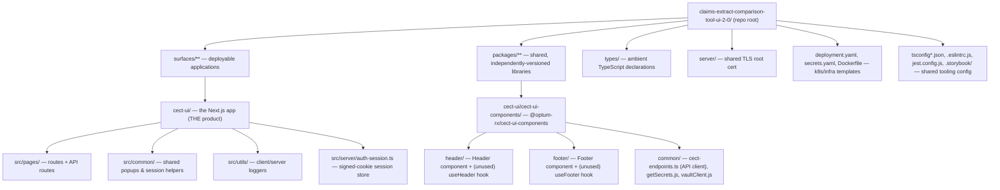

**Rule of thumb:** `surfaces/**` = things that run and get deployed. `packages/**` = things that get imported by surfaces. Almost all lint/TypeScript/Prettier/Jest base configuration is inherited from shared `@uhg-skyline/*` org packages, not defined locally — so this repo's own config files are intentionally thin.

---

## 5. System Architecture

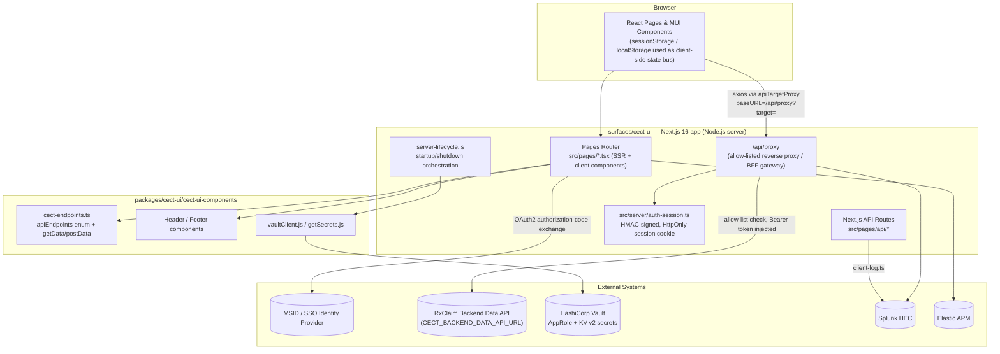

**The single most important fact about this architecture:** the browser **never talks to the RxClaim backend directly**. Every data call goes through the Next.js app's own `/api/proxy` route, which acts as a **Backend-for-Frontend (BFF) / gateway**: it holds the real access token (never exposed to client JS), validates the requested `target` path against a hard-coded allow-list, blocks cross-origin and SSRF attempts, and only then forwards the request to the real backend with a `Bearer` token attached.

---

## 6. Deployment Architecture

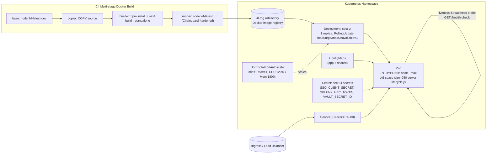

Key operational details (from `deployment.yaml`, `Dockerfile`, `server-lifecycle.js`):

- **Single replica by design** — `minReplicas: 1, maxReplicas: 1` in the HPA. This is not a highly-scaled service; it's a low-traffic internal tool.
- **`server-lifecycle.js`** is a custom wrapper around the Next.js standalone server that:
  1. Fetches secrets from Vault (`getSecrets()`) and injects them into `process.env` *before* the server starts.
  2. Initializes the Splunk-backed logger (`initializeServerWithVault()`).
  3. Installs a **signal guard** that intercepts Next.js's own `SIGTERM`/`SIGINT` handlers so that a graceful-shutdown log can reach Splunk before the process exits (there's a documented root-cause comment in the file explaining a prior production incident where shutdown logs were silently lost because Next.js called `process.exit(0)` before the async Splunk flush completed).
- **Health check**: `GET /health-check` (`src/pages/health-check.tsx`) is a trivial page returning "Success!! UI Server up and running" — used by both the K8s liveness and readiness probes.
- **Container hardening**: `allowPrivilegeEscalation: false`, dropped Linux capabilities (`KILL`, `MKNOD`, `SYS_CHROOT`), non-root `runAsUser: 65535`.

---

## 7. Application Bootstrap & Authentication

### 7.1 `_app.tsx` — the global wrapper

Every page renders inside `_app.tsx` (`surfaces/cect-ui/src/pages/_app.tsx`). It wraps the whole app in:

```
<ThemeProvider theme={OptumDefault}>
  <CssBaseline />
  <AppShell>                  (styled flex column, 100vh)
    <Header content={content} />
    <Component {...pageProps} />   <-- the actual routed page
    <Footer />
  </AppShell>
  <TimeoutWarningPopup .../>  (global session-timeout dialog)
</ThemeProvider>
```

It also owns five independent `useEffect` hooks, each solving one cross-cutting concern:

| # | Effect | Purpose |
|---|---|---|
| 1 | Fetch env config | Reads `SESSION_INACTIVE_TIME` / `SESSION_EXPIRY_AFTER_INACTIVE_TIME` from `/api/envConfig` once on mount |
| 2 | **Inactivity watchdog** | Listens for `mousemove`/`keydown` on `window`; arms two timers — one shows `TimeoutWarningPopup`, one hard-redirects to `/SessionExpired` |
| 3 | Runtime theme loader | Calls `@optum-rx-skyline/runtime-themes`' `init()`; fetches a remote theme bundle from Azure Blob Storage (a **micro-frontend / plugin loading pattern** — the theme is not bundled at build time) |
| 4 | Elastic APM route tracking | On every `routeChangeComplete`, starts/ends an APM transaction labeled by route |
| 5 | Back/forward navigation guard | Suppresses the Dashboard's state-selection popup once when the user navigates via the browser Back button |

### 7.2 OAuth2 login flow

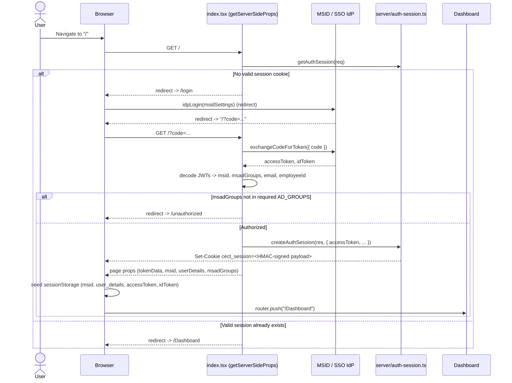

Notable implementation details:

- **Server-side authorization gate** happens in `getServerSideProps` *before* any session cookie is created — unauthorized users never get a session at all.
- The real `accessToken` is stored **server-side only**, inside an `HttpOnly` cookie signed with HMAC-SHA256 (`server/auth-session.ts`). Client JS cannot read it. What the client *does* get in `sessionStorage` is a decoded copy of the same token's claims — enough for UI logic, but the proxy always re-derives the authoritative token from the signed cookie, never trusts the client.
- Cookie verification uses `crypto.timingSafeEqual` to compare signatures — a deliberate defense against timing attacks.
- Session has a **sliding expiration**: `extendAuthSession()` recomputes a new expiry as `min(now + 30min, JWT's own exp claim)` — so a session can never outlive the underlying token, but stays alive as long as the user is active and the token hasn't hard-expired.

### 7.3 Inactivity / session-timeout watchdog

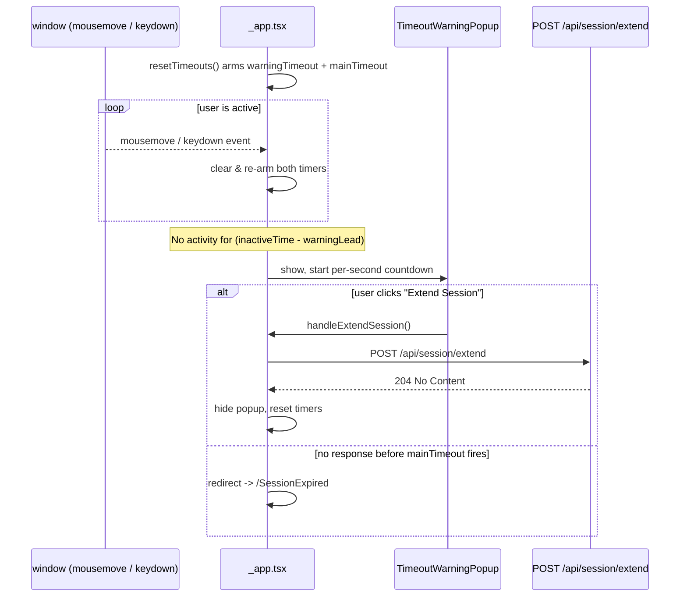

`/api/session/extend` (`src/pages/api/session/extend.ts`) and `/api/session/logout` (`src/pages/api/session/logout.ts`) are thin API routes that call `extendAuthSession()` / `destroyAuthSession()` respectively from `server/auth-session.ts`.

### 7.4 Session lifecycle pages

| Page | Role |
|---|---|
| `login.tsx` | Reads SSO env vars server-side; client component calls `idpLogin()` exactly once (guarded by a ref to survive React 18 double-invoke), shows a spinner while redirecting |
| `logout.tsx` + `LogoutPage.tsx` | Best-effort revokes the server session (`POST /api/session/logout`) and clears UI-state (`DELETE /api/v1/ui-state`), wipes all browser storage/cookies, shows a "Logout Complete" screen |
| `SessionExpired.tsx` | Same cleanup as Logout, triggered by the inactivity watchdog instead of a user-initiated logout |
| `health-check.tsx` | Trivial liveness/readiness probe target |
| `logpage.tsx` | Generic "activity log viewer" — see [§9.8](#98-shared-log-viewer-logpagetsx) |

---

## 8. The Dashboard — Tab Host

`Dashboard.tsx` is the single landing page after login. It hosts **8 feature tabs** behind a mandatory "pick your state" gate, using MUI's Tabs/Tab/TabPanel **compound component pattern**.

| Tab index | Label | Component | ODI-Gov visibility |
|---|---|---|---|
| 0 | Load Trial Claim File | `TrialClaimBatchLoadTab` | hidden |
| 1 | Comparison Request | `ComparsionRequestTab` | visible |
| 2 | Reports | `ReportsTab` | visible |
| 3 | Single Reject Reports | `SingleRejectReportTab` | visible |
| 4 | Create Subset | `CreateSubsetTab` | visible |
| 5 | Import Data | `ImportDataTab` | visible |
| 6 | Progress Reports | `ProgressReportTab` | visible |
| 7 | BDT/cBDT | `BdtCBdtRequestTab` | hidden |

All 8 tab panels are mounted in the DOM simultaneously (hidden via `display:none` through `CustomTabPanel`), not route-based code-split — a standard "render all, show one" MUI approach.

### 8.1 Dashboard bootstrap flow

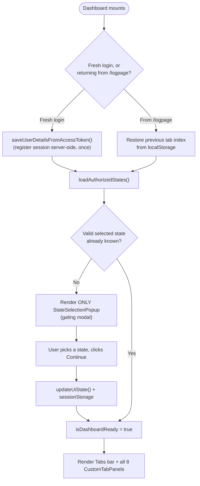

Key functions in `Dashboard.tsx`:

| Function | Purpose |
|---|---|
| `getUiState()` / `updateUiState()` | GET/POST wrappers around `/api/v1/ui-state` (server-side cookie storing selected state) |
| `normalizeAuthorizedStates()` | Tolerant parser accepting several possible API payload shapes for "authorized states" |
| `loadAuthorizedStates()` | For ODI-Gov users, POSTs the user's AD groups to `AUTHORIZED_STATES` to determine which states they may access; defaults to `CORE` otherwise |
| `handleStateContinue()` / `openStateSelectionPopup()` / `handleStatePopupClose()` | Drive the state-selection gating modal |

**Cross-component communication**: instead of React Context, Dashboard and `Header` coordinate via **`window.dispatchEvent`/`addEventListener`** custom events: `stateSelectionChanged`, `authorizedStatesUpdated`, `openStateSelectionPopup`. This is a lightweight pub/sub pattern — simple, but easy to lose track of since there's no single place listing "who listens to what."

---

## 9. Feature Walkthroughs

### The two repeating shapes

Before looking at each feature individually, understand that **every feature is built from two recurring component shapes** — this is the single biggest structural insight in the codebase.

#### Shape A — the "Tab" (list/history) component

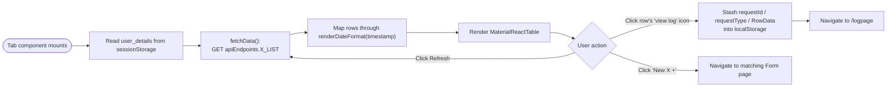

#### Shape B — the "Form" (submit) component

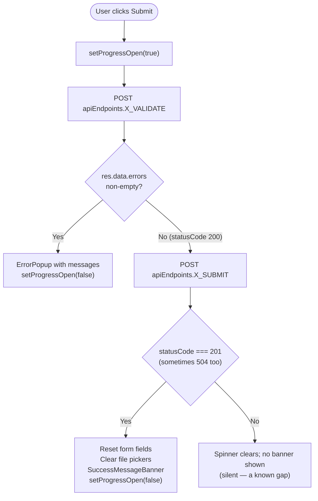

This **validate-then-submit Template Method** is repeated, nearly verbatim, in every single form in the app: `ImportDataForm`, `CreateSubsetForm`, `TrialClaimFileLoadRequestForm`, `BdtCBdtForm`, `ComparsionRequestForm`, `CompareRequestWithPARForm`, `ClinicalComparsionReportRequest`, `DetailedComparsionReportRequest`, `SummaryComparsionReportRequest`, `SingleRejectReportRequest`, `PaidClaimAIReportRequestForm`, and `ProgressReportTab`'s submit button. None of them share a common hook for this — it's copy-pasted each time (see [§16](#16-known-issues--tech-debt-read-before-you-touch-anything)).

**No form library is used anywhere** (no Formik, react-hook-form, Yup, Zod). Validation is almost entirely server-authoritative via the `/validate` endpoint; client-side, only native HTML `required` attributes and a few bespoke regex checks (Single Reject Report's threshold fields) exist.

---

### 9.1 Trial Claim Batch Load

**Files:** `TrialClaimBatchLoadTab.tsx` + `TrialClaimFileLoadRequestForm.tsx`

Lets a user load a trial claim file into RxClaim — the heaviest-parameter form in the app (17 fields: environment, file/library pairs, wave/wave-part, member, claim data queue, plan/eligibility overrides, price schedule overrides, reason code).

| Component | Function | Purpose |
|---|---|---|
| `TrialClaimBatchLoadTab` | `fetchData()` | `GET TRIAL_CLAIM_BATCH_LOAD_LIST`, wrapped in try/catch (the only Tab with explicit error handling) |
| | `callUserDetails()` | Calls shared `checkUserActiveStatus()` — the **only** Tab that performs an account-active guard |
| | row-selection `useEffect` | Enables a **"Launch Compare"** button once a row is selected, which deep-links into `ComparsionRequestForm` pre-filled with that job |
| `TrialClaimFileLoadRequestForm` | `selectChange()` | Environment → Claim Data Queue auto-lookup (`dataQueue` map) |
| | `handleSubmit()` | Validate→submit against `RXCLAIM_REQUEST_CLAIM_VALIDATE/SUBMIT`; on success resets all 17 fields to their RxClaim defaults (not just blank) |

> **Gotcha:** this form imports the API client via a long relative path (`../../../../packages/cect-ui/cect-ui-components/...`) instead of the `@optum-rx/cect-ui-components` alias used elsewhere — functionally identical, just inconsistent style.

---

### 9.2 Comparison Request (+ "Compare with PAR" variant)

**Files:** `ComparsionRequestTab.tsx` + `ComparsionRequestForm.tsx` + `CompareRequestWithPARForm.tsx`

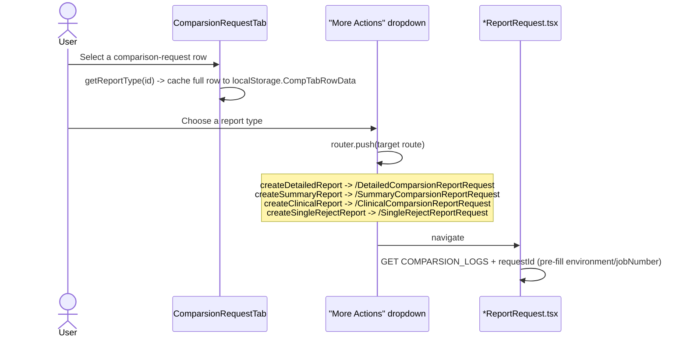

The "More Actions" dropdown is effectively a **menu-driven router/strategy selector** — picking a value doesn't call a function per se, it's an `if/else if` chain of `router.push()` calls.

`ComparsionRequestForm` is the entry-point form (environment, carrier, account/group, fill/add date windows, historical-origin code). `CompareRequestWithPARForm` is a simplified ODI-Gov-only alternative (environment/client/job-number/short-note only) reached when `isODIGov` is true.

> **Gotcha:** `CompareRequestWithPARForm` reads `sessionStorage.getItem('msId')` (a flat key) while every other form reads `msid` out of the parsed `user_details` JSON object — nothing else in the codebase appears to set that flat `msId` key, suggesting this field may always submit as empty/undefined.

---

### 9.3 Reports

**Files:** `ReportsTab.tsx`, `ClinicalComparsionReportRequest.tsx`, `DetailedComparsionReportRequest.tsx`, `SummaryComparsionReportRequest.tsx`, `SingleRejectReportRequest.tsx` + `SingleRejectReportTab.tsx`, `PaidClaimAIReportRequestForm.tsx`

`ReportsTab` (Dashboard tab 2) is a **unified history table across all report types**, fetched from one aggregate endpoint (`GET_ALL_REPORTS`). A `type` discriminator field on each row (`"Detailed Comparison"`, `"Summary Comparison"`, `"Clinical Review"`, `"Paid Claims AI Report"`) drives both the row's displayed label and whether the **"Paid Claims AI Report +"** button is enabled (only for rows of type `"Detailed Comparison"`).

Three of the report-request forms — **Clinical**, **Detailed**, **Summary** — are near-identical copies of one template:

| Form | Extra fields beyond environment/jobNumber/outputName | Endpoints |
|---|---|---|
| `ClinicalComparsionReportRequest` | `passingTiers` (multiline free-text tier codes, default `"98\n00"`) | `RXCLAIM_REQUEST_CLINICAL_REVIEW_VALIDATE/SUBMIT` |
| `DetailedComparsionReportRequest` | — (simplest) | `RXCLAIM_REQUEST_DETAILED_COMPARSION_VALIDATE/SUBMIT` |
| `SummaryComparsionReportRequest` | — | `RXCLAIM_REQUEST_SUMMARY_COMPARSION_VALIDATE/SUBMIT` |

**Single Reject Report** (`SingleRejectReportRequest.tsx`) is the most complex report form:

- Uses `react-multi-select-component`'s `<MultiSelect>` to pick one or more NCPDP reject codes.
- Conditional field visibility based on the selected codes (a small **Strategy-by-value** pattern):
  ```js
  const isControlledFieldsEnabled = () => selectedRejectCodeList.some(i => i.value === '79' || i.value === '88');
  const isThresholdFieldsEnabled  = () => selectedRejectCodeList.some(i => i.value === '79');
  ```
- `fetchCarrierFromLogs()` **scrapes free-text log entries** with a regex (`/Carrier:\s*([^\n\r]+)/`) to recover the carrier name, because it isn't stored structurally on the comparison request record — a fragile but functional integration point.
- Treats both HTTP `201` and `504` as "submission succeeded" (long-running jobs can cause a gateway timeout even though the job was actually queued).

**Paid Claim AI Report** (`PaidClaimAIReportRequestForm.tsx`) is reached only from a `"Detailed Comparison"` row and is the one form with a genuine **debounced server-side typeahead search** (`useDropzone`-style 200ms debounce on `inputValue` → re-queries `BDT_cBDT_FILE_VERSIONS?q=...`), plus a client-side re-filter/sort/cap-at-15 pass over whatever the server returns.

---

### 9.4 Create Subset

**Files:** `CreateSubsetTab.tsx` + `CreateSubsetForm.tsx`

Requests creation of a smaller "trial claim subset file" cut from a larger one. Notable: the **Claim Data Queue field is the one field users never type directly** — it's auto-derived from the selected Environment via a lookup map (`selectChange()` → `dataQueue[selectedEnv]`), then displayed in a disabled `TextField`.

### 9.5 Import Data

**Files:** `ImportDataTab.tsx` + `ImportDataForm.tsx`

The simplest form in the app: Environment, Job Number, Client, and an Excel file attachment (both a manual `<input type="file">` and a `react-dropzone` drag-and-drop zone feed the same `selectedFile` state). Submits via `IMPORT_DATA_VALIDATE` → `IMPORT_DATA_SUBMIT`.

> Note on file uploads generally: **none of the forms in this app actually stream file bytes as part of the JSON payload** — they submit the file's *name* only. The real binary transfer mechanism (a shared network drop location the backend watches, by convention) lives outside this UI codebase.

### 9.6 Progress Report

**File:** `ProgressReportTab.tsx`

Despite the name, **this is not a live-polling "progress" indicator** — there is no `setInterval` or polling loop anywhere in this file. It's a one-shot request: the user multi-selects one or more comparison jobs from a picker grid, clicks Submit, and the resulting pass/fail/blocked/paid/rejected counts are rendered directly from the `/submit` response into a second, read-only results grid below.

```js
const handleSubmit = async () => {
  const res = await postData(PROGRESS_REPORT_VALIDATE, selectedRows);   // note: posts an ARRAY, not an object
  if (res.data?.errors?.length > 0) { handleShowError(res.data.errors); }
  else if (res.statusCode == 200) {
    setClaimCompDataLoading(true);
    const response = await postData(PROGRESS_REPORT_SUBMIT, selectedRows);
    if (response.statusCode == 201) { setClaimCompRows(response.data); }
    setClaimCompDataLoading(false);
  }
};
```

### 9.7 BDT/cBDT Request

**Files:** `BdtCBdtRequestTab.tsx` + `BdtCBdtForm.tsx`

The most elaborate form in the app — up to **four independent file-upload slots** (NAS files, RxComet mapping file, optional Format files, Plan Code mapping file), each gated by checkboxes (`rxComet`, `medicareType`, `nonStandardPlanCode`) that show/hide different combinations of fields and enforce different file-naming prefix rules (`BDT_`, `cBDT_`, `RxComet_`) client-side before ever calling `/validate`.

`handleSubmit()` runs in three stages:
1. **Duplicate-version pre-check** — `GET BDT_cBDT_FILE_VERSIONS`, case-insensitive compare against the entered version ID.
2. **Client-side file-naming validation** — the one form in the app with real business-rule validation before hitting the server.
3. The usual validate→submit pair against `BDT_cBDT_FORM_VALIDATE/SUBMIT`.

### 9.8 Shared Log Viewer (`/logpage`)

**File:** `logpage.tsx`

A generic "activity log" screen every Tab's row-action icon routes to. It reads `requestId`/`requestType`/`RowData` out of `localStorage` (set by whichever Tab/Form the user came from) and uses an `if/else if` chain on `requestType` to pick the right `apiEndpoints.*_LOGS` URL and page header. This is effectively a **hand-rolled lookup table** — a `Record<string, {endpoint, header, tabIndex}>` map would be a straightforward simplification if anyone touches this file.

---

## 10. The API Client & Backend Proxy Layer

### 10.1 `cect-endpoints.ts` — the API client (Facade/Adapter pattern)

File: `packages/cect-ui/cect-ui-components/src/common/cect-endpoints.ts`

This single file is imported by nearly every page in the app. It defines:

- **`apiEndpoints`** — a ~45-member TypeScript `enum` centralizing every backend route the UI can call (e.g. `IMPORT_DATA_VALIDATE`, `RXCLAIM_REQUEST_CLAIM_SUBMIT`, `BDT_cBDT_FILE_VERSIONS`).
- **`pageName`** — an enum of route constants (`HOME_PAGE`, `LOGIN`, `LOGOUT`, `SESSION_EXPIRED`, `UNAUTHORIZED`).
- **`apiTargetProxy`** — a single shared `axios.create()` instance (a **Singleton**) whose `baseURL` is `/api/proxy?target=`. Every request this app makes is therefore routed through the local Next.js server, never directly to the backend.
- **`getData(url)` / `postData(url, data)`** — thin wrappers that normalize every response (success *and* failure) into one consistent shape:
  ```ts
  interface Result { statusCode: number; errorMessage: string; data: object; }
  ```
  This is a small but important pattern: callers never need a `try/catch` around every API call — `getData`/`postData` already caught the error and turned it into a `Result` with a `statusCode` the caller can branch on.
- **`enrichPostPayloadWithStateCode(url, dataObj)`** — auto-injects a `stateCode` field into any POST body going to `/api/request_type/*` (except `PROGRESS_REPORT_*`, which posts an array, not an object), sourced from `sessionStorage.selectedState`.
- **`getStateCodeHeader()`** — attaches an `x-state-code` header to the same family of requests.

### 10.2 `/api/proxy` — the hardened reverse proxy

File: `surfaces/cect-ui/src/pages/api/proxy.ts`

This is a textbook **API Gateway / BFF proxy pattern**, and it's worth understanding in detail because every single data-bearing request in the app passes through it:

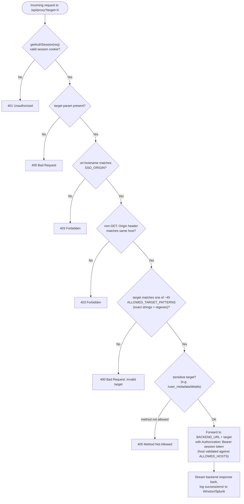

Security measures stacked in this one file:
- **Session required** — every call must present a valid signed session cookie; the real access token never comes from the client.
- **SSRF protection** — the target hostname is checked against `SSO_ORIGIN` and, separately, the final resolved backend URL's host is checked against `ALLOWED_HOSTS` (derived from `CECT_BACKEND_DATA_API_URL`) before any outbound request is made.
- **Explicit allow-list** (`ALLOWED_TARGET_PATTERNS`) — a request to any path not in this list (string or regex match) is rejected outright, even if it would otherwise look like a valid backend route.
- **CORS/origin check** on mutating methods — rejects cross-origin POST/PUT/DELETE unless the `Origin` header matches the current host.
- **Sensitive-method policy** — certain targets (e.g. `/api/user_metadata/details`) are locked to `POST` only.
- **PII redaction in logs** — `empId`/`userEmail`/`email`/`employeeId` fields are masked to `***` before any request body is logged.
- **Log-injection defense** — `sanitizeForLog()` strips `\r`/`\n` from any user-controlled value before it reaches a log line.

### 10.3 Generic request lifecycle (sequence diagram)

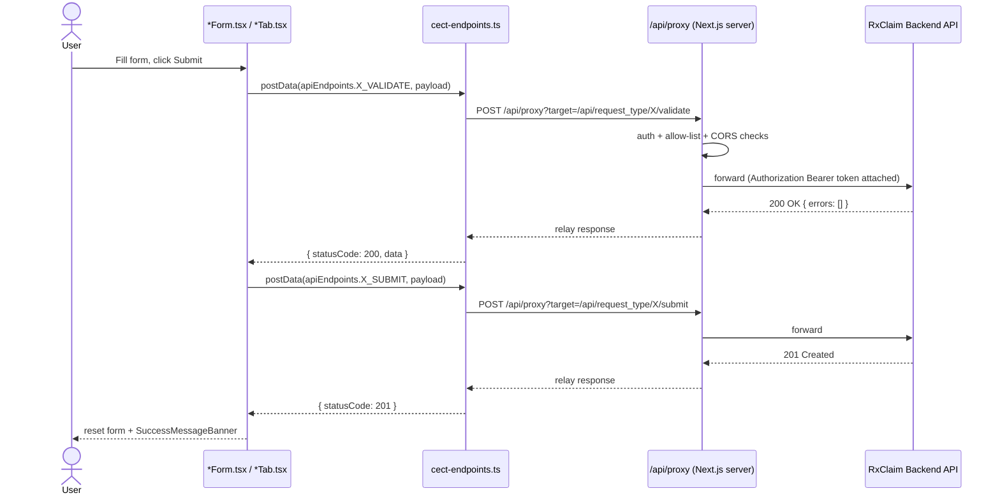

---

## 11. Shared Component Library (`cect-ui-components`)

Package: `@optum-rx/cect-ui-components` (`packages/cect-ui/cect-ui-components`)

### 11.1 The intended pattern vs. what's actually there

The Skyline template scaffolds every shared component as a **component + co-located custom hook** pair — the idea being the hook holds all stateful logic, and the component is a thin, purely-presentational consumer of it.

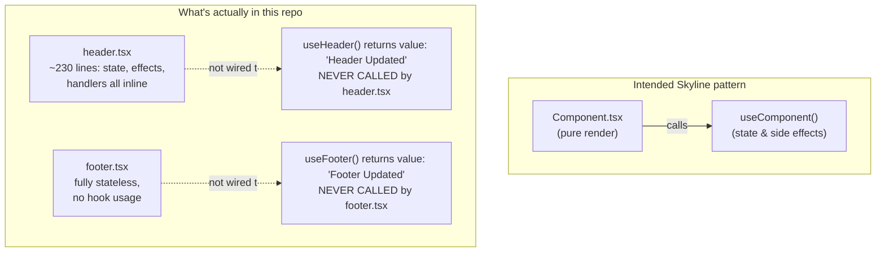

**Read this twice if you're new here:** `useHeader` and `useFooter` are **dead template scaffolding**. They exist, are exported from the package's public barrel, and even have their own passing unit tests — but the real `Header`/`Footer` components never call them. Don't assume the hook's return value reflects real app behavior.

### 11.2 `Header` (`header/Header/header.tsx`)

The real, production header bar. Entirely self-contained — manages its own state (`moreEl` account-menu anchor, `selectedState`, `stateOptions`, `user`) and effects inline:

| Function | Purpose |
|---|---|
| `syncSelectedStateFromServer()` | GETs `/api/v1/ui-state`, populates the state-switcher dropdown |
| `handleStateSelect()` | Updates selection, persists to `sessionStorage` + server, dispatches `stateSelectionChanged`, redirects to `/Dashboard` |
| `handleSignout()` | For ODI-Gov users, checks/clears any duplicate last session, clears all browser storage/cookies, routes to `/logout` |

> **Duplication gotcha:** `handleSignout()` re-implements its own local copies of `checkUserLastSessionDetails`/`clearUserLastSession` instead of importing the identical functions already defined in `src/common/details.ts` — two independent sources of truth calling the same two backend endpoints.

### 11.3 `Footer` (`footer/Footer/footer.tsx`)

Purely presentational — a copyright line and a "Terms of Use" link. **Default-exported**, while `Header` is a *named* export. This matters: the package's barrel (`src/index.ts`) uses `export * from './footer/Footer/footer'`, and `export *` **does not forward default exports** — so `Footer` is not actually reachable through the public barrel the way `Header` is. Consumers need a direct default-import path.

### 11.4 Barrel export (`src/index.ts`)

```ts
export * from './header/Header/header';
export * from './header/Header/header.types';
export * from './header/useHeader/use-header';
export * from './header/useHeader/use-header.types';
export * from './footer/Footer/footer';
export * from './footer/Footer/footer.types';
export * from './footer/useFooter/use-footer';
export * from './footer/useFooter/use-footer.types';
```

Note that `cect-endpoints.ts` (the API client — arguably the most-used file in the whole package) is **not re-exported here at all**. Every consumer reaches it via a deep import path instead, which is why you'll see both `@optum-rx/cect-ui-components` (barrel) and `@optum-rx/cect-ui-components/src/common/cect-endpoints` (deep import) used side-by-side across the codebase.

---

## 12. Data Model / Class Diagram

The app has no backend ORM entities of its own — the closest things to "classes" are the TypeScript interfaces/enums that shape data moving between layers:

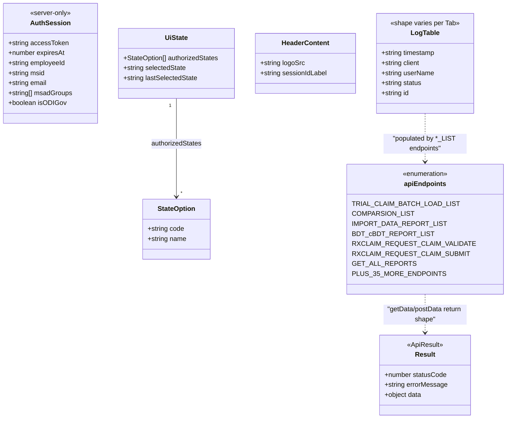

> **Note on `LogTable`:** multiple Tab components declare their own `LogTable` TypeScript type, and in at least two places (`ImportDataTab`, `BdtCBdtRequestTab`) the declared type doesn't fully match the `accessorKey`s actually rendered by `material-react-table` — a sign these aren't being strictly checked against each other. Don't trust the type alone; check the `columns` definition too.

---

## 13. Design Patterns Catalog

| Pattern | Where used | Notes |
|---|---|---|
| **Provider pattern** | `<ThemeProvider>` in `_app.tsx` | Standard MUI theming |
| **Compound components** | MUI `Tabs`/`Tab`/`CustomTabPanel` in `Dashboard.tsx` | `CustomTabPanel` only renders children when `value === index` |
| **Template Method** | Every `*Tab.tsx` (list/fetch/render skeleton); every `*Form.tsx` (validate→submit skeleton) | Repeated by copy-paste, not by a shared base hook — a clear refactor opportunity |
| **Facade / Adapter** | `getData()`/`postData()` in `cect-endpoints.ts` | Normalizes axios success/error into one `Result` shape |
| **Gateway / BFF (Backend-for-Frontend)** | `/api/proxy` | Hides the real backend and access token from the browser entirely |
| **Singleton** | `apiTargetProxy` (shared axios instance), Winston `logger` instances | One instance reused across all calls in a module |
| **Observer** | Inactivity watchdog (`mousemove`/`keydown` listeners in `_app.tsx`) | Classic DOM-event observer driving a timeout state machine |
| **Pub/Sub via DOM events** | `window.dispatchEvent`/`addEventListener` for `stateSelectionChanged`, `authorizedStatesUpdated`, `openStateSelectionPopup` | Used instead of React Context to decouple `Header` and `Dashboard` |
| **Gating / wizard modal** | `StateSelectionPopup` blocks all Dashboard content until a state is chosen | Nothing else renders until the precondition is met |
| **Controlled component** | All popups (`ErrorPopup`, `SuccessMessageBanner`, `ProgressMessageBanner`, etc.) | Parent owns `isOpen`/callbacks; popups hold little to no internal state |
| **Strategy-by-value** | Menu-driven navigation in `ComparsionRequestTab` ("More Actions" dropdown); conditional field visibility in `SingleRejectReportRequest` based on selected reject codes | Implemented as `if/else if` chains rather than a lookup table/strategy object |
| **Barrel export** | `packages/cect-ui/cect-ui-components/src/index.ts` | Intentionally excludes `cect-endpoints.ts`, forcing deep imports for the API client |
| **Ambient module declarations** | `types/*.d.ts` (`.png`, `.pdf`, `.mdx` imports) | Lets TypeScript treat non-code assets as typed imports |
| **Declaration merging / module augmentation** | `types/theme-extensions/index.d.ts` | Extends MUI's own `Palette`/`Shape`/`Theme` types with Optum-specific fields, rather than replacing them |
| **Plugin / remote-module loading** | Runtime theme loader in `_app.tsx` (`@optum-rx-skyline/runtime-themes`) | Theme bundle fetched from a signed Azure Blob URL at runtime, not bundled at build time |
| **Sliding session expiration** | `extendAuthSession()` in `server/auth-session.ts` | New expiry = `min(now + 30min, JWT's own exp claim)` |
| **Fail-safe / best-effort cleanup** | `logout.tsx`/`LogoutPage.tsx` | Local cleanup proceeds even if server revocation calls fail |
| **Hook-extraction pattern (intended but abandoned)** | `useHeader`/`useFooter` | Scaffolded by the template, never actually wired into the real components — see [§11.1](#111-the-intended-pattern-vs-what-is-actually-there) |
| **Local/session storage as a state bus** | `requestId`, `CompTabRowData`, `ReportTabRowData`, `PreviousDashboardTab`, `user_details`, `isODIGov`, etc. | Functions as inter-page "props" with no React Context/Redux; convenient but easy to lose track of — see [§16](#16-known-issues--tech-debt-read-before-you-touch-anything) |

---

## 14. Cross-Cutting Concerns

### 14.1 Session management

- **Server side:** `server/auth-session.ts` — HMAC-signed, `HttpOnly`, `SameSite=Lax` cookie (`cect_session`) holding only `{ accessToken, expiresAt }`. Verified with `crypto.timingSafeEqual` to resist timing attacks. Never trusts a client-supplied token directly.
- **Client side:** `sessionStorage` holds a decoded, UI-convenience copy of the user's claims (`msid`, `user_details`, `accessToken`, `idToken`, `isODIGov`) — used for display and request-building, but the proxy layer re-derives the authoritative token server-side regardless of what the client sends.
- **Single-session enforcement (ODI-Gov only):** `checkUserLastSessionDetails()`/`clearUserLastSession()` (duplicated in both `src/common/details.ts` and `Header.tsx`) detect and forcibly end a lingering prior session for the same user before letting a new login through.

### 14.2 Multi-state tenancy

Nearly every `/api/request_type/*` call is automatically tagged with a `stateCode` (header `x-state-code` + payload field), sourced from `sessionStorage.selectedState`. The pseudo-state `CORE` is normalized to `ZZ` server-side. This is how one deployment of CECT UI can serve multiple US-state-specific RxClaim environments.

### 14.3 Logging & observability

| Channel | Mechanism |
|---|---|
| Server logs | `winston` → console + Splunk HEC (`winston-splunk-httplogger`), with PII redaction and log-injection sanitization in both `proxy.ts` and `client-log.ts` |
| Client logs | `src/utils/clientLogger.ts` → `fetch('/api/client-log')` → forwarded to the same Splunk pipeline server-side (keeps Splunk credentials out of browser JS) |
| Client-side RUM | Elastic APM, instrumented per-route in `_app.tsx` |
| Container lifecycle | `server-lifecycle.js` logs startup/shutdown events to Splunk, with a custom signal-guard to ensure shutdown logs aren't lost to a race with Next.js's own `SIGTERM` handler |

### 14.4 Secrets management

- **At deploy time:** Kubernetes `Secret` (`secrets.yaml`) provides placeholder env vars (`SSO_CLIENT_SECRET`, `CECT_SPLUNK_HEC_TOKEN`, `VAULT_SECRET_ID`) — real values are injected by the deployment pipeline, never committed.
- **At runtime:** `server-lifecycle.js` calls `getSecrets()` (`packages/cect-ui/cect-ui-components/src/common/getSecrets.js`), which authenticates to **HashiCorp Vault via AppRole** (`vaultClient.js`'s `authenticateWithAppRole()`) and reads a KV-v2 secrets path, injecting the results into `process.env` *before* the server starts listening.
- `vaultClient.js` also owns the TLS trust setup, loading Optum's internal root CA chain (`server/OptumRootChainCert.pem`) so outbound HTTPS calls to internal services succeed.

---

## 15. Testing & Build Tooling

| Tool | Scope | Notes |
|---|---|---|
| **Jest** + React Testing Library | `packages/cect-ui/cect-ui-components` only | Shallow smoke tests (`header.test.tsx`, `use-header.test.tsx`, `footer.test.tsx`, `use-footer.test.tsx`) — assert the component/hook renders without throwing, nothing deeper |
| **Cypress** | — | `cypress/` exists but contains only a `.gitkeep` file — **no actual e2e tests exist yet**, this is reserved scaffolding |
| **Storybook 8** (Vite builder) | Header/Footer components | Root `.storybook/` auto-discovers `*.stories.tsx` across `packages/**`; one story + one `args` object per component |
| **ESLint** | Whole repo | Extends `@uhg-skyline/optum/recommended-typescript`; forbids importing the whole `@mui/icons-material` barrel (tree-shaking) |
| **Prettier** | Whole repo | Delegates entirely to `@uhg-skyline/prettier` — no local formatting rules |
| **TypeScript** | Whole repo | `tsconfig.json` extends `@uhg-skyline/typescript`; `noUncheckedIndexedAccess` and `noPropertyAccessFromIndexSignature` are both on, explaining the `process.env['X']` bracket-access style seen everywhere instead of `process.env.X` |
| **Lerna** | Versioning | Independent per-package versioning across `packages/**`/`surfaces/**` |

**Honest coverage picture:** `jest.config.js` collects coverage **only** from `packages/**`, not `surfaces/**` — meaning the entire CECT UI application (every page, every form, the proxy, the auth session logic) currently has **zero automated test coverage**. Only the shared Header/Footer library has (very shallow) tests. New engineers writing tests should expect to be creating test infrastructure for `surfaces/cect-ui`, not just adding to existing suites.

---

## 16. Known Issues & Tech Debt (read before you touch anything)

These are real, observed issues — flagging them here so you don't mistake them for intentional design on your first read-through:

1. **Massive duplication of the validate→submit flow.** Every form hand-rolls the same `setProgressOpen(true) → POST /validate → branch on errors → POST /submit → branch on 201 → reset` sequence. A shared `useValidateAndSubmit(validateUrl, submitUrl, payload)` hook would remove most of it. Same story for the "Tab" list components — a `useRequestList(endpoint)` hook would collapse 8 near-identical implementations into one.
2. **`useHeader`/`useFooter` are dead code** — exported, tested, documented by Storybook, but never called by the real components. Don't trust what they "seem" to imply about app behavior.
3. **`Footer`'s default export isn't reachable through the package barrel** (`export *` doesn't forward default exports) — only `FooterProps` makes it through automatically.
4. **Duplicated session-check logic** between `src/common/details.ts` and `header.tsx` (`checkUserLastSessionDetails`/`clearUserLastSession` reimplemented twice, calling the same backend endpoints).
5. **Zero automated test coverage for `surfaces/cect-ui`** — only the shared component library has smoke tests; Cypress is empty.
6. **`LogTable` TypeScript types drift from actual rendered columns** in at least `ImportDataTab` and `BdtCBdtRequestTab` — don't assume the type tells you the whole truth about what's on screen.
7. **Inconsistent import paths** for the API client — most files use the `@optum-rx/cect-ui-components` package alias; `TrialClaimFileLoadRequestForm.tsx` and `BdtCBdtForm.tsx` use long relative paths into `packages/...` instead.
8. **`CompareRequestWithPARForm` reads a `sessionStorage` key (`msId`) that nothing else appears to set** — likely a latent bug where this field silently submits empty.
9. **Heavy reliance on `localStorage`/`sessionStorage` as an inter-page "state bus"** (`requestId`, `CompTabRowData`, `ReportTabRowData`, `PreviousDashboardTab`, `PreviousPage`, `user_details`, etc.) instead of URL params, server sessions, or React Context. Powerful but easy to break silently — if a key is renamed in one file, every reader elsewhere breaks without a compile-time error.
10. **File uploads submit filenames only, not file bytes**, in every form — the real binary transport path is outside this codebase; don't assume `postData()` sends the actual file.
11. **`types/to-case/index.d.ts`** uses `declare function` nested inside `declare module` — non-standard ambient-module syntax that may not actually type-check named imports correctly.
12. Several leftover `console.log` debug statements in `SingleRejectReportRequest.tsx`, and a largely dead code block in `_app.tsx` (commented-out lines 33–37, 119–127, 261–263).
13. **Silent failure path** in several forms: if a network/JS exception occurs during submit (not a validation error), the progress spinner clears but no error message is shown to the user — only business-rule validation errors get an `ErrorPopup`.

---

## 17. Appendix A — Full Function Reference

This index consolidates the most important functions discovered across the codebase. Organized by file.

### `src/pages/_app.tsx`
| Function | Purpose |
|---|---|
| `handleExtendSession()` | Resets inactivity timer, POSTs `/api/session/extend`, navigates to `/Dashboard` on success |
| `handleLogoutNow()` | Closes the timeout popup, routes to `/logout` |
| inactivity `useEffect` | Arms/clears warning + hard-logout timers based on `mousemove`/`keydown` |
| theme-loader `useEffect` | Loads the runtime MUI theme bundle via `@optum-rx-skyline/runtime-themes` |
| APM `useEffect` | Starts/ends an Elastic APM transaction per route change |

### `src/pages/index.tsx`
| Function | Purpose |
|---|---|
| `getServerSideProps` | Full OAuth2 callback handler: session check → authorization-code exchange → AD-group authorization gate → `createAuthSession()` |
| `Home` (client component) | Strips `?code=` from the URL, seeds `sessionStorage` from server-rendered token props, redirects to Dashboard or Login |

### `src/pages/Dashboard.tsx`
See [§8](#8-the-dashboard--tab-host) for the full table — key functions: `ensureCoreStateOption()`, `hasPersistedStateSelection()`, `syncSelectedStateToSession()`, `getUiState()`, `updateUiState()`, `normalizeAuthorizedStates()`, `loadAuthorizedStates()`, `handleChange()`, `handleStateContinue()`, `openStateSelectionPopup()`, `handleStatePopupClose()`.

### `src/server/auth-session.ts`
| Function | Purpose |
|---|---|
| `createAuthSession(res, options)` | Signs and sets the `cect_session` cookie |
| `getAuthSession(req)` | Verifies and decodes the session cookie; returns `undefined` if invalid/expired |
| `extendAuthSession(req, res)` | Slides the session expiry forward (capped by the JWT's own `exp`) |
| `destroyAuthSession(req, res)` | Clears the session cookie |
| `signPayload`, `encodeSessionCookie`, `decodeSessionCookie`, `getCookieValue`, `getCookieOptions` | Internal HMAC signing/encoding helpers |

### `src/pages/api/proxy.ts`
| Function | Purpose |
|---|---|
| `handler(req, res)` | The full gateway logic described in [§10.2](#102-apiproxy--the-hardened-reverse-proxy) |
| `sanitizeForLog(value)` | Strips CR/LF from log values to prevent log injection |

### `src/common/details.ts`
| Function | Purpose |
|---|---|
| `getEmpIdFromToken()` | Decodes the ID token to extract the employee ID (internal) |
| `logout()` | `sessionStorage.clear()` only — no API calls |
| `checkUserActiveStatus(userSessionDetails)` | Confirms the account is still active; force-logs-out if not |
| `getAndSaveExpiryForAccessToken()` | Stores the access token's `exp` claim (ms) into `sessionStorage.expiry` |
| `sendUserSessionDetails(userSessionDetails)` | Registers/refreshes the session with the backend |
| `checkUserLastSessionDetails(userSessionDetails)` | Checks for an existing session for the same user |
| `clearUserLastSession(userSessionDetails)` | Forcibly ends a stale prior session |
| `saveUserDetailsFromAccessToken()` | Orchestrator — called once from `Dashboard.tsx` on mount |

### `src/common/utilityFunctions/utiltyFunction.ts`
| Function | Purpose |
|---|---|
| `renderDateFormat(dateString)` | `MM/DD/YY hh:mm A` formatting via `moment-timezone` |
| `renderDateFormatToLocalDate(dateString)` | Converts a Central-time (`America/Chicago`) backend timestamp into the viewer's local timezone |

### `src/utils/clientLogger.ts` / `src/utils/serverLogger.ts`
| Export | Purpose |
|---|---|
| `logger.info/warn/error` (client) | Console-logs immediately, fire-and-forgets `POST /api/client-log` |
| `serverLogger.info/warn/error` (server) | Winston logger → console + Splunk HEC; safe to use in `getServerSideProps`/API routes only (never import client-side — it pulls in Node-only `winston`) |

### `packages/cect-ui/cect-ui-components/src/common/cect-endpoints.ts`
| Export | Purpose |
|---|---|
| `apiEndpoints` | Enum of every backend route |
| `pageName` | Enum of route constants |
| `apiTargetProxy` | Shared axios instance, `baseURL = /api/proxy?target=` |
| `getData(url)` | GET wrapper → normalized `Result` |
| `postData(url, dataObj)` | POST wrapper → normalized `Result`, auto-attaches `stateCode` |
| `getEnvConfig()` | Fetches `/api/envConfig` (public runtime env vars) |
| `getStateCode()` / `getStateCodeHeader()` | Derive the current state code from `sessionStorage` |

### `packages/cect-ui/cect-ui-components/src/common/getSecrets.js` / `vaultClient.js`
| Function | Purpose |
|---|---|
| `getSecrets()` | Authenticates to Vault, reads the KV secrets path, injects results into `process.env` |
| `authenticateWithAppRole()` | Vault AppRole login |
| `initializeServerWithVault()` | Sets up the Splunk-backed server logger using Vault-sourced credentials |
| `logServerReady()` / `logServerShutdown(signal)` | Lifecycle log events sent to Splunk |

### Per-feature Tab/Form functions

See the detailed tables in [§9](#9-feature-walkthroughs) for `fetchData()`, `handleSubmit()`, `selectChange()`, `handleClick()`, and file-upload handlers (`handleFileChange`, dropzone `onDrop`, `handleClearFile`) — these follow the same name and shape across all 8 feature pairs, as documented above.

---

## 18. Glossary

| Term | Meaning |
|---|---|
| **CECT** | Claims Extract Comparison Tool — this product |
| **RxClaim** | The backend mainframe-style claims-processing system this tool drives |
| **BDT / cBDT** | Benefit Design Template / client-specific BDT — Excel rule files |
| **RxComet** | A specific BDT format/mapping variant |
| **ODI-Gov** | Government-customer deployment flavor with stricter state-based access control |
| **MSID** | Optum's internal SSO identity claim |
| **Trial Claim** | A simulated claim loaded into RxClaim for testing |
| **Comparison Request** | A job diffing two sets of claim results |
| **BFF** | Backend-for-Frontend — the `/api/proxy` gateway pattern used here |
| **Skyline** | Optum's internal microproduct-template platform this app is scaffolded from |
| **stateCode** | US-state partition key for multi-tenant RxClaim environments (not React state) |
| **HEC** | Splunk's HTTP Event Collector — how logs are shipped to Splunk |
| **AppRole** | A HashiCorp Vault authentication method using a role-id/secret-id pair |

---

*End of document. If something here looks wrong or has drifted from the code, trust the code and update this doc — it's meant to evolve with the project, not freeze it in time.*
