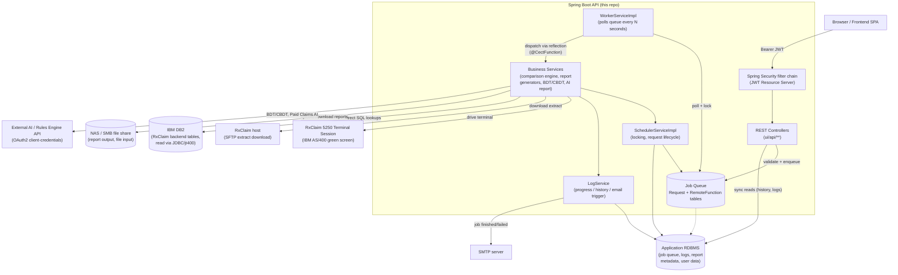
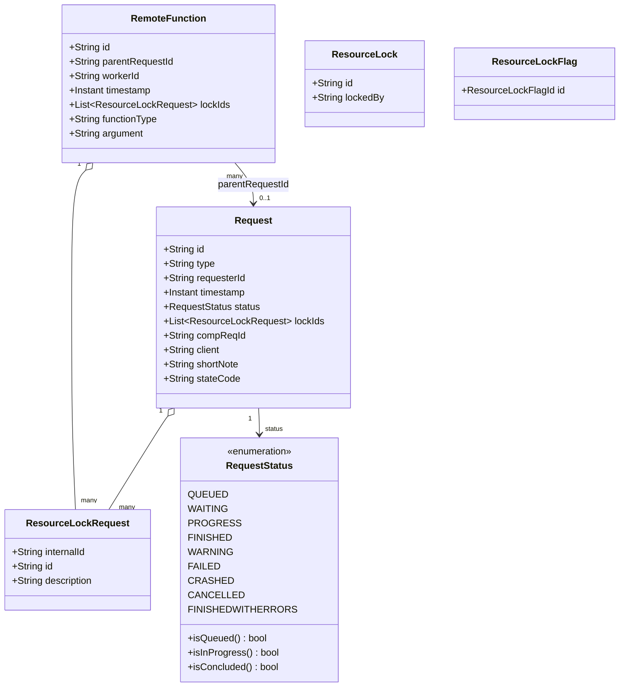
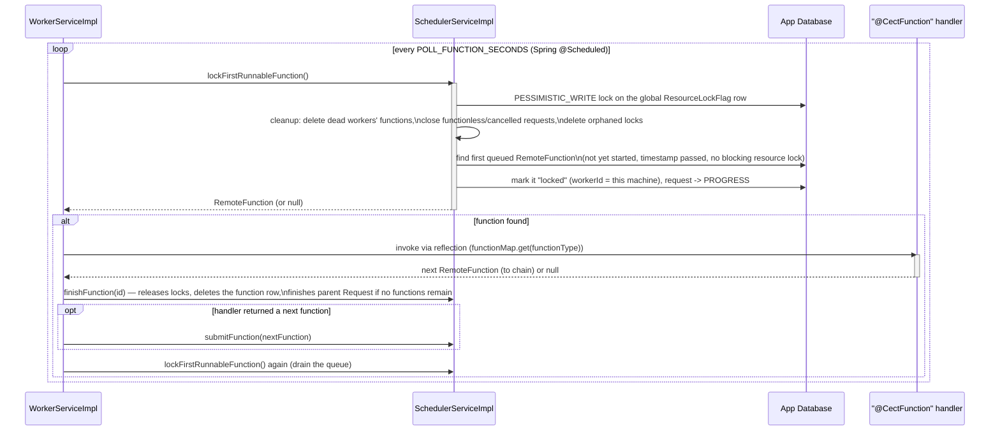
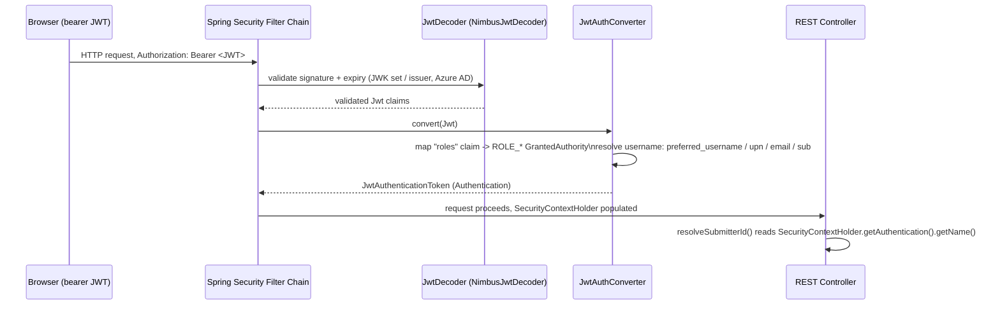
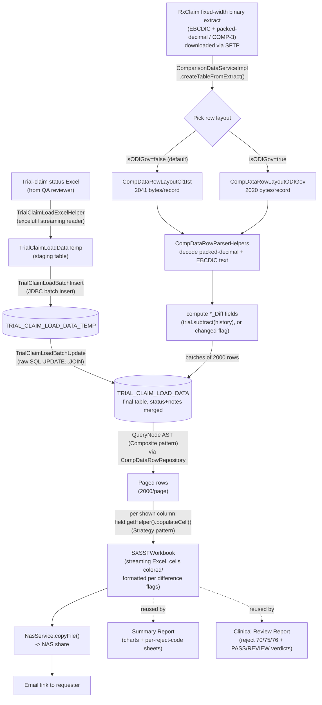
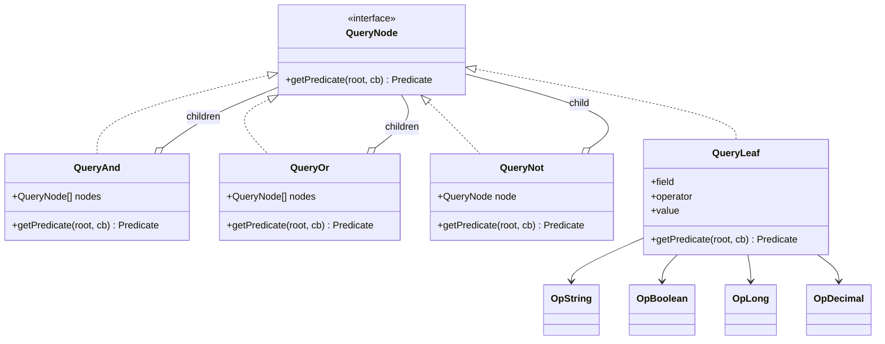
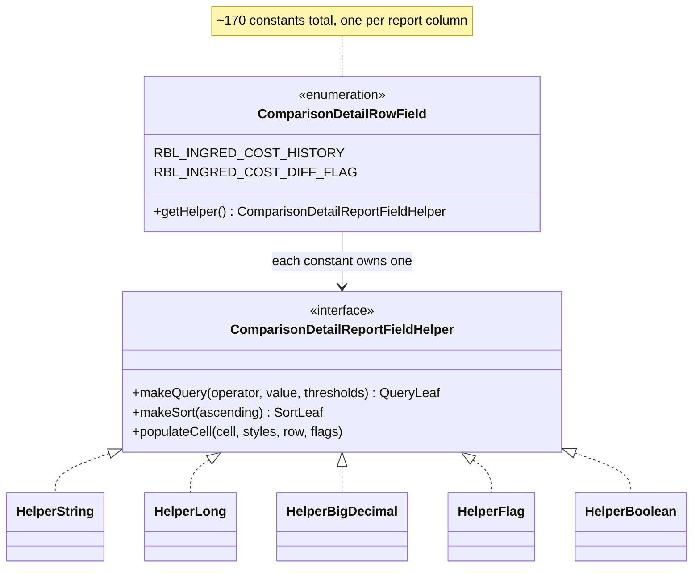
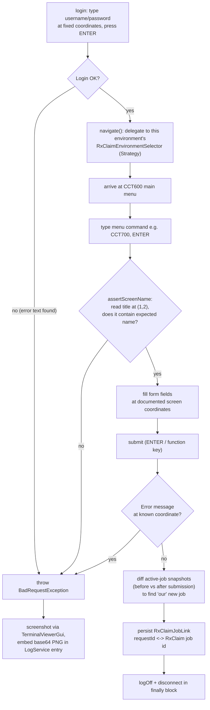
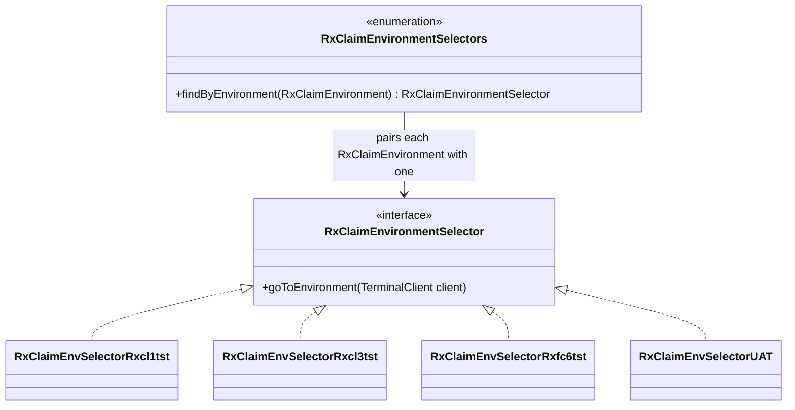
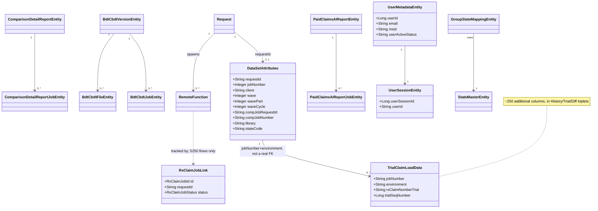

# Claims Extract Comparison Tool (CECT) API — Knowledge Transfer Guide

> **Audience:** this document assumes zero prior knowledge of the project. If you know Java and Spring but nothing about CECT, RxClaim, or pharmacy claims processing, start here.
> **Scope:** the backend API only (`claims-extract-comparison-tool-api`). A separate frontend repo consumes this API.

---

## Table of Contents

1. [What This Application Does](#1-what-this-application-does)
2. [Domain Glossary](#2-domain-glossary)
3. [Technology Stack](#3-technology-stack)
4. [High-Level Architecture](#4-high-level-architecture)
5. [The Core Engine: A Database-Backed Job Queue](#5-the-core-engine-a-database-backed-job-queue)
6. [Security Architecture](#6-security-architecture)
7. [Package Map](#7-package-map)
8. [Walkthrough: Submitting a Detailed Comparison Report](#8-walkthrough-submitting-a-detailed-comparison-report)
9. [The Comparison Engine (Core Domain Logic)](#9-the-comparison-engine-core-domain-logic)
10. [RxClaim 5250 Terminal Automation](#10-rxclaim-5250-terminal-automation)
11. [Other Business Features](#11-other-business-features)
12. [Infrastructure / Integration Services](#12-infrastructure--integration-services)
13. [REST API Reference](#13-rest-api-reference)
14. [Entity / Data Model](#14-entity--data-model)
15. [Design Patterns Catalog](#15-design-patterns-catalog)
16. [Known Quirks, Typos & Tech Debt](#16-known-quirks-typos--tech-debt)
17. [Running the App Locally](#17-running-the-app-locally)
18. [Where to Go Next](#18-where-to-go-next)

---

## 1. What This Application Does

CECT is an internal Optum Rx tool used by QA/analyst teams to validate that **RxClaim** — the mainframe/midrange pharmacy claims-adjudication system — behaves correctly after a configuration or code change, *before* that change is promoted to production.

The workflow it automates:

1. An engineer prepares a batch of **trial claims** (synthetic test claims) and loads them into RxClaim via this tool.
2. The tool **drives a real IBM AS/400 "green screen" (5250) terminal session**, programmatically, exactly as a human operator would — typing into menus, pressing function keys, reading screen text — to submit the claims and later pull back the results.
3. RxClaim adjudicates the claims (decides pay/reject, calculates cost, etc.).
4. The tool extracts the resulting claim data and the expected/previous ("history") data, and **compares every field of every claim** to find differences.
5. Differences become **Excel reports** — a row-by-row detail report, a summary/statistics report with charts, a clinical-review sign-off report, and specialized reject-code diagnostic reports.
6. Finished reports are uploaded to a network file share (NAS) and the requester is emailed a link.

Everything after step 1 happens **asynchronously** in the background — a user submits a request from a browser, gets an immediate "queued" response, and the actual work (which might take minutes and involves a live terminal session) runs later, polled by a background worker. This asynchronous design is the single most important thing to understand about this codebase, and is covered in depth in [§5](#5-the-core-engine-a-database-backed-job-queue).

---

## 2. Domain Glossary

| Term | Meaning |
|---|---|
| **RxClaim** | The pharmacy claims-adjudication mainframe/midrange system under test. Reached via IBM AS/400 "green screen" (5250) terminal sessions. There are several RxClaim test hosts (`RXCL1TST`, `RXCL3TST`, `RXFC6TST`, `RXBK2UAT`), each hosting multiple "sub-environments" (e.g. `TN1`, `HA4`, `WY1`). |
| **5250 / green screen** | IBM's terminal protocol for AS/400 (IBM i) systems — a text-mode, fixed-coordinate screen UI, traditionally used by a human via a terminal emulator. This app automates that emulator. |
| **Trial claim** | A synthetic/test pharmacy claim submitted to RxClaim to see how it gets adjudicated, as opposed to a real patient's claim. |
| **BDT / cBDT** | Basic Drug Table / client Basic Drug Table — reference data files describing drug formulary/pricing rules, uploaded and sent to an external AI/rules engine to generate processing rules. |
| **PAR extract / comparison extract** | The data RxClaim produces after adjudicating trial claims, pulled back via SFTP for comparison. |
| **Reject code** | A code RxClaim attaches to a claim it rejects (e.g. prior authorization required, refill too soon). Some reject codes have dedicated diagnostic reports. |
| **ODI-Gov** | "Government" tenant/environments (states `WY`, `VT`, `ME`) that use a separate network path, separate extract record layout, and separate compliance rules (e.g. user pre-registration) from standard commercial environments. |
| **State code** | A 2-letter code representing a client/state (e.g. a state Medicaid plan). Used both for authorization (which users can see which states) and for NAS file routing. |
| **Wave / wave cycle / wave part** | QA testing terminology for batching trial claims into rounds ("waves") of testing. |
| **Job number** | A numeric identifier tying together a trial-claim load, its comparison extract, and all generated reports for one test run. |
| **NAS** | Network-Attached Storage — an SMB/CIFS file share where generated report files are uploaded and input files are read from. |
| **Request vs. Function** (engine terms) | A **`Request`** is one user-submitted job (e.g. "generate a detail report"). A **`RemoteFunction`** is one unit of background work belonging to a Request; a single Request can chain through several Functions over time (e.g. submit → poll → finish). See [§5](#5-the-core-engine-a-database-backed-job-queue). |

---

## 3. Technology Stack

| Concern | Technology |
|---|---|
| Language / runtime | Java 21 |
| Framework | Spring Boot 4.1 (Spring MVC, Spring Data JPA, Spring Security, Spring Cloud) |
| Build | Maven |
| Database | IBM DB2 (RxClaim/AS400 side, read via JDBC/jt400), plus a relational app database (via JPA/Hibernate) for the job queue, logs, and report metadata — H2 in-memory for tests |
| Security | OAuth2 Resource Server (JWT bearer tokens, Azure AD/Entra ID) + OAuth2 Client (client-credentials grant, for one outbound AI API integration) |
| Terminal automation | `jt400` (IBM AS/400 toolbox) + an internal vendored wrapper (`ibm-5250-wrapper`) around the open-source `xtn5250` Java 5250 emulator |
| Excel | Apache POI (`poi-ooxml`, streaming `SXSSFWorkbook` for report *writing*) + a vendored lightweight streaming XLSX *reader* (`excelutil/`, structurally similar to `dhatim/fastexcel-reader`) for reading large uploaded files cheaply |
| File transfer | JSch (SFTP) + Apache Commons Net (FTPS) to RxClaim hosts; JCIFS (SMB/CIFS) to the NAS share |
| Email | Spring Mail / Jakarta Mail (Eclipse Angus) |
| Markdown rendering | Flexmark (log messages are written as Markdown and rendered to HTML for the UI) |
| Crypto | AES-GCM (`javax.crypto`, hand-wrapped in `AESUtility`) — used specifically to encrypt a PHI column (claim number) in one AI-report workflow |
| Reflection / plugin discovery | `org.reflections` — scans for custom annotations at startup (the heart of the job-dispatch engine) |
| Scheduling | Spring `@Scheduled` (polling, cron-like maintenance jobs) |
| Logging | SLF4J + Logback/Log4j2, plus Splunk logging library |
| Deployment | Docker image, deployed to an HCC Kubernetes Hybrid Cloud environment; Jenkins CI/CD |

---

## 4. High-Level Architecture



**Reading this diagram:** a browser call either (a) reads data synchronously (job history, logs, dropdown lists) or (b) submits a job, which is validated and written to the `Request`/`RemoteFunction` queue tables and returned immediately. A single background `WorkerServiceImpl` instance (per running pod) continuously polls that queue and executes the actual business logic — which may mean driving a live mainframe terminal session, running SQL against DB2, moving files over SFTP/SMB, or calling an external AI API.

---

## 5. The Core Engine: A Database-Backed Job Queue

This is the most important subsystem to understand before anything else makes sense. Almost every "feature" in this app is just a plug-in into this engine.

### 5.1 The two key entities

| Entity | File | Purpose |
|---|---|---|
| `Request` | `scheduler/model/Request.java` | One user-submitted job (e.g., "generate detail report for job 12345"). Has a `status` (`RequestStatus`), a `type` string, a `requesterId`, and optional resource locks that persist for the whole request. |
| `RemoteFunction` | `scheduler/model/RemoteFunction.java` | One *unit of work* belonging to (usually) one `Request`. Has a `functionType` string (the dispatch key), a JSON `argument` blob, a `timestamp` (don't run before this time), and its own resource locks. A `Request` can spawn a *chain* of `RemoteFunction`s over time — e.g. `submit` → `check` (poll) → `finish`. |



### 5.2 `@CectFunction` — annotation-driven dispatch (Command pattern via reflection)

Instead of a big `switch` statement mapping function-type strings to handler methods, this codebase uses a custom annotation plus the `Reflections` library to build that mapping automatically at startup:

```java
// worker/model/CectFunction.java
@Retention(RetentionPolicy.RUNTIME)
@Target(ElementType.METHOD)
public @interface CectFunction {
    String id();
}
```

Any method anywhere under package `worker` can be annotated `@CectFunction(id = "some_type")`. At startup, `WorkerServiceImpl.initializeFunctions()` scans the whole `worker` package for such methods and builds an in-memory `Map<String, FunctionRunner>`. A handler method must take either `(RemoteFunction)` or `(RemoteFunction, SomeRequestType)` and must return `RemoteFunction` (the *next* function to chain to, or `null` to end the chain).

A second annotation, `@CectAutomaticFunctionBuilder`, marks "self-scheduling" methods — recurring background jobs (cleanup, polling heartbeats) that aren't triggered by a user at all, but bootstrap themselves once and re-enqueue themselves forever.

This is effectively the **Command pattern** (each handler is a command, `RemoteFunction` is the command's serialized invocation) combined with a **Service Locator** built via reflection instead of explicit registration.

### 5.3 The poll loop



Key design points worth calling out to a new engineer:

- **The lock is a real database row**, not an in-JVM mutex: `ResourceLockFlag` is a single-row table, and `LockFlagRepository.getLockFlag()` uses JPA's `PESSIMISTIC_WRITE` lock mode to acquire an exclusive row lock via `SELECT ... FOR UPDATE`. This makes the queue safe even if multiple instances (pods) of this app are running at once — only one pod's poll loop can be mutating the queue at any instant.
- **Resource locks** (`ResourceLock`/`ResourceLockRequest`) are a *second*, finer-grained locking layer on top of the global lock: they let two unrelated jobs run concurrently while still preventing two jobs from touching the *same* external resource (e.g. the same RxClaim host, or the same output file) at the same time. `LockConventionService` is the single place that defines how a lock's string ID is constructed (`rxclaim/host/<host>`, `nas/<host>/<path>`, etc.) so that two different code paths locking "the same thing" produce matching IDs.
- **A `RemoteFunction` handler can chain forward** by returning a new `RemoteFunction` — this is how multi-stage, long-running external work (a 5250 terminal session, an external AI job) is modeled as a sequence of short "submit → check → check → ... → finish" steps instead of one giant blocking call. Several features use a "poll every N minutes" convention purely by having the `check` stage re-submit itself with a future timestamp if the external work isn't done yet.
- **Self-healing**: every poll cycle also cleans up after crashed workers (functions whose worker no longer has a heartbeat row in `WorkerStatus` get force-finished and their parent `Request` marked `CRASHED`), deletes orphaned functions (parent request already gone), and limits queue growth by truncating old concluded requests (keeps the newest 100 per request type).

### 5.4 Live progress & completion notification — `LogService`

Background jobs have no direct connection back to the browser that submitted them. Instead, every `@CectFunction` handler calls methods on `LogService` (`progress`, `info`, `warning`, `success`, `failure`, `exception`) to report status. Each call writes a `Log` row tied to the owning `Request`'s ID, in its **own independent transaction** (`REQUIRES_NEW`) so a log entry survives even if the calling job's transaction later rolls back.

- `LogLevel.PROGRESS` entries are special: instead of accumulating, the *latest* progress row for a request is overwritten in place — so there's always exactly one "current status" line per job, not thousands of rows.
- The frontend polls `GET /api/request_type/{type}/request/{id}/logs` to show a live activity feed.
- A `success()`/`failure()` call (logged at `LogLevel.EMAIL`) triggers `LogServiceImpl.sendFinishedEmailIfNeeded`, which looks up the requester's email (`UserMetadataService`) and **submits a `SendEmail` function into the same job queue** — so "job finished" notifications are themselves just another asynchronous function in this engine.
- Log content can embed base64 screenshots (critical for the 5250 terminal automation — see §10) which are extracted and surfaced separately by `findRequestLogs()`.

---

## 6. Security Architecture



- **Inbound requests** (`SecurityConfig`): the app is a pure **OAuth2 Resource Server**. Session management is `STATELESS` (no cookies/server sessions); form login, HTTP Basic, and OAuth2 login are all explicitly disabled. `/healthz` and the H2 console are public; everything under `/api/**` requires a valid bearer JWT. `JwtAuthConverter` (implements Spring's `Converter<Jwt, AbstractAuthenticationToken>` — an Adapter/Decorator over Spring's built-in authorities converter) turns the validated token into a Spring `Authentication`, mapping a configurable claim (default `roles`) into `ROLE_*` authorities used by `hasRole(...)`/manual role checks.
- **Outbound requests to one external system** (`OAuthClientConfiguration`): separately, the app is an OAuth2 **client** using the **client-credentials** grant to call an external AI/rules-engine API (`AiApiService`) — this is unrelated to how inbound requests are authenticated; the app authenticates *itself*, not a user, for that one integration.
- **Admin/role-gated actions**: a handful of destructive or privileged endpoints (deleting a queued function, viewing another user's session) check a configurable property `cect.security.view-all-roles` (default `CECT_ADMIN,CECT_OPERATIONS`) against the caller's granted authorities. This check is duplicated per-controller rather than centralized — a known refactor opportunity, not a shared `@PreAuthorize` annotation or base class.
- **State-code authorization** (`authorization/` package) is a *separate, data-driven* access-control layer, orthogonal to Spring Security roles: a user's IAM/AD group memberships are mapped (via `CECT_GROUP_STATE_MAPPING`) to the list of state codes/clients they're allowed to run reports against — this is what populates state-code dropdowns and filters throughout the UI.
- **Encryption at rest for one PHI field**: `AESUtility` (AES-256-GCM) is used in exactly one place — encrypting the RxClaim claim-ID number column before it's written into a "Paid Claims AI" report artifact, and decrypting it back on read, using a shared key from the `cect.aesKey` property. It is **not** used for DB2 credentials, which remain plain configuration values.

---

## 7. Package Map

High-level orientation before diving into details. All packages are rooted at `src/main/java/com/optumrx/optumrxautomation/cect/`.

| Package | Role |
|---|---|
| `Application.java` | Spring Boot entry point. |
| `config/`, `security/`, `logging/`, `DB2Config/`, `system/config/` | Cross-cutting infrastructure configuration (security, DB, logging, Hibernate naming). |
| `system/exception/`, `exception/` | The app's exception vocabulary. |
| `scheduler/` | **The job queue engine** — `Request`/`RemoteFunction` entities, repositories, `SchedulerService` (locking + lifecycle), `LockConventionService` (lock-naming), plus two unrelated nightly cron jobs for user deactivation. |
| `worker/` | **The dispatch engine** (`WorkerServiceImpl`, `@CectFunction`/`@CectAutomaticFunctionBuilder` annotations) *and* every feature's actual background job-handler classes (`worker/request/**`). |
| `ui/api/` | REST controllers — the HTTP entry points. Mostly organized as Controller → Form → `*Request` → business service, one sub-package per feature under `ui/api/requests/submission/`. |
| `comparison_data/` | The generic comparison engine: parsing fixed-width mainframe extracts, the composite query DSL, paging/querying stored comparison rows. |
| `comparison_detail_report/`, `comparison_summary_report/`, `clinical_review_report/` | The three Excel report generators built on top of the comparison engine. |
| `trial_claim_load_report/` | Importing/loading trial-claim status data into the database (Excel → staging table → final table). |
| `datasetattributes/`, `progress_report/`, `dto/` | Comparison-job metadata and QA progress tracking. |
| `SingleRejectCode/`, `dto/single_reject_code/` | A parallel, narrower diagnostic flow that queries DB2 directly per reject code. |
| `rxclaim5250/` | The 5250 terminal automation: `RxClaim5250Service` (drives the terminal), environment registry/selection, DTOs mirroring green-screen fields. |
| `bdt_cbdt_files/`, `paid_claims_ai_report/` | BDT/cBDT file management and the "Paid Claims AI" workflow that calls an external AI/rules API. |
| `ftp/`, `nas/`, `email/` | Thin facade services wrapping SFTP/FTPS, SMB/CIFS, and SMTP. |
| `excelutil/` | A vendored, streaming, read-only XLSX parser (not POI) used for cheaply reading large uploaded files. |
| `log/`, `json/`, `markdown/`, `uuid/` | Cross-cutting utility services used everywhere (progress logging, JSON (de)serialization, Markdown→HTML, ID generation). |
| `authorization/`, `usermetadata/`, `usersession/` | Who-can-see-what (state-code access control) and who-is-this-user (profile + session tracking), independent of the JWT identity provider. |
| `util/` | `AESUtility` (encryption), `CommonMethods` (input sanitization). |

---

## 8. Walkthrough: Submitting a Detailed Comparison Report

This is the canonical example of the Controller → Form → Request → `@CectFunction` pattern used by nearly every feature. Concrete files: `DetailedCompReportController`, `DetailedCompReportForm`, `CreateComparisonDetailReportRequest`, `CreateComparisonDetailReport`.

```mermaid
sequenceDiagram
    actor User
    participant FE as Browser
    participant C as DetailedCompReportController
    participant F as DetailedCompReportForm
    participant Svc as CreateComparisonDetailReport
    participant Sch as SchedulerService
    participant Q as Job Queue (DB)
    participant W as WorkerServiceImpl
    participant Rpt as ComparisonDetailReportService
    participant NAS as NasService
    participant Log as LogService

    User->>FE: fill out report form
    FE->>C: GET .../form
    C-->>FE: DetailedCompReportForm (defaults/choices)
    FE->>C: POST .../validate (as user types)
    C->>F: form.validate()
    C-->>FE: ValidationErrors
    FE->>C: POST .../submit
    C->>F: form.validate()
    C->>F: form.toRequest()
    F-->>C: CreateComparisonDetailReportRequest
    C->>Svc: submitRequest(request, submitterId)
    Svc->>Sch: submitRequest(new Request(type, QUEUED, ...))
    Svc->>Rpt: saveComparisonDetailReport(requestId, ...)
    Svc->>Sch: submitFunction(new RemoteFunction(NAS-file lock, JSON(request)))
    Sch->>Q: persist Request + RemoteFunction
    Svc-->>C: requestId
    C-->>FE: 201 Created, requestId
    Note over FE,Q: user sees "queued"; browser can now poll logs

    loop background poll (seconds later, possibly a different pod)
        W->>Sch: lockFirstRunnableFunction()
        Sch-->>W: the queued RemoteFunction
        W->>Svc: createDetailedComparisonReport(function, request) [via @CectFunction reflection]
        Svc->>Log: progress("Writing detailed difference sheet...")
        Svc->>Rpt: createExcel(jobNumber, environment, settings)
        Rpt-->>Svc: SXSSFWorkbook
        Svc->>NAS: copyFile(outputPath -> NAS, stateCode)
        Svc->>Log: success("...resulting file under <NAS path>")
        Log->>Q: submitFunction(SendEmail) [job-finished notification]
        Svc-->>W: null (chain ends)
        W->>Sch: finishFunction(id) -> Request marked FINISHED
    end
```

Note the **separation of validation**: the Form validates shallow/UI-facing fields and then builds-and-delegates to the deeper `*Request` object's own `.validate()`, merging the two `ValidationErrors`. There is no shared `Form` interface or base class — every feature's Form class follows this shape by convention/copy-paste, not by inheritance.

---

## 9. The Comparison Engine (Core Domain Logic)

This is the heart of what the tool actually *computes*. It lives mostly in `comparison_data/` and `comparison_detail_report/`.

### 9.1 End-to-end data flow



### 9.2 The query DSL — Composite pattern

Report filters (and sorts) are modeled as a small hand-rolled AST, not raw SQL strings, so they can be built up from independent `ComparisonDetailRequestFilter` rows submitted by the UI and converted straight into JPA Criteria `Predicate`s:



`And`/`Or`/`Not` nodes recurse into their children and combine the resulting `Predicate`s with `CriteriaBuilder.and/or/not`; `QueryLeaf` is the only node that actually terminates recursion, delegating to one of the four typed `Op*` enums (`EQ`, `NEQ`, `GT`, `LT`, `GTE`, `LTE`, plus `LIKE`/`NLIKE` for strings). There is no `toSQL()` step — the object graph is converted directly into a JPA `Predicate`, which Hibernate turns into SQL at execution time.

### 9.3 Field rendering — Strategy pattern

Each of the ~170 report columns is a constant in a large enum (`ComparisonDetailRowField`, or `ComparisonDetailRowFieldCl1tst` for non-ODI-Gov environments, or `ClinicalReviewRowField` for the clinical report), and **every constant carries its own rendering strategy**, chosen at compile time:



Call sites never branch on field type — they just call `field.getHelper().populateCell(...)` / `.makeQuery(...)` / `.makeSort(...)` polymorphically. This is what lets `ComparisonDetailReportServiceImpl.insertSheet()` render every column uniformly regardless of whether it's a string, a dollar amount, a boolean, or a computed difference flag.

**Difference-flag formula:** a dollar/decimal field is flagged as "different" if `|trial − history| > threshold` (user-configurable per field; defaults to 0, i.e. any difference at all). This flag drives both cell styling in the detail report and the PASS/REVIEW verdict columns in the clinical review report.

### 9.4 The three report generators

| Report | Service | What it adds on top of the base engine |
|---|---|---|
| **Detailed Comparison Report** | `ComparisonDetailReportServiceImpl` | Row-by-row Excel export with user-chosen filters/sorts/thresholds/hidden columns. |
| **Summary Comparison Report** | `ComparisonSummaryServiceImpl` | Streams all rows once to accumulate `SummaryStatistics` (paid/rejected counts, dollar totals, reject-code breakdown), renders two pie charts (XChart), then **delegates back into the Detail Report engine** (`insertSheet()`) to add one detail sheet per reject code. |
| **Clinical Review Report** | `ClinicalReviewReportServiceImpl` | Filters to clinically significant reject codes 70/75/76 (prior auth / step therapy / quantity limits) and adds three hard-coded PASS/REVIEW verdict columns, reusing the same Strategy field-rendering. |

### 9.5 The single-reject-code diagnostic flow (a side path)

`dto/single_reject_code/` + `SingleRejectCode/` is a **separate, narrower flow**: instead of diffing data already loaded into `TrialClaimLoadData`, it goes **live to DB2** with bespoke, hardcoded SQL per reject code (supported codes: `6T,05,06,09,10,11,73,77,81,E7,41,619,645,648,69,42,22,43,44,46,79,88`) to answer a targeted "why did this specific reject fire" question — e.g. for reject code `05` it checks whether the pharmacy's contract end date is on/before the claim's date of service. Unsupported codes gracefully fall back to the generic detail-report engine filtered by reject code.

---

## 10. RxClaim 5250 Terminal Automation

This is the most unusual part of the codebase. `RxClaim5250ServiceImpl` (1,300+ lines) drives a **real terminal session** against an IBM AS/400 host, exactly as a human would with a 5250 emulator — there is no API; everything is screen coordinates and typed commands.

### 10.1 The emulator library (Adapter pattern)

An internal, vendored library `ibm-5250-wrapper` wraps the open-source `xtn5250` terminal emulator engine behind a small, clean API (`TerminalClient`, `Element`, `TerminalQueryPosition(row, col)`, `TerminalKey`). The business code never touches the raw 5250 wire protocol — only this narrow interface. A companion `TerminalViewerGui` can render the in-memory screen to a PNG, which is how the system takes **screenshots on error** for debugging.

### 10.2 The mechanism: "assert-then-act" screen scraping



Because RxClaim never hands back a generated job ID directly, the code identifies "its" job by **snapshotting the active-job list before and after submission and taking the set difference** — if zero or more than one new job appears, it throws (can't safely identify which job is ours).

### 10.3 Environment selection — Strategy pattern (confirmed)

Different RxClaim hosts present different intermediate "choose your sub-environment" menus after login. This is modeled as a classic Strategy:



`RxClaim5250ServiceImpl.navigate()` simply calls `RxClaimEnvironmentSelectors.findByEnvironment(environment).getSelector().goToEnvironment(client)` — adding a new RxClaim host/menu structure means adding an enum entry, not touching the service class.

### 10.4 The four submission flows (a recurring "submit → poll → finish" state machine)

All four live under `worker/request/rxclaim/` and share the same shape: a `submit` function drives the terminal and records a `RxClaimJobLink`; a `check` function (re-submitted every few minutes) asks "has the status changed yet?"; a `finish` function retrieves results once done. A global heartbeat job (`RxClaimCommonJobs.pollJobs`, itself a self-re-arming `@CectAutomaticFunctionBuilder`) periodically scrapes each RxClaim host's job list once and refreshes every tracked `RxClaimJobLink`'s status — the per-request `check` functions just read whatever that heartbeat last wrote.

| Flow | Request type | Trigger | What it does |
|---|---|---|---|
| **Batch Trial Claim** | `rxclaim_batch_trial_claim` | `TrialClaimSubmission` | Validates the input file exists on RxClaim *before* queuing; submits the claim-load job via the terminal; polls; on finish, scrapes paid/rejected counts. |
| **Comparison Extract** | `rxclaim_comparison_request` | `TrialClaimCompSubmission` | Drives the `EXTCMDDX` command-entry screen to request RxClaim produce a comparison extract; on finish, downloads the result file via SFTP and feeds it into the comparison engine (§9). |
| **PAR Comparison Extract** | `rxclaim_request_comparison_par_extract` | `TrialClaimParCompSubmission` | A download-only variant — skips the green screen entirely when the user already has a RxClaim job number; just SFTPs the file and processes it. |
| **Trial Claim Subset File** | `create_trial_claim_subset_file` | `TrialClaimSubsetSubmission` | Combines the terminal session *with direct JDBC against DB2* to look up claim records by claim number and extract a subset file (uses EBCDIC byte-pattern search in raw SQL). |

**Resource locking**: all four lock `rxclaim/host/{host}` (one terminal session per AS/400 box at a time) via `LockConventionService`, plus a file-level lock when a reply/output file name is involved.

---

## 11. Other Business Features

| Feature | Entry point | Pattern | Notes |
|---|---|---|---|
| **BDT/cBDT Files** | `BdtCbdtFilesController` → `BdtCbdtFilesProcess` | 4-stage polling chain (`submit → check → finish\|finish_error`) | Persists an uploaded file set as a "version", submits it to an external AI/rules API (`POST /api/savedata`) via `AiApiService` (OAuth2 client-credentials Adapter), polls `GET /api/status/{id}`. |
| **Paid Claims AI Report** | `PaidClaimsAIReportController` → `PaidClaimsAIReportProcess` | 5-stage polling chain (`submit → ai_job_check → output_file_check → finish\|finish_error`) | Ensures a detail comparison report exists, **de-identifies it** (AES-encrypts the claim-ID column — the one real use of `AESUtility`), submits to the AI API's `/api/runengine`, polls, retrieves the output workbook from the SMB share, and decrypts the PHI column back on the archived copy. |
| **Progress Report** | `ProgressReportController` → `ProgressReportService` | **Synchronous — not queued at all.** | The only feature that bypasses the job-queue engine entirely; runs a live native SQL PIVOT query (`DataSetAtrributeRepository.getprogressRecordList`) and returns results directly in the HTTP response. Tracks % of claims manually reviewed by QA, not % compared. |
| **Import Excel Data** | `ImportExcelDataController` → `ImportTrailClaimLoadData` | Single-shot function | Downloads an uploaded status/notes Excel file from NAS and merges it into `TrialClaimLoadData` (see §9.1's staging-table pipeline). |
| **Scheduled housekeeping** | `worker/request/clean_up/*` | Self-re-arming `@CectAutomaticFunctionBuilder` jobs, every 4 hours | `CleanUpLogs` truncates old log rows; `DeleteConcludedRequestCompData` is **currently a no-op** (its cleanup call is commented out). |
| **User lifecycle** | `scheduler/sevice/UserActiveSchedulerService` + `UserInactiveNotification` | Spring `@Scheduled` cron jobs (1 AM / 2 AM) | Deactivates users inactive beyond a threshold (ODI-Gov only), and separately emails users approaching that threshold as a warning. Unrelated to the Request/RemoteFunction engine despite living in the `scheduler` package. |

---

## 12. Infrastructure / Integration Services

Each of these follows the same shape: a narrow `*Service` interface, a `*ServiceImpl` that does the messy protocol work, and library exceptions translated into the app's own exception vocabulary (`SystemException`, `BadRequestException`, `NotFoundException`, `ConflictingIdException`) — a textbook **Facade**.

| Service | Wraps | Purpose |
|---|---|---|
| `FtpService` | Apache Commons Net (FTPS, legacy/unused path) + JSch (SFTP, actually used) | Downloads RxClaim extract files over SFTP, addressed in IBM i `QSYS.LIB/*.LIB/*.FILE/*.MBR` path notation. |
| `NasService` | JCIFS (SMB/CIFS) | Uploads generated reports and downloads user-provided input files to/from the NAS share; path resolution branches on state code (`"ZZ"` = base path, ODI-Gov states get a suffixed path, others get `/CECT_OUTPUT_{stateCode}`). |
| `EmailService` | Spring `JavaMailSender` | Sends HTML emails (job completion, inactivity warnings); translates an SMTP 452 "too many recipients" error into a domain-specific `TooManyEmailsException`. |
| `AiApiService` | Spring Security OAuth2 client-credentials | Fetches an access token for the one external AI/rules-engine integration (used by both BDT/cBDT and Paid Claims AI Report). |
| `excelutil/*` | (vendored, no third-party wrapping) | A **streaming, read-only XLSX parser** structurally similar to `dhatim/fastexcel-reader` — opens the `.xlsx` ZIP, lazily streams rows via StAX so a multi-million-row uploaded file can be read with only one row's worth of memory at a time. Used only for *reading* uploads (`TrialClaimLoadExcelHelper`); report *generation* uses Apache POI's `SXSSFWorkbook` instead. |
| `LogService`, `JsonService`, `MarkdownService`, `UuidService` | Jackson, Flexmark, `java.util.UUID` | Cross-cutting Facades used throughout the codebase — see §5.4 for `LogService`. `UuidService.generateUuid()` Base64-URL-encodes a raw UUID's bytes for a shorter, URL-safe ID used as every entity's primary key. |

---

## 13. REST API Reference

All paths are relative to the app's base URL. Every `submit`-style controller resolves the acting user via `SecurityContextHolder` first, falling back to a client-supplied `msId` field.

### 13.1 Generic / cross-cutting

| Method | Path | Purpose |
|---|---|---|
| GET | `/healthz` | Liveness probe (no auth). |
| GET | `/api/user/{id}/requests` | A user's (or, if `id` blank, the caller's own) job history. |
| GET | `/api/request_type/{type}/requests?stateCode=` | List jobs of a given type. |
| GET | `/api/request_type/{type}/request/{id}` | One job's detail (enriched with client/wave/job-number metadata). |
| GET | `/api/request_type/{type}/request/{id}/logs` | Log/progress history for one job. |
| GET | `/api/request_type/getAllRequests?stateCode=` | Unified job history across report types. |
| GET | `/support/log/global` | All logs (ops view). |
| GET | `/support/functions` | Dump of the entire pending job queue (ops view). |
| DELETE | `/support/function/{id}/delete` | Cancel a queued function — **role-gated** (`CECT_ADMIN`/`CECT_OPERATIONS`). |

### 13.2 Per-feature submission controllers (all follow `form` → `validate` → `submit`)

| Base path | Feature |
|---|---|
| `/api/request_type/create_detailed_comparison_report` | Detailed Comparison Report |
| `/api/request_type/create_summary_comparison_report` | Summary Comparison Report |
| `/api/request_type/create_clinical_review_report` | Clinical Review Report |
| `/api/request_type/create_single_reject_report` | Single Reject Code Report |
| `/api/request_type/create_trial_claim_subset_file` | Trial Claim Subset File |
| `/api/request_type/import_excel_data` | Import status/notes Excel |
| `/api/request_type/bdt_cbdt_files` | BDT/cBDT Files |
| `/api/request_type/paid_claims_ai_report` | Paid Claims AI Report |
| `/api/request_type/rxclaim_request_claim_submission` | Batch Trial Claim submission (5250) |
| `/api/request_type/rxclaim_request_comparison_extract` | Comparison Extract (5250) |
| `/api/request_type/rxclaim_request_comparison_par_extract` | PAR Comparison Extract (download-only, no Form layer) |
| `/api/request_type/create_progress_report` | Progress Report (**synchronous**, not queued) |

### 13.3 Supporting data / lookups

| Method | Path | Purpose |
|---|---|---|
| POST | `/api/v1/authorizedStates` | Map a user's AD groups → authorized state codes. |
| GET | `/api/rxclaim/environments?stateCode=` | Valid RxClaim environments (filterable by state). |
| GET | `/api/rxclaim/histOrgCodes` | Valid history-origin codes. |
| GET | `/api/rxclaim/claimDataQueues?stateCode=` | Environment → claim-data-queue map. |
| POST | `/api/user_metadata/details` | Register/update a user profile. |
| POST | `/api/user_metadata/userstatus` | Fetch a user's stored profile. |
| POST | `/api/user/session/exists` | Check if a user session record exists. |
| POST | `/api/user/session/delete` | Clear a user's session record. |

---

## 14. Entity / Data Model



Notable modeling quirks worth knowing (so they don't confuse you later):

- `ComparisonDataTable` was apparently meant to be a parent/container key for `TrialClaimLoadData` rows, but no real foreign key exists — the two are correlated only by matching `jobNumber` + `environment` strings.
- Several entities (`DataSetAttributes`, `SingleRejectRequestDetails`, `ComparisonDetailReportEntity`) are, somewhat unusually, *also* annotated `@Service` — harmless but non-idiomatic, likely copy-paste.
- A handful of table/class names contain long-standing, intentional typos that are load-bearing (used in JPQL / bean wiring) and should **not** be "fixed" silently: `DataSetAtrributeRepository`, `TrialClaimLoadDataRepositoty`, `DetailedComparision`, and inconsistent `Trail`/`Trial` spelling throughout `trial_claim_load_report`.

---

## 15. Design Patterns Catalog

| Pattern | Where | Evidence |
|---|---|---|
| **Command (via reflection)** | `worker/model/CectFunction` + `WorkerServiceImpl.functionMap` | Any method anywhere under `worker` tagged `@CectFunction(id=...)` becomes a callable command; `RemoteFunction` is the serialized invocation (type + JSON argument) stored in the DB and dispatched later. |
| **Service Locator** | `WorkerServiceImpl.initializeFunctions()` | Builds `Map<String, FunctionRunner>` via `Reflections` at startup instead of an explicit registry. |
| **Mutex-via-database-row** | `ResourceLockFlag` / `LockFlagRepository` | A single-row table locked with JPA `PESSIMISTIC_WRITE` to serialize job-queue mutations across multiple running instances of the app. |
| **Factory Method** | `LockConventionService` | `rxClaimHost(...)`, `rxClaimLibraryFile(...)`, `nasFile(...)` each construct a correctly-shaped `ResourceLockRequest`, guaranteeing consistent lock IDs across unrelated call sites. |
| **Composite** | `comparison_data/model/query/*` (`QueryNode`/`QueryAnd`/`QueryOr`/`QueryNot`/`QueryLeaf`) | Recursive tree of a single `getPredicate(root, cb)` interface; composites recurse into children and combine via `CriteriaBuilder.and/or/not`. |
| **Strategy** | `ComparisonDetailReportFieldHelper` (5 impls, one per data type) and `RxClaimEnvironmentSelector` (4 impls, one per AS/400 host) | Interface + interchangeable implementations, selected at construction time (field enum) or via a lookup enum (`RxClaimEnvironmentSelectors`), with zero type-branching at call sites. |
| **Adapter** | `TerminalClient` (wraps `xtn5250` 5250 protocol engine), `FtpService`/`NasService`/`EmailService` (wrap JSch/JCIFS/JavaMail), `AiApiService` (wraps Spring Security OAuth2), `JwtAuthConverter` (wraps Spring's default JWT authorities converter) | Each hides a third-party/low-level API behind a narrow, purpose-built interface used by the rest of the app. |
| **Facade** | `LogService`, `JsonService`, `MarkdownService`, and every infra `*Service` in §12 | A handful of simple methods (`success`/`failure`/`progress`, `objectToJson`, `markdownToHtml`, `copyFile`) hide significant underlying complexity (transactions, UUIDs, email side-effects, Jackson config, Flexmark pipelines, SMB/SFTP protocol details). |
| **DTO** | Every `*Form`, `*Request` (worker-layer), `*Fields`, `RequestLog`, `ProgressReport`, etc. | Plain data carriers with no persistence annotations, moving data across layer boundaries. |
| **Repository** | Nearly every `*Repository` interface | Standard Spring Data JPA; a few (`LockFlagRepository`, `CompDataRowRepository`) are hand-written against `EntityManager`/Criteria API because pessimistic locking and dynamic predicates aren't expressible as derived query methods. |
| **Enum-with-behavior** | `RequestStatus` (`isQueued`/`isInProgress`/`isConcluded`), `RxClaimJobStatus` | Encapsulates state-category logic inside the enum instead of scattering equality checks throughout the codebase. |
| **Self-re-arming background job ("poll until done" state machine)** | RxClaim submission flows, `BdtCbdtFilesProcess`, `PaidClaimsAIReportProcess`, scheduled cleanup jobs | A recurring, hand-rolled convention (not a shared framework class) for modeling long-running external work as a `submit → check → check → ... → finish` chain of self-resubmitting `RemoteFunction`s. |
| **Convention over inheritance (anti-pattern, flagged deliberately)** | Form validation (`validate()`/`toRequest()`), submitter-ID resolution, role-gating checks | These shapes repeat near-verbatim across many classes with **no shared interface or base class** — a known opportunity for refactoring, not an oversight to silently "fix" without discussion. |

---

## 16. Known Quirks, Typos & Tech Debt

New engineers routinely trip over these — they are real, in production, and intentionally preserved (do not "fix" package/class names without a deliberate, reviewed change, since some are load-bearing in JPQL strings or Spring bean names):

- **Typos load-bearing in code**: `scheduler.sevice` (package), `DataSetAtrributeRepository`, `TrialClaimLoadDataRepositoty`, `DetailedComparision`, inconsistent `Trail`/`Trial` spelling across `trial_claim_load_report` (`TrailClaimLoadServiceImpl` vs `TrialLoadRepository`).
- **Dead/unused code**: `CompDataRowLayout` (superseded by `Cl1tst`/`ODIGov` variants), `trial_claim_load_report`'s `StatusAndNotes`/`ImportTrialLoadDao`(`Impl`), `progress_report/repo/ProgressReportRepository` (no custom methods — real logic lives in `DataSetAtrributeRepository`), `dto/DetailedComparision`, `ComparisonDetailCellStyles.bodyDollar` / `ComparisonDetailCellType` enum, `RxClaimComparisonExtractCounts`.
- **`DeleteConcludedRequestCompData`'s cleanup call is commented out** — this self-re-arming job currently runs every 4 hours and does nothing.
- **Resource-leak risk**: `TrialClaimLoadBatchUpdate.updateStatusAndNotes` opens its own `DriverManager` JDBC connection (bypassing the shared `DataSource`) and never closes it.
- **`ConflictingIdException` is overloaded in meaning**: in `NasService` it's thrown for "file already exists" (its name's intent) but also reused elsewhere as a "not found" signal — check the call site, not just the exception name.
- **JSch host-key checking is disabled** in `FtpServiceImpl` (no SFTP host verification) — a known, accepted risk in this internal-network context, not an oversight to "fix" unilaterally.
- **No shared `Form` base class/interface** — every submission controller's Form class follows the `validate()`/`toRequest()` convention purely by copy-paste.
- **Duplicated role-gating logic** (`cect.security.view-all-roles` check) appears independently in `SupportController` and `UserSessionController` rather than a shared security utility.

---

## 17. Running the App Locally

From the project `README.md`:

```bash
mvn clean spring-boot:run -Dspring-boot.run.profiles=local -Dspring-boot.run.fork=false -Djava.awt.headless=false
```

- `-Dspring-boot.run.fork=false` may be needed depending on how your IDE attaches its debugger.
- `-Djava.awt.headless=false` lets the RxClaim 5250 terminal viewer pop up a visible window when a job drives a real session locally.
- Environments are named differently from typical conventions: `local` (your machine, local DB), `dev` (shared preview server), `test` (the final pre-prod environment). **Switching profiles requires the right credentials — be careful.**
- Lombok's IDE plugin is required (the codebase relies heavily on Lombok-generated getters/setters/constructors).

---

## 18. Where to Go Next

1. Read `src/main/java/.../Application.java`, then `worker/service/WorkerServiceImpl.java` and `scheduler/sevice/SchedulerServiceImpl.java` — everything else is a plug-in on top of this engine.
2. Pick one feature end-to-end, e.g. the Detailed Comparison Report (§8) — trace Controller → Form → Request → `@CectFunction` handler to internalize the pattern; every other feature is a variation on it.
3. Skim `comparison_detail_report/service/ComparisonDetailReportServiceImpl.java` to see the Strategy-pattern field rendering in action — this is the most "clever" piece of business logic in the codebase.
4. If you'll be touching RxClaim automation, read `rxclaim5250/service/RxClaim5250ServiceImpl.java` alongside an actual green-screen session (ask a teammate for a walkthrough) — the screen-coordinate logic is unreadable without seeing the real screens.
5. Check `docs/` (this file) back into context whenever something looks like a typo or dead code — it's very likely already a known, intentional quirk documented in [§16](#16-known-quirks-typos--tech-debt).

---

*This document was generated via automated codebase analysis as a starting point for new engineers. It reflects the state of the `R26.11.25_sonarfix` branch at the time of writing — verify against current code for anything load-bearing (exact SQL, exact screen coordinates, current validation rules).*
